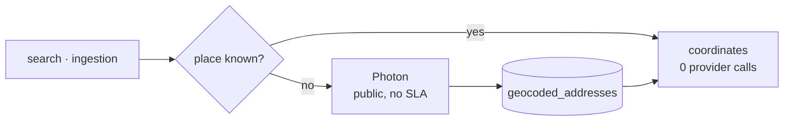

# SC-198 — Add geocoded_addresses cache table (cost)

> **Purpose:** lock the requirement and its verbatim ACs · **Derived from:** SC-198 (Shortcut) · **Delta:** new story

| Field | Value |
|---|---|
| Shortcut | https://app.shortcut.com/halal-food-finder/story/198 |
| Story | SC-198 · feature · workflow state **Prioritization** |
| Epic | M1 Platform & Cost Hardening (196) |
| Iteration | none — *"Not a Sprint 6 item"* (story) |
| Requester | Arham · **Backend owner:** Hamza |
| Priority | Founder-directed cost hedge (2026-09-04); backlog position unverified — Q-4 (Adnan) |
| Workflow | `@tahirs-feature-workflow`; approval before implementation |
| Branch | `feat/SC-198-geocoded-cache` |

## Story as filed (verbatim)

> Cost hedge: PhotonGeocoder (adapter) hits the free public photon.komoot.io API on
> every call — no SLA, IP rate-limiting under burst, and a future Google/Mapbox swap
> costs ~$5/1k requests. Fix: add an idempotent `geocoded_addresses` cache table in
> Postgres (normalized_query_hash, lat, lng, display_name, created_at). Check the
> table before calling GeocoderPort.geocode(); on hit return cached; on miss call +
> write. Repeated lookups for the same street/venue/neighborhood cost zero external
> calls.
>
> Backend TDD (Hamza). Acceptance: (a) migration adds geocoded_addresses with unique
> normalized_query_hash; (b) a CachingGeocoder (or repo cache behind GeocoderPort)
> short-circuits repeat queries; (c) normalized hash ignores whitespace/case so
> 'Main St' == ' main st'; (d) tests: miss-then-hit, provider failure leaves no
> partial cache write, hash stability.
>
> Founder-directed cost hedge (2026-09-04), epic 196. Not a Sprint 6 item.

## Acceptance criteria (verbatim, split)

> **AC-a** migration adds geocoded_addresses with unique normalized_query_hash

> **AC-b** a CachingGeocoder (or repo cache behind GeocoderPort) short-circuits
> repeat queries

> **AC-c** normalized hash ignores whitespace/case so 'Main St' == ' main st'

> **AC-d** tests: miss-then-hit, provider failure leaves no partial cache write,
> hash stability

## Personas

| Prefix | Persona | Relevance |
|---|---|---|
| U | User | Searches by place text; sees faster, more resilient lookups |
| ET | Extension Trigger (AI agent client) | Drives `search_restaurants`, the warm-path beneficiary |
| DC | Data Curator | Ingestion geocodes many addresses; repeat runs cost zero provider calls |
| — | Founder (cost owner) | Directed the hedge; approves the cache lifetime (D-6) |

## Where the geocoder is called today

| Caller | Channel | Calls `GeocoderPort.geocode` |
|---|---|---|
| `SearchListingsForAgent` (SC-209) | MCP `search_restaurants`, place text only | every request with a place |
| `RunSampleIngestion` (SC-211, pipeline PR pending) | `scripts/ingest-sample.sh` | every source row + 1 pre-flight |
| `CompileManualBatch` (SC-211, pending) | manual Tier-3 batch | every curated row |
| `CheckGeocoderHealth` (SC-211) | ingestion pre-flight | 1 probe before any fetch |

## Edge cases

| # | Edge case | Handling |
|---|---|---|
| E-1 | Same place, different case/whitespace (`'Main St'` vs `' main st'`) | One normalized hash → one row (AC-c) |
| E-2 | Provider returns no match | Nothing cached; the miss is retried next time (D-4) |
| E-3 | Provider unreachable on a cold query | Error propagates as today; nothing written (AC-d) |
| E-4 | Provider swap (Photon → Google/Mapbox) | Cache rows carry `provider`; a swap purges first (D-5) |
| E-5 | Two concurrent identical misses | `ON CONFLICT … DO UPDATE` (one row); duplicate provider call accepted (D-8) |
| E-6 | Cache read or write fails (DB hiccup) | Fail open: warn + continue as a normal miss/hit (D-7) |
| E-7 | Pre-flight probe answers from cache while Photon is down | Pre-flight is wired to the **uncached** port (D-2) |
| E-8 | Non-ASCII / diacritics / full-width text | NFKC → lowercase; equivalent forms share a key (D-3) |
| E-9 | Very long or hostile query text | Bounded by existing request validation; only the 64-char hash is stored |
| E-10 | Another story claims migration V22 first | Rebase the number at merge time; content unchanged (D-9) |
| E-11 | A row is older than 90 days | Ignored on read; the next successful lookup refreshes it in place (D-6) |

## Open questions

| # | Unknown | Owner | Needed by |
|---|---|---|---|
| Q-1 | ~~Retention: permanent cache, TTL, or manual purge~~ — resolved 2026-11-08: lazy 90-day TTL, refreshed in place (D-6) | Founder | closed |
| Q-2 | Cached Photon `display_name` is ODbL-derived data in our DB; does the open attribution decision (SC-211 Q-4) cover it? | Founder | Before deploy |
| Q-3 | Does SC-198's table land before SC-211's `RunSampleIngestion` PR (migration order, wiring)? | Adnan | Sprint sign-off |
| Q-4 | Backlog priority against the two prioritization docs | Adnan | Sprint sign-off |
| Q-5 | Provider-swap runbook (purge vs. re-key by provider) | Hamza / Adnan | Before any provider swap |
