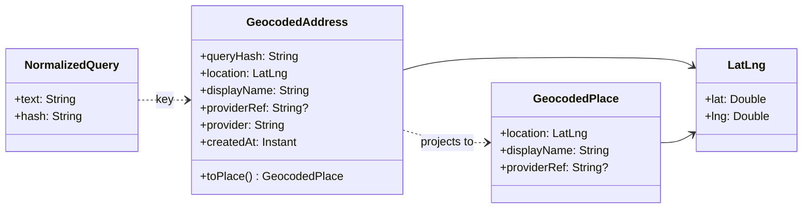

# SC-198 — Phase 1: Domain model

> **Purpose:** the vocabulary and rules the cache obeys · **Derived from:** 00 · **Delta:** extends (`GeocodedAddress`, `NormalizedQuery`); no change to any aggregate

**ARCHITECTURE.md §1.2 impact: extends** — one cache-only entity, `GeocodedAddress`, with no aggregate root and no relationship to `RestaurantListing`. No state transition of any existing entity changes; the cache is an optimization on the geocoding seam.

`NormalizedQuery` is a pure value object: `of(text)` normalizes (NFKC → trim → collapse internal whitespace → lowercase `Locale.ROOT`) and returns the normalized text plus a lowercase hex SHA-256. `GeocodedAddress` is the row shape; it never gains behaviour beyond `toPlace()`. A row is a hit only while fresh: `created_at` older than 90 days is treated as absent and refreshed on the next successful lookup, so a wrong or outdated match self-heals without a scheduler.

## Invariants

| # | Invariant | Becomes test |
|---|---|---|
| INV-1 | A row exists iff a provider call succeeded with a match; no match and provider failure write nothing | `CachingGeocoderTest.noMatchIsNotCached` · `providerFailureLeavesNoCacheRow` |
| INV-2 | `{'Main St', ' main st', 'MAIN   ST'}` normalize to one key | `NormalizedQueryTest.ignoresWhitespaceAndCase` · `collapsesInternalWhitespace` |
| INV-3 | The hash is stable across calls and processes for the same normalized text | `NormalizedQueryTest.hashIsStable` · `knownHashVector` |
| INV-4 | `normalized_query_hash` is unique; a second save refreshes the same row, never a second row | `ExposedGeocodedAddressStoreTest` "saveRefreshesStaleRow" · `GeocodedAddressesMigrationTest` "normalized_query_hash is the primary key" |
| INV-5 | A hit returns the stored lat/lng, display name and provider reference, and makes **zero** provider calls | `CachingGeocoderTest.hitReturnsStoredPlaceWithoutProviderCall` |
| INV-6 | A cold miss calls the provider exactly once and stores exactly one row | `CachingGeocoderTest.missThenHitCallsProviderOnce` |
| INV-7 | The ingestion pre-flight always reaches the provider; it never answers from cache | `GeocodingWiringTest.healthProbeBypassesCache` |
| INV-8 | The cache key is computed once per call, so the lookup and the write always agree | `CachingGeocoderTest.lookupAndWriteUseSameKey` |
| INV-9 | Cache is an optimization: a store read/write failure never fails a request | `CachingGeocoderTest.readFailureFallsBackToProvider` · `writeFailureStillReturnsPlace` |
| INV-10 | The outbound provider call is never inside a database transaction | design constraint — verified in 06/UC-01 (not a unit test) |
| INV-11 | A row older than the 90-day TTL is not served; the next successful lookup refreshes that same row, never adds another | `CachingGeocoderTest.expiredRowIsRefetchedAndRefreshed` · `ExposedGeocodedAddressStoreTest.saveRefreshesStaleRow` |

## States

| From | Event | To | Guard |
|---|---|---|---|
| Absent | geocode → provider match | Stored | Provider returned coordinates |
| Absent | geocode → provider no-match | Absent | `null` result is not cached |
| Absent | geocode → provider throws | Absent | No write attempted |
| Stored | geocode → equivalent normalized text, row fresh | Stored | Hash equal and `created_at` within 90 days |
| Stored | 90 days pass | Stale | Ignored on read; the row stays until re-fetched |
| Stale | geocode → provider match | Stored | Row refreshed in place; `created_at` moves forward |
| Stored | provider swap / operator purge | Absent | Ops action (D-5, Q-5) |

## Glossary

| Term | Meaning |
|---|---|
| Query text | The free-text place the caller supplied (city, street, venue, neighbourhood) |
| Normalized query | NFKC-folded, trimmed, whitespace-collapsed, lowercased text used for identity |
| Query hash | Lowercase hex SHA-256 of the normalized query; the table's primary key |
| Cache hit / miss | A row exists for the hash / no row exists |
| Cold · warm | First lookup for a place (provider) · a later lookup (cache) |
| Upstream provider | The geocoding service behind `GeocoderPort` (today Photon) |
| Pre-flight probe | The one ingestion health query that must bypass the cache (SC-211 AC-9) |
| Cache entry | One `geocoded_addresses` row: hash, point, label, provider reference, provider, created-at |
| TTL · stale | 90 days — the age after which a row is ignored · a row past it, refreshed on the next successful lookup |
