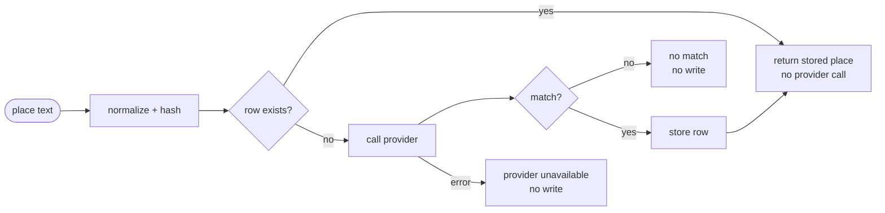

# SC-198 — Phase 2: Use cases

> **Purpose:** the actor goals the cache serves, and their flows · **Derived from:** 01 · **Delta:** UC-01 modified (SC-209), UC-02 modified (SC-211); no new actor goal

| ID | Name | Basis | Primary actor | Supporting |
|---|---|---|---|---|
| UC-01 | Search for Halal Restaurants | Existing (Shortcut 36; MCP channel SC-209) — **modified** | U | ET (agent client), Photon |
| UC-02 | Run a sample directory ingestion | Existing (SC-211 UC-01; pipeline PR pending) — **modified** | DC | Certifier libraries, Photon |

No new use case: the cache is transparent to both actors and is a design component of the shared geocoding step (same stance as SC-211, which keeps geocoding internal to its UCs).

## Business rules

| ID | Rule |
|---|---|
| BR-1 | Place text is untrusted input; the store receives only its hash and a bound-parameter write. |
| BR-2 | Identity is the normalized query only — not the caller, channel, or coordinates. |
| BR-3 | A provider **no-match** is not cached; the lookup is retried on the next request. |
| BR-4 | A provider **failure** writes nothing and propagates as today (search: "supply coordinates"; ingestion: abort). |
| BR-5 | The cache never changes a search or ingestion outcome, only the cost of reaching it. |
| BR-6 | The ingestion pre-flight probes the uncached provider, so a cached probe can never mask an outage. |
| BR-7 | Cache reads and writes are best-effort; a store error degrades to a normal provider call / a returned result. |
| BR-8 | SC-209 BR-10 ("no cache in v1") is **superseded** by this feature; the rest of BR-10 still holds. |

## UC-01 — Search for Halal Restaurants (existing; cached place resolution)

- **Primary actor:** U · **Supporting:** ET (AI agent client), Photon · **Trigger:** the user asks their agent for halal restaurants near a place
- **Goal:** find halal restaurants around a searched place, at provider cost only for places never seen before
- **Preconditions:** MCP endpoint healthy; agent initialized; schema migrated (V22); the user stated a place or coordinates

**Main success scenario**

1. The user asks for halal restaurants near a place, optionally with filters.
2. The agent calls the search tool with place **or** coordinates, a radius, and filters.
3. Tahir's List validates radius, page and every filter value.
4. If place text was supplied, Tahir's List resolves it to a search centre:
   1. normalizes the text and derives its hash;
   2. reads `geocoded_addresses` by hash;
   3. on a hit, uses the stored point and label — **no provider call**;
   4. on a miss, calls Photon once; on a match, stores the row before continuing.
5. Tahir's List finds index-qualified listings within the radius matching the filters.
6. Results are ordered by distance, paged, and returned with halal/verification facts.
7. The agent presents the results.

**Alternate flows**

- **A1 (from 2)** — coordinates supplied: steps 3, 5–7; step 4 is skipped entirely.
- **A2 (from 4.2)** — warm hit: continues at 5; Photon is not contacted.
- **A3 (from 5)** — no listings match: empty page, count 0. Success (unchanged).
- **A4 (from 5)** — page full: `nextOffset` returned (unchanged).

**Exception flows**

| ID | From | Condition → outcome | Resulting state |
|---|---|---|---|
| E1 | 3 | Invalid radius/page/filter → actionable tool error | Nothing read, nothing written |
| E2 | 4.4 | Photon returns no match → "try a nearby city or town" | No row; retried next request |
| E3 | 4.4 | Photon unreachable → "location lookup unavailable; supply coordinates" | No row; other (warm) searches still work |
| E4 | 2 | Rate limit exceeded → rate-limit tool error | No work done (unchanged) |
| E5 | 4.2 | Cache read fails → warn, treat as a miss, call Photon | Request succeeds; possible cost |
| E6 | 4.4 | Cache write fails → warn, still return the provider result | Request succeeds; row absent |

- **Postconditions:** success — a results page is returned; after a cold success exactly one cache row exists for the normalized query. Failure — no row is written, no partial state.
- **Data:** read — cache row, listings · created — one cache row on a cold successful match
- **ACs:** AC-a (INV-4) · AC-b (INV-5, INV-6) · AC-c (INV-2, INV-3) · AC-d (INV-1, INV-3) · **Open:** D-1…D-9

## UC-02 — Run a sample directory ingestion (existing SC-211 UC-01; cached per-row geocoding)

- **Primary actor:** DC · **Supporting:** certifier libraries (HMS, HFSAA, HMA), Photon
- **Goal:** produce the same geocoded, reconciled candidate batch while paying for each address at most once, ever
- **Trigger:** the curator starts the sample-ingestion command with a metro selection
- **Preconditions:** SC-211 preconditions; `geocoded_addresses` migrated; no unreviewed run (or archived)

**Main success scenario (delta to SC-211 UC-01)**

1. Curator selects metros and caps, then starts with a pending-run policy.
2. System applies the pending-run guard.
3. System runs the Photon pre-flight query **against the uncached port**; only on success does it proceed.
4. System fetches each directory through its library and translates the records.
5. System filters rows to the metro allowlists.
6. For each row, Tahir's List resolves the address:
   1. normalizes the address and derives its hash;
   2. on a hit, uses the stored place — no provider call;
   3. on a miss, calls Photon once and stores a successful match (even if match-confirmation later rejects the row — the cache records the provider's answer, not a catalogue decision);
   4. applies match-confirmation; unconfirmed rows stay rejected.
7. System reconciles same-venue rows and records intended verification / hand-cut.
8. System writes the per-run artifacts and report.

**Alternate / exception flows**

| ID | From | Condition → outcome | Resulting state |
|---|---|---|---|
| A1 | 3 | Repeat run with warm addresses → most rows resolve from cache | Fewer provider calls; same artifacts |
| P2 | 3 | Pre-flight fails (uncached probe) → abort before any directory request | No artifacts; no cache writes |
| E2 | 6.3 | Photon down mid-run → abort before publishing candidates | No artifacts; earlier rows remain valid cache entries, not partial output |
| E3 | 6.3 | Photon returns no match → row rejected with reason | No row for that address |

- **Postconditions:** success — the SC-211 artifact set exists; one cache row per distinct successfully geocoded address. Failure — no artifacts; cache rows already written are each a complete provider result, never a partial one.
- **Data:** read — cache rows, directory records · created — cache rows, run artifacts
- **ACs:** AC-a…AC-d · SC-211 AC-2 and AC-9 unchanged · **Open:** Q-3 (ordering with SC-211's pipeline PR), D-2
