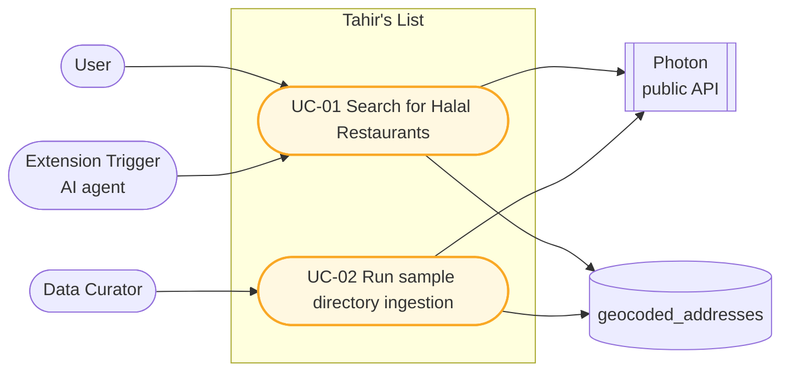
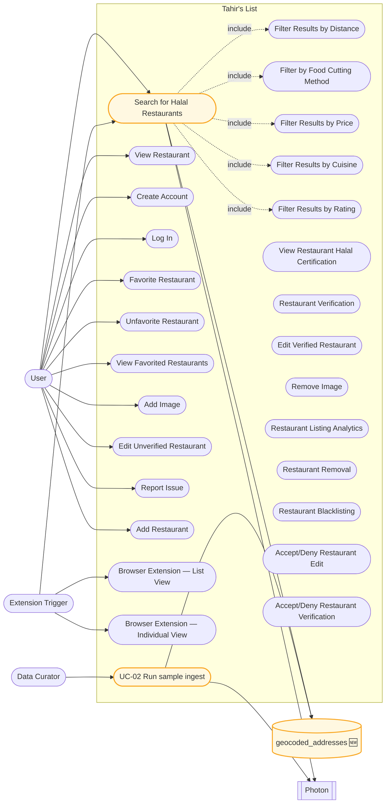

# SC-198 — Phase 3: Use case diagram

> **Purpose:** place the two modified use cases against the agreed model · **Derived from:** 02 · **Delta:** UC-01 and UC-02 marked modified; no new use case, no new actor

## Feature scope

No `«include»`: the shared geocoding step stays internal to both use cases, the same stance SC-211 ratified. The cache is a design component of that step, not an actor goal, so it is absent from the bubble model and present only as the store both flows touch.

## System-wide (changed items amber; everything else unchanged)

| Mark | Meaning |
|---|---|
| Amber | Changed by SC-198 (UC-01 search, UC-02 ingest, new cache store) |
| Solid arrow | Actor association / external dependency / store access |
| Dotted arrow | `«include»` |

All other use cases, actors and associations are unchanged. The store is owned infrastructure, drawn as a data store (`[(...)]`) on the right.
