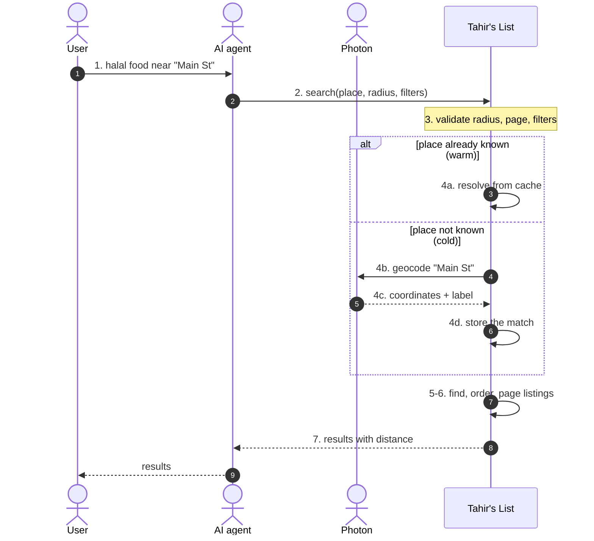
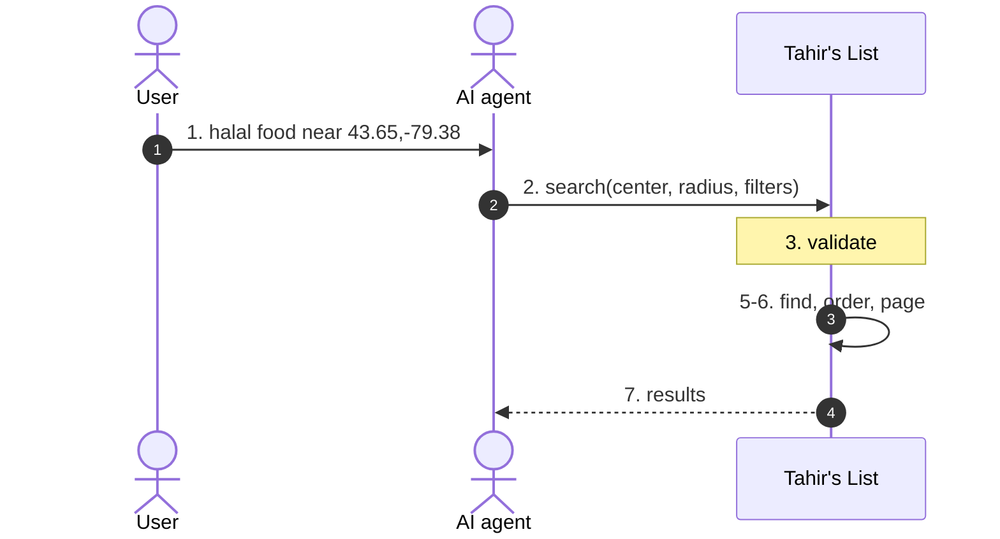
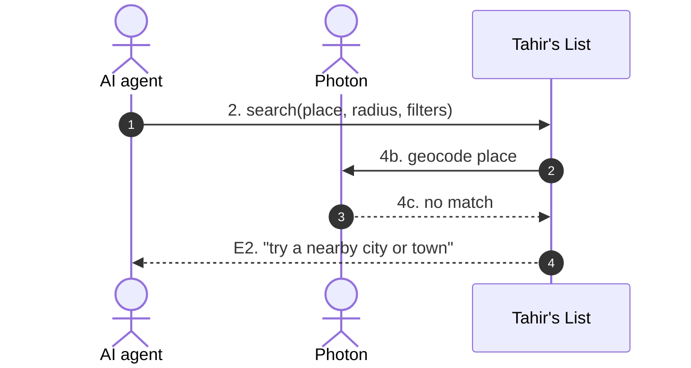

# SC-198 — Phase 4: Black-box sequence, UC-01 Search for Halal Restaurants

> **Purpose:** what the user and agent see, flow by flow · **Derived from:** 02 UC-01 · **Delta:** new warm branch + cache-outage behaviour
> **Security:** place text is untrusted caller input; the cache stores only its hash, never the raw text.



## Alternate — A1 coordinates supplied



No place resolution, so no cache read and no provider call.

## Exception — E2 no match (cold)



Nothing is stored: a miss stays a miss and is retried on the next request.

## Exception — E3 provider unavailable (cold), warm queries unaffected

```mermaid
sequenceDiagram
  autonumber
  actor AG as AI agent
  actor PH as Photon
  participant S as Tahir's List

  AG->>S: 2. search(place X, radius, filters)
  S->>PH: 4b. geocode X
  PH--xS: 4c. timeout / non-200
  S-->>AG: E3. "lookup unavailable; supply coordinates"
  Note over S: nothing stored for X
  AG->>S: 2'. search(place Y, radius, filters)
  Note over S: 4a. Y already cached
  S-->>AG: 7'. results for Y
```

A cache hit keeps search working during an outage; only never-seen places fail.

## Exceptions — E5 / E6 cache store trouble

| ID | Condition | What the actor sees | Store state |
|---|---|---|---|
| E5 | Cache read fails | Normal results (a provider call happens) | Unchanged |
| E6 | Cache write fails after a provider match | Normal results | No row; provider paid again later |

Both are logged at WARN; neither changes the visible outcome (D-7).

## Unchanged flows

E1 (invalid arguments), A3 (empty page), A4 (page full) and E4 (rate limit) behave exactly as in SC-209 `04-blackbox/UC-01`.
