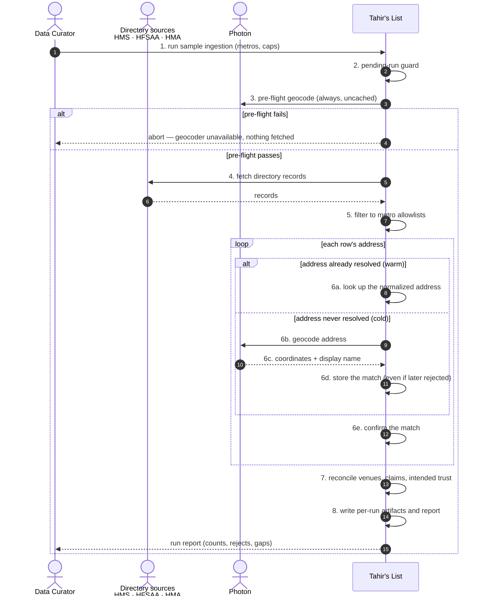
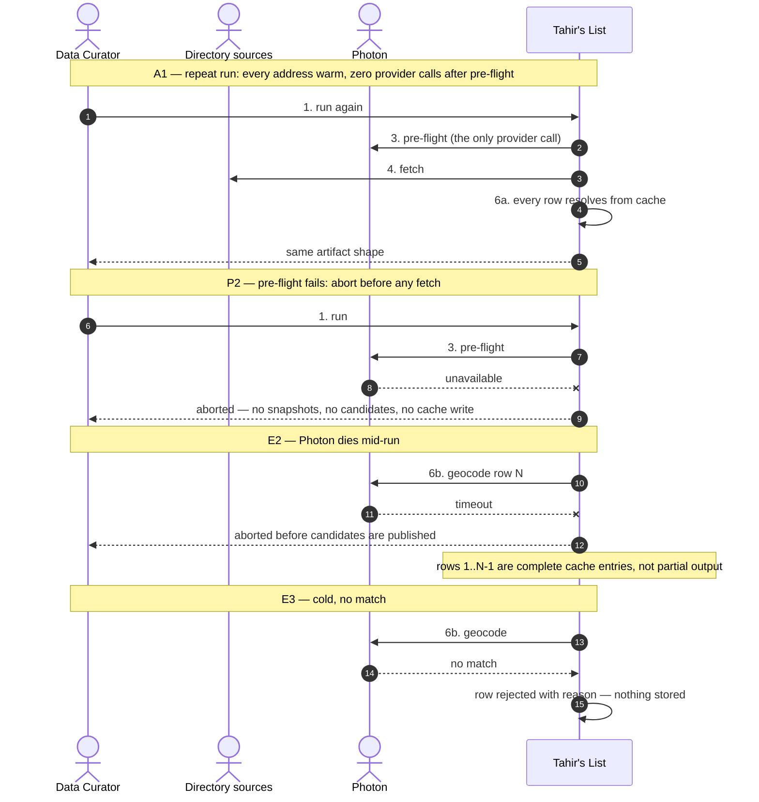

# SC-198 — Phase 4: Black-box sequence, UC-02 Run a sample directory ingestion

> **Purpose:** what the curator sees, warm vs cold, pre-flight included · **Derived from:** 02 UC-02 (SC-211 UC-01 delta) · **Delta:** step 3 probes uncached; step 6 splits into cache hit / provider miss
> **Security:** addresses come from third-party directories; only hashes are cached. The run stays operator-initiated and local, as SC-211 designed it.

## Flows

## Caption

- **Visible change:** a repeat run costs one pre-flight call instead of one per row; a cold run behaves exactly as SC-211 specified.
- **Locks in:** the pre-flight is *always* a real provider call — a cached probe could hide an outage and let a run start with no usable geocoder.
- **Unchanged:** guard, fetch, translation, metro filter, confirmation, reconciliation, artifacts, report.
