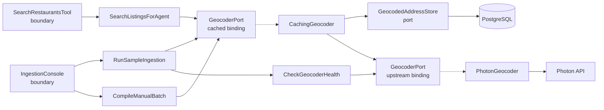
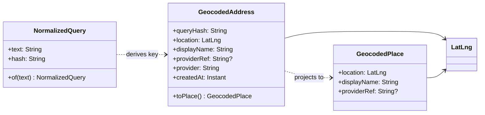
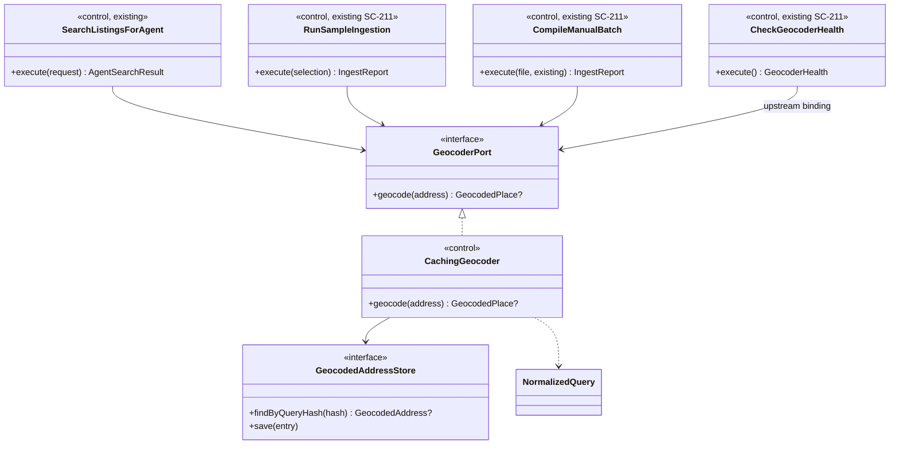
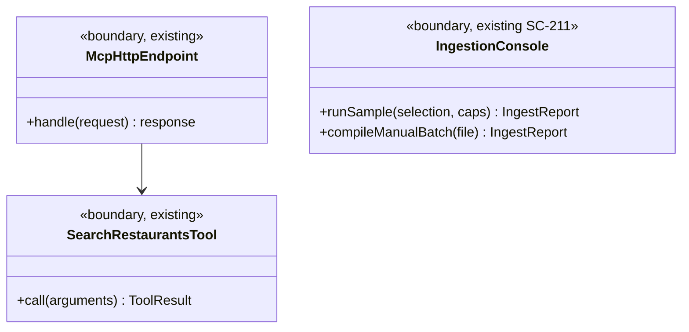

# SC-198 — Phase 5: System class diagram (conceptual)

> **Purpose:** the classes and ports that serve the two use cases · **Derived from:** 01–04 · **Delta:** +1 control (`CachingGeocoder`), +1 port (`GeocodedAddressStore`), +2 value objects; existing `GeocoderPort` and both controls reused

## Overview

Two bindings of one interface: consumers get the **cached** port; `CheckGeocoderHealth` gets the **upstream** port so the pre-flight can never be answered by the cache (D-2).

## Domain

## Application

`CachingGeocoder` is a decorator: it implements the same port, consults the store, and delegates one call to the wrapped upstream instance. No caller knows it exists.

## Boundary

## Ports and adapters

| Port | Operation | Adapter | Store / external |
|---|---|---|---|
| `GeocoderPort` (cached) | `geocode(address): GeocodedPlace?` | `CachingGeocoder` (decorator) | — |
| `GeocoderPort` (upstream) | `geocode(address): GeocodedPlace?` | `PhotonGeocoder` (existing) | Photon HTTP API |
| `GeocodedAddressStore` | `findByQueryHash(hash)` · `save(entry)` | `ExposedGeocodedAddressStore` | PostgreSQL `geocoded_addresses` |
| `ListingSearchQuery` (existing) | `searchNearby(centre, radius, filters, offset, limit)` | `ExposedListingSearchQuery` | PostgreSQL/PostGIS |
| `RestaurantListingRepository` (existing) | batch/read operations (SC-211) | `ExposedRestaurantListingRepository` | PostgreSQL/PostGIS |

Only `CheckGeocoderHealth` is wired to the upstream binding; every other consumer receives the cached one.

## Operation coverage

| UC step | Operation |
|---|---|
| UC-01.2–3 | `McpHttpEndpoint.handle` → `SearchRestaurantsTool.call` → existing parser/validation |
| UC-01.4.1–3 | `SearchListingsForAgent.execute` → `CachingGeocoder.geocode` → `NormalizedQuery.of` → `GeocodedAddressStore.findByQueryHash` |
| UC-01.4.4 | `CachingGeocoder.geocode` → `GeocoderPort.geocode` (upstream) → `GeocodedAddressStore.save` |
| UC-01.5–7 | existing `ListingSearchQuery.searchNearby` → result mapping (unchanged) |
| UC-01.A1 | coordinates branch skips `CachingGeocoder` entirely |
| UC-01.E2 / E3 | upstream returns `null` / throws `GeocodingException`; no `save` |
| UC-01.E5 / E6 | `findByQueryHash` / `save` fail → WARN, continue (D-7) |
| UC-02.2 | existing pending-run guard (SC-211) |
| UC-02.3 | `CheckGeocoderHealth.execute` → upstream `GeocoderPort.geocode` (never the decorator) |
| UC-02.4–5 | existing library fetch / translator / metro filter (SC-211) |
| UC-02.6 | per row: `CachingGeocoder.geocode` → `findByQueryHash` / upstream / `save`; then existing confirmation |
| UC-02.7–8 | existing reconciliation + `ArtifactWriter` (SC-211) |

**Existing collaborators:** `SearchListingsForAgent`, `RunSampleIngestion`, `CompileManualBatch`, `CheckGeocoderHealth`, `GeocoderPort`, `PhotonGeocoder`, `ListingSearchQuery`, `ArtifactWriter`, `RestaurantListingRepository`.
