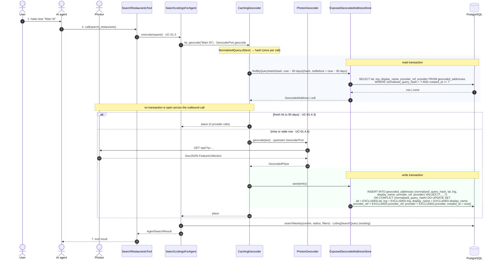
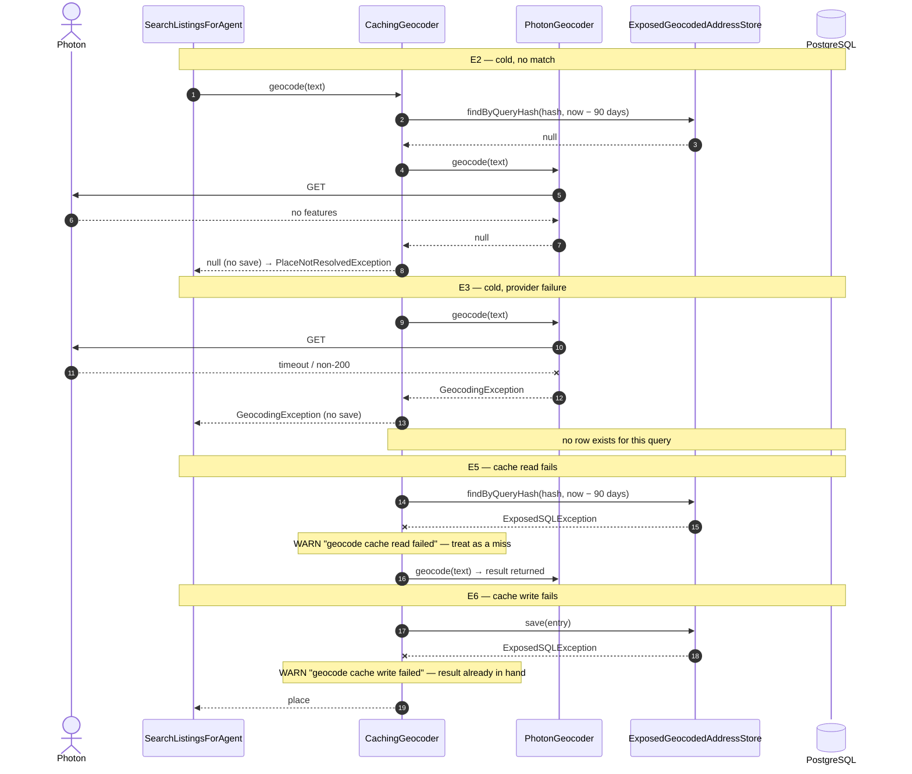

# SC-198 — Phase 6: White-box sequence, UC-01 Search for Halal Restaurants

> **Purpose:** the classes, operations, transactions and stores behind 04/UC-01 · **Derived from:** 05 · **Delta:** `CachingGeocoder` sits between the use case and Photon
> **Security:** anonymous surface; the MCP per-client rate limit runs before this flow. Place text never reaches the database — only its SHA-256. All SQL binds parameters.

## Exception paths

## What this diagram pins

| Concern | Shown |
|---|---|
| Transaction boundary | Two short transactions (read, then write) with **no** transaction held across the HTTP call (INV-10) |
| State transition | `Absent`/`Stale` → `Stored` on a successful lookup; a stale row is refreshed in place; no-match/failure leaves the state unchanged |
| Authorization | None beyond the anonymous MCP gate — the cache key carries no identity, so no cross-user data can be reached by guessing a place |
| Concrete errors | `PlaceNotResolvedException` (null) · `GeocodingException` (provider) · WARN-and-continue (store read/write) |
| TTL | A row older than 90 days is not a hit; the next success rewrites it with `created_at = now()` (INV-11) |
| Idempotency | `ON CONFLICT … DO UPDATE` keeps one row per key and refreshes a stale one; the unique key is the idempotency |
| Data minimization | Only the hash, point, provider label/ref and provider name are written; the address text is not |
