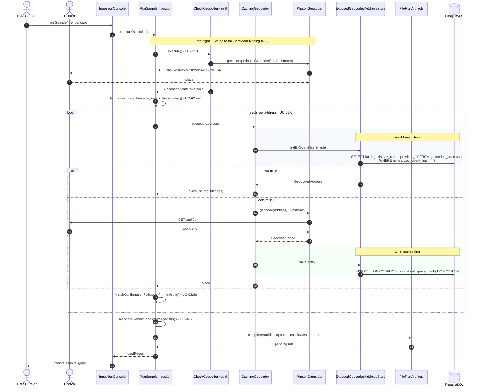
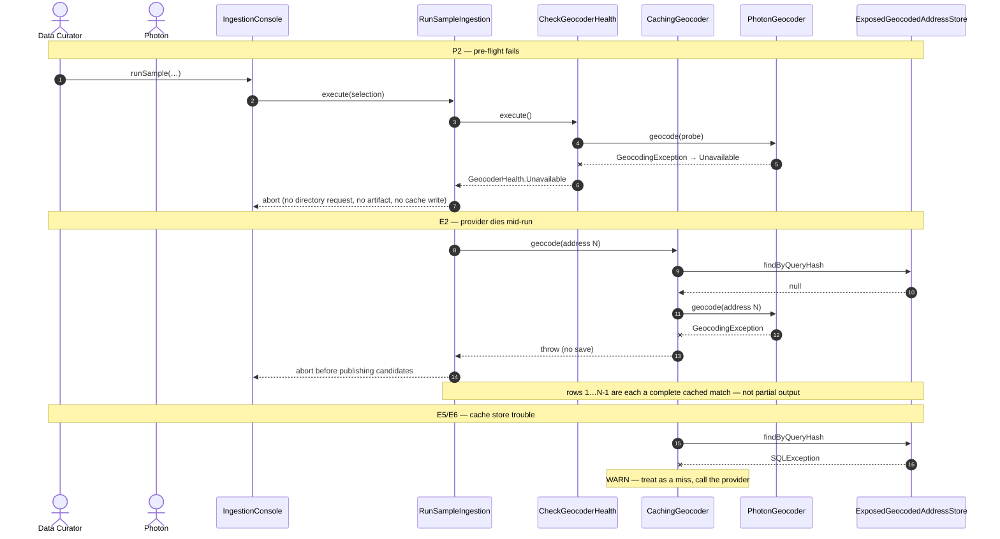

# SC-198 — Phase 6: White-box sequence, UC-02 Run a sample directory ingestion

> **Purpose:** the classes, operations, transactions and stores behind 04/UC-02 · **Derived from:** 05 · **Delta:** pre-flight bypasses the cache; per-row geocoding is cached
> **Security:** operator-initiated local run (SC-211); no HTTP identity. Address text is never stored — only its hash. Reads/writes are parameter-bound.

## 1. Pre-flight (uncached), then cached per-row geocoding

## 2. Failure paths

## What this diagram pins

| Concern | Shown |
|---|---|
| Transaction boundary | Short read and write transactions per row; the provider call is never inside one |
| State transition | Each successfully geocoded address: Absent → Stored; rejected rows may still be stored (the cache records the provider's answer) |
| Authorization | Operator CLI only; no user identity exists to scope. The cache key has no tenant dimension |
| Concrete errors | Pre-flight `Unavailable` → abort; provider `GeocodingException` → abort; store errors → WARN + continue |
| No dependency change | SC-211's guard, fetch, translate, confirm, reconcile and artifact contract are untouched |
| Cost | A warm row costs one indexed `SELECT`; only the first sighting of an address reaches Photon |
