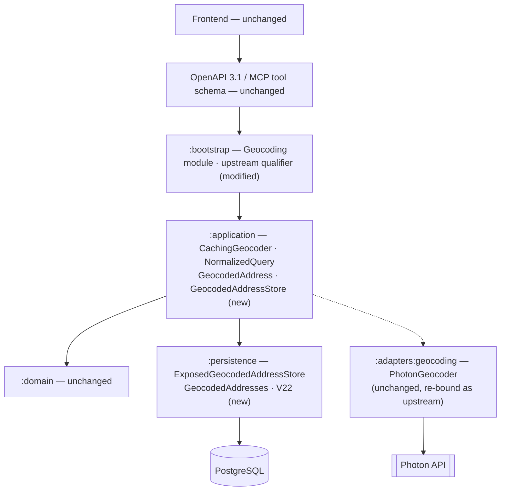
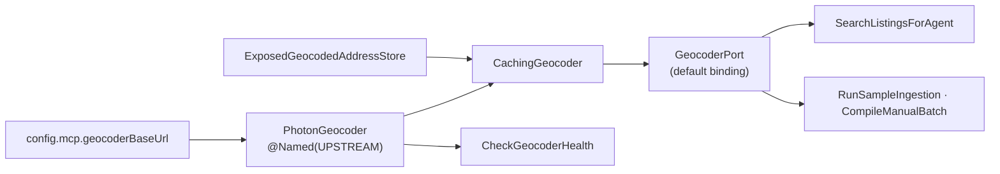

# SC-198 — Phase 7: Complete class diagram (the design being approved)

> **Purpose:** final names, modules, schema and deltas · **Derived from:** 05–06 · **Delta:** one table, one adapter, one decorator, one value object; no API or frontend change

## Layer map



## Persistence delta

| Object | Kind | Name | Detail |
|---|---|---|---|
| Table | new | `geocoded_addresses` | One row per normalized query |
| Column | new | `normalized_query_hash` | `CHAR(64) PRIMARY KEY` — AC-a's unique key |
| Column | new | `lat`, `lng` | `DOUBLE PRECISION NOT NULL`, `CHECK` in range |
| Column | new | `display_name` | `TEXT NOT NULL` — provider label, preserved on hits |
| Column | new | `provider_ref` | `TEXT NULL` — provider's own id, preserved on hits |
| Column | new | `provider` | `VARCHAR(32) NOT NULL` — `'photon'` today (D-5) |
| Column | new | `created_at` | `TIMESTAMPTZ NOT NULL DEFAULT now()` — first sighting, refreshed when a stale row is re-fetched |
| Exposed | new | `GeocodedAddresses` | `Tables.kt`, same columns |
| Adapter | new | `ExposedGeocodedAddressStore` | `findByQueryHash` / `save`, own short transactions |
| Migration | new | `V22__sc_198_geocoded_addresses.sql` | Next free version; renumber on collision |
| Existing objects | unchanged | `restaurant_listings`, `listing_search`, `favorites`, … | No column, index or constraint touched |

```sql
-- V22__sc_198_geocoded_addresses.sql (shape, not final syntax)
CREATE TABLE geocoded_addresses (
    normalized_query_hash CHAR(64)       PRIMARY KEY,
    lat                   DOUBLE PRECISION NOT NULL CHECK (lat BETWEEN -90 AND 90),
    lng                   DOUBLE PRECISION NOT NULL CHECK (lng BETWEEN -180 AND 180),
    display_name          TEXT           NOT NULL,
    provider_ref          TEXT,
    provider              VARCHAR(32)    NOT NULL,
    created_at            TIMESTAMPTZ    NOT NULL DEFAULT now()
);
```

The primary key *is* the idempotency: `INSERT … ON CONFLICT (normalized_query_hash) DO UPDATE` keeps one row per key and rewrites a stale one. Reads are `… WHERE normalized_query_hash = ? AND created_at >= ?` with a cutoff of `now − 90 days` (D-6): a stale row is simply not a hit, so no scheduler or sweep job is needed. The TTL is a config value (`APP_GEOCODE_CACHE_TTL_DAYS`, default 90); `0` means permanent and uses an epoch-0 cutoff (PostgreSQL cannot bind `Instant.DISTANT_PAST`).

## API delta

| Surface | Change | Detail |
|---|---|---|
| MCP `search_restaurants` | **none** | Same arguments, results and error strings; only latency and outage behaviour change |
| REST / OpenAPI 3.1 | **none** | No endpoint, DTO, error code or schema change |
| Ingestion CLI | **none** | Same script, same flags, same artifacts |

## Frontend delta

| Route · component · store · client call | Change |
|---|---|
| — | **none** |

## Final names

| Name | Module | Type |
|---|---|---|
| `CachingGeocoder` | `:application` (`application.geo`) | Decorator implementing `GeocoderPort` |
| `NormalizedQuery` | `:application` (`application.geo`) | Value object |
| `GeocodedAddress` | `:application` (`application.geo`) | Cache entry |
| `GeocodedAddressStore` | `:application` (`application.geo`) | Outbound port |
| `ExposedGeocodedAddressStore` | `:adapters:persistence` (`persistence.geo`) | Port adapter |
| `GeocodedAddresses` | `:adapters:persistence` (`persistence.db`) | Table binding |
| `GeocodingQualifiers.UPSTREAM` | `:bootstrap` | Koin qualifier |

`CachingGeocoder` owes its application-module home to being pure orchestration (no framework, no socket); its tests run with a fake store and a fake provider.

## Wiring delta



| Binding | Type | Change |
|---|---|---|
| `single<GeocoderPort>(named(UPSTREAM)) { PhotonGeocoder(...) }` | provider | modified (was the only binding) |
| `single<GeocoderPort> { CachingGeocoder(get(UPSTREAM), get(), ttl = Duration.ofDays(config.geocodeCache.ttlDays)) }` | consumers | new (default 90 days) |
| `single<GeocodedAddressStore> { ExposedGeocodedAddressStore(get()) }` | cache store | new |
| `single { CheckGeocoderHealth(get(UPSTREAM)) }` | pre-flight | new wiring (class exists) |

## Named tests (written first)

| Test | Module | Proves |
|---|---|---|
| `NormalizedQueryTest.ignoresWhitespaceAndCase` | application | AC-c |
| `NormalizedQueryTest.collapsesInternalWhitespace` | application | AC-c |
| `NormalizedQueryTest.fullWidthFormsNormalize` | application | AC-c (NFKC) |
| `NormalizedQueryTest.hashIsStable` | application | AC-d |
| `NormalizedQueryTest.knownHashVector` | application | AC-d (pins the algorithm) |
| `CachingGeocoderTest.missThenHitCallsProviderOnce` | application | AC-b, AC-d |
| `CachingGeocoderTest.hitReturnsStoredPlaceWithoutProviderCall` | application | AC-b |
| `CachingGeocoderTest.noMatchIsNotCached` | application | AC-d |
| `CachingGeocoderTest.providerFailureLeavesNoCacheRow` | application | AC-d |
| `CachingGeocoderTest.lookupAndWriteUseSameKey` | application | INV-8 |
| `CachingGeocoderTest.expiredRowIsRefetchedAndRefreshed` | application | INV-11 |
| `CachingGeocoderTest.readFailureFallsBackToProvider` | application | INV-9 |
| `CachingGeocoderTest.writeFailureStillReturnsPlace` | application | INV-9 |
| `ExposedGeocodedAddressStoreTest.saveThenFindRoundTrips` | persistence | AC-a |
| `ExposedGeocodedAddressStoreTest.saveRefreshesStaleRow` | persistence | INV-11 |
| `ExposedGeocodedAddressStoreTest.oldRowIsNotServed` | persistence | INV-11 |
| `GeocodedAddressesMigrationTest.uniqueQueryHash` | persistence | AC-a |
| `GeocodedAddressesMigrationTest.rejectsOutOfRangePoint` | persistence | AC-a (checks) |
| `GeocodingWiringTest.healthProbeBypassesCache` | bootstrap | D-2, INV-7 |
