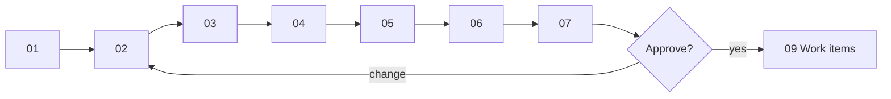

# Design walkthrough — SC-198 geocoded_addresses cache

> **Purpose:** the founder review surface · **Derived from:** 00–07 · **Delta:** one migration, one decorator, two modified use cases
> Design commit: `91fc71b` · Date: 2026-11-08 · **Status: approved**

| Date | Change | Phases re-run |
|---|---|---|
| 2026-11-08 | Initial walkthrough | — |
| 2026-11-08 | D-6 decided: lazy 90-day TTL, refreshed in place (no scheduler) | 01, 02, 04, 06, 07 |
| 2026-11-08 | **Approved** by founder; D-1…D-9 resolved as tabled | 08 |
| 2026-11-08 | Merge with main: SC-211 landed `V22` first; SC-198 renumbered to `V23` (D-9 contingency) | 07, 09, 10 |



## 1. Story and domain model
**Shows:** one cache-only entity, `GeocodedAddress`, keyed by the SHA-256 of a normalized query; no aggregate changes.
**Locks in:** only successful provider matches are stored; the cache never touches a listing’s state; the record is invisible to the domain; rows older than 90 days stop counting and are refreshed in place.
**Need:** approve; confirm D-3 (normalization), D-5 (extra columns).

## 2. Use cases
**Shows:** UC-01 search and UC-02 ingestion, both modified only at the geocoding step.
**Locks in:** a fresh lookup (≤ 90 days) costs zero provider calls; a cold failure behaves exactly as today; no new actor goal.
**Need:** approve; confirm D-4, D-7.

## 3. Use case diagram
**Shows:** two existing use cases marked changed, plus one new owned store; no new actor or bubble.
**Locks in:** the cache is a component of the shared geocoding step, not an actor goal (same stance as SC-211).
**Need:** approve.

## 4. Black-box sequences
**Shows:** warm vs cold from the user’s and the curator’s side, including a fresh search succeeding during a Photon outage.
**Locks in:** no-match and provider failure store nothing; repeat ingestion inside 90 days costs one pre-flight call; pre-flight is always a real provider call.
**Need:** approve; confirm D-2 (pre-flight bypass).

## 5. System class diagram
**Shows:** `CachingGeocoder` as a decorator on one `GeocoderPort` interface, `GeocodedAddressStore` as its port, and two bindings of the port.
**Locks in:** every existing consumer gains the cache without changing; only the pre-flight receives the upstream binding.
**Need:** approve; confirm D-1 (decorator), D-2.

## 6. White-box sequences
**Shows:** the real calls — `NormalizedQuery.of`, `findByQueryHash`, Photon, `save` — with two short transactions and the provider call outside both.
**Locks in:** the read predicate `created_at >= now − 90 days`; an upsert that refreshes a stale row; no raw address stored; store errors are WARN-only; each exception maps to a concrete error.
**Need:** approve; confirm D-6, D-7, D-8.

## 7. Complete class diagram (the design being approved)
**Shows:** module map, final names, V23 schema, wiring delta, and the tests that prove each AC.
**Locks in:** one migration and one table, no API/frontend change, no column touched elsewhere; `created_at` doubles as the 90-day freshness stamp.
**Need:** approve, including D-5, D-9.

## Decision items

| # | Question | Recommendation | Decision |
|---|---|---|---|
| D-1 | Cache as a `CachingGeocoder` decorator bound at the composition root (rather than caching inside each use case or inside `PhotonGeocoder`) | Yes — one place, provider-agnostic | decided 2026-11-08 |
| D-2 | Wire `CheckGeocoderHealth` to the **uncached** upstream binding so the pre-flight cannot be answered by the cache | Yes — otherwise a cached probe masks an outage | decided 2026-11-08 |
| D-3 | Normalization = Unicode NFKC → trim → collapse internal whitespace → lowercase `Locale.ROOT`; key = lowercase hex SHA-256 | Yes | decided 2026-11-08 |
| D-4 | Cache successful matches only; never cache a no-match or a provider failure; nothing written on failure | Yes — AC-d | decided 2026-11-08 |
| D-5 | Add `provider` and `provider_ref` beyond the story’s five columns; keep `normalized_query_hash` as the primary key; a provider swap purges old rows | Yes | decided 2026-11-08 |
| D-6 | Cache lifetime: lazy 90-day TTL — a row older than 90 days is ignored and refreshed in place on the next successful lookup; no scheduler | Decided 2026-11-08 | decided — lazy TTL, 90 days |
| D-7 | Fail open on cache store errors: read failure → treat as a miss; write failure → warn and return the provider result | Yes — the cache must never cause an outage | decided 2026-11-08 |
| D-8 | Accept that two concurrent first-time lookups may both call Photon; the unique key keeps one row | Yes — a lock costs more than a duplicate call | decided 2026-11-08 |
| D-9 | No REST/MCP/OpenAPI/frontend change; the next migration version is reserved for this story (renumbered to V23 when SC-211 landed V22); SC-209 BR-10 ("no cache in v1") amended | Yes | decided 2026-11-08 |

## Approval

```
Approved by: founder · Date: 2026-11-08 · Design commit: 91fc71b · Design PR: #80
Decision items: D-1 … D-9 resolved as tabled
```

Approved. Work items (09) and traceability (10) append to this PR; implementation starts on
`feat/SC-198-cache-impl` from `main` once this PR merges.

Artifacts 09 (work items) and 10 (traceability) are written only after this line exists.
