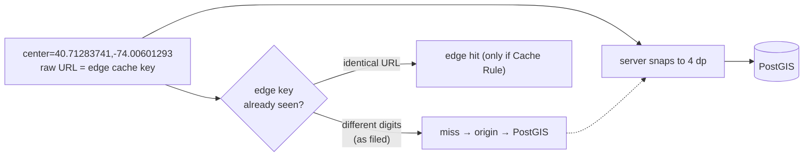

# SC-199 — Quantize search coords + cache headers (cost)

> **Purpose:** lock the requirement and what it actually asks for · **Derived from:** SC-199 (Shortcut) · **Delta:** new story

| Field | Value |
|---|---|
| Shortcut | https://app.shortcut.com/halal-food-finder/story/199 |
| Story | SC-199 · feature · workflow state **Prioritization** |
| Epic | M1 Platform & Cost Hardening (196) |
| Iteration | none — *"Not a Sprint 6 item"* (story) |
| Requester | Arham · **Backend owner:** Hamza |
| Priority | Founder-directed cost hedge (2026-09-04); backlog position unverified — Q-4 (Adnan) |
| Blocker | *"Blocked on founder decision (ratify precision + TTL)"* — tracked here as D-1 and D-2 |
| Workflow | `@tahirs-feature-workflow`; approval before implementation |
| Design branch | `docs/SC-199-search-quantization` |

## Story as filed (verbatim)

> Cost hedge: clients send 7-8 decimal GPS coords (40.71283741,-74.00601293). Slightly
> different coords per query defeat edge/CDN/Redis caching, forcing every search into
> PostGIS ST_DWithin/ST_DistanceSphere. Fix: round lat/lng query params to 3-4 decimal
> places (~11–110m) in ListingReadController.parseCenter before building the filter, and
> add Cache-Control headers on /v1/listings/search so repeat local requests can be served
> from edge cache.
>
> PRODUCT-VISIBLE: rounding changes returned distanceMiles slightly and alters which
> listings land on a radius boundary. Backend TDD (Hamza), but REQUIRES founder
> ratification of the rounding precision (3 vs 4 dp) and the maxAge TTL before
> implementation.
>
> Founder-directed cost hedge (2026-09-04), epic 196. Not a Sprint 6 item. Blocked on
> founder decision (ratify precision + TTL).

## Acceptance criteria

**The story files no AC list.** It states two directives, quoted below; the AC-1…AC-6
rows are *derived* from them and from the two mechanisms they name, and exist so the
design has something testable to approve. They are marked derived, not verbatim.

| # | Source | Criterion |
|---|---|---|
| AC-1 | verbatim directive 1 | `center` is snapped to 3 or 4 decimal places before the filter is built (D-1) |
| AC-2 | verbatim directive 2 | `GET /v1/listings/search` returns a `Cache-Control` header with a founder-ratified `maxAge` (D-2) |
| AC-3 | derived from "PRODUCT-VISIBLE" | `distanceMiles` and radius-boundary membership are computed from the snapped centre, and the shift is documented |
| AC-4 | derived | snapping is idempotent and cell-equal: two centres in one cell produce the same result body |
| AC-5 | derived | no non-200 response is cacheable; the uniform `no-store` default survives everywhere else |
| AC-6 | derived | an over-precision request is never answered from a *different* cell's cache entry |

## What exists today (delta from the story's wording)

| Story says | Reality on `main` | Consequence |
|---|---|---|
| `ListingReadController.parseCenter` | `ListingRoutes.kt` → private `parseCenter` (Ktor route) | design edits `ListingRoutes.kt` + the shared parser |
| "edge/CDN/Redis caching" | no Redis; Cloudflare Tunnel in front of the frontend; SvelteKit proxies `/v1/*` and forwards `Cache-Control` | no app cache to change; the header is the whole mechanism |
| `Cache-Control` on search | every response that does not opt in is forced to `no-store` (`WebApi.kt` SecurityHeadersPlugin) | search currently *forbids* caching; this story is an explicit opt-in |
| Cloudflare caches JSON | it does **not**; Cloudflare caches by file extension and JSON is not in the default list | a Cache Rule is required or the header only reaches browsers (D-5) |
| "round … so repeat requests are served from edge" | the edge key is the **raw URL**; server-side rounding does not rewrite it | rounding alone does not collapse edge keys (D-3) |

## Personas

| Prefix | Persona | Relevance |
|---|---|---|
| U | User | Searches near a place or their location; sees distances move by metres |
| ET | Extension Trigger (AI agent client) | Calls the same search with explicit lat/lng |
| — | Founder (cost owner) | Directed the hedge; ratifies precision (D-1) and TTL (D-2) |
| — | Operator (ops) | Owns the Cloudflare Cache Rule, if adopted (D-5) |

## Edge cases

| # | Edge case | Handling |
|---|---|---|
| E-1 | Client sends 8 dp | Snapped; same body as any other centre in that cell (AC-4) |
| E-2 | Client sends exactly 4 dp | Unchanged value; the snap is a no-op (INV-1) |
| E-3 | Centre near a pole/antimeridian (`89.99999`, `-179.99999`) | Snap stays inside WGS84 (`90.0`, `-180.0`) (INV-4) |
| E-4 | `NaN` / `Infinity` as lat or lng | `LatLng` range check rejects → 400 `invalid_input`, `no-store` |
| E-5 | Listing sits within `shiftMetres` of the radius boundary | May enter/leave; disclosed in the OpenAPI description (AC-3) |
| E-6 | Empty result page | Still a 200 → still cacheable (no special case) |
| E-7 | Two clients, different filters, one cell | Different URLs → different cache keys; both cached separately |
| E-8 | Listing delisted/revoked right after a response is cached | Visible for at most the freshness window; bound ratified (INV-10) |
| E-9 | Origin error during a stale revalidation | Edge may serve stale for the SWR budget, then 5xx (UC-02 E-2) |
| E-10 | Cloudflare Cache Rule absent | Header still gives browser cache hits; origin/DB unchanged — the hedge is partial |

## Open questions

| # | Unknown | Owner | Needed by |
|---|---|---|---|
| Q-1 | Precision default 4 dp (configurable to 3) — ratify | Founder | Before implementation (D-1) |
| Q-2 | Freshness window 60 / 300 / 60 s — ratify | Founder | Before implementation (D-2) |
| Q-3 | Is the Cloudflare zone's Cache Rule in scope (D-5), or header-only for now? | Founder / Adnan | Sprint sign-off |
| Q-4 | Backlog priority against the two prioritization docs | Adnan | Sprint sign-off |
| Q-5 | Do any current clients send > 4 dp, and how often? (measure before claiming a cost win) | Hamza | Before deploy |
| Q-6 | Should the API echo the snapped centre so clients converge without a spec change? Not proposed here | Founder | If D-3 is rejected |
