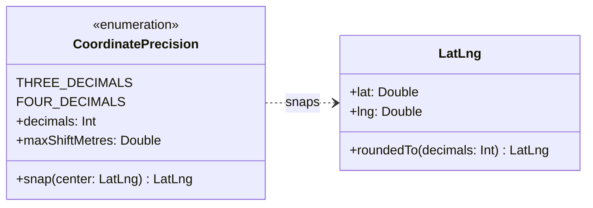

# SC-199 — Phase 1: Domain model

> **Purpose:** the one new rule and the vocabulary it adds · **Derived from:** 00 · **Delta:** extends (`CoordinatePrecision` new, `LatLng` gains one operation); no aggregate, entity or relationship changes

**ARCHITECTURE.md §1.2 impact: none.** Nothing in the domain model changes shape. The
feature adds a snapping rule to an existing value object and a transport freshness
policy; listings, verification, hand-cut and ownership are untouched.

`radius`, `ListingSearchFilters` and `ListingSearchResult` are unchanged — only the
centre moves. A snapped centre is an ordinary `LatLng`: no new type reaches the
persistence port, and `ExposedListingSearchQuery` cannot tell a snapped centre from a
client-supplied one.

Freshness (how long a response may be reused) is **not** domain vocabulary — it is a
boundary policy drawn in Phase 5 (`SearchCachePolicy`). What the domain does record is
the trust bound it may not exceed (INV-10): a cached response can hide a delisting for
at most the freshness window.

## Geometry the rule is built on

| Precision | Cell side (lat) | Cell side (lng, 43.7°N) | Max centre shift (equator, half-diagonal) | Max `distanceMiles` error |
|---|---|---|---|---|
| 3 dp | 111.3 m | 80.5 m | 78.5 m | 0.0488 mi |
| 4 dp | 11.1 m | 8.05 m | 7.85 m | 0.0049 mi |

Snapping is plain rounding of each component to `decimals` places. Rounding maps a value
to the **nearest** grid point, so the set of centres that share a snapped value is a
*half-cell-wide neighbourhood around that grid point* (a rounding basin), not the grid
square that starts at it: `43.68294` and `43.68299` sit in the same 4 dp grid square but
snap to `43.6829` and `43.6830`. The shift is bounded by half the cell diagonal, which is
why the worst case is quoted at the equator (QA finding F1).

## Invariants

| # | Invariant | Becomes test |
|---|---|---|
| INV-1 | Snapping is idempotent: `snap(snap(c)) == snap(c)` for every valid centre | `CoordinatePrecisionTest.snapping is idempotent` · `LatLngRoundingTest.a value already at the precision is unchanged` |
| INV-2 | Any two centres in one **rounding basin** (each component within half a cell of the same grid point) snap to the identical `LatLng` | `CoordinatePrecisionTest.two centres in one rounding basin snap to the same centre` |
| INV-3 | The shift never exceeds `maxShiftMetres` for the configured precision | `CoordinatePrecisionTest.the snapped shift never exceeds the advertised maximum` |
| INV-4 | A valid centre within one cell of a boundary snaps to a still-valid coordinate (`89.99999 → 90.0`, `-179.99999 → -180.0`) | `LatLngRoundingTest.rounding near a pole / the antimeridian stays inside WGS84` |
| INV-5 | A snapped component has at most `decimals` fractional digits | `LatLngRoundingTest.the rounded result has at most N fractional digits` |
| INV-6 | Snapping is deterministic and total: same input, same output, no exceptions for valid input | `CoordinatePrecisionTest.snapping is deterministic` |
| INV-7 | The radius is never snapped — only the centre | `ListingSearchRequestParserTest.centre leaves the radius untouched` |
| INV-8 | Every returned `distanceMiles` is within `maxShiftMetres` (converted) of the distance from the requested centre; radius membership can differ only for listings within `maxShiftMetres` of the boundary | **QA spot check** (0.001458 mi against a 0.004892 mi bound) — no unit assertion |
| INV-9 | Every `200` on `/v1/listings/search` carries the freshness header; every `4xx`/`5xx` is `no-store` | `ListingSearchEndpointTest.a successful search advertises the freshness window` · `…an error response keeps no-store` · `ErrorMappingTest.an error replaces an opt-in cache policy` |
| INV-10 | The advertised staleness never exceeds **600 s** on either channel: `max-age + swr` and `s-maxage + swr` are each bounded, so a delisting cannot be hidden longer | `SearchSettingsTest` (both bounds and their composition) · `SearchSettingsFromEnvTest` |
| INV-11 | The cacheable body is user-invariant: no per-user data, no `Set-Cookie`, no `Vary: *` | `ListingSearchEndpointTest.the cacheable search response carries no cookie and no per-caller variance` |
| INV-12 | Two requests in one basin with the same filters/paging produce byte-identical bodies | `ListingSearchEndpointTest.two centres in one 4 dp rounding basin return the same body` |

## States

**A search centre** — one transition, no failure mode:

| From | Event | To | Guard |
|---|---|---|---|
| Requested | validation passes | Snapped | value within WGS84; precision configured |
| Requested | validation fails | — | rejected → 400, no state |

**A cached response at the edge** — the lifecycle the freshness header advertises:

| From | Event | To | Guard |
|---|---|---|---|
| Absent | origin 200 with the freshness header | Fresh | Cache Rule makes the path eligible (D-5) |
| Absent | origin 4xx/5xx, or no Cache Rule | Absent | `no-store` / not eligible |
| Fresh | `s-maxage` elapses | Stale | edge clock |
| Stale | a request arrives | Fresh | one revalidation; the stale copy is served meanwhile |
| Stale | origin unreachable through the SWR budget | Expired | error to the client |
| Fresh / Stale | operator purge | Absent | ops action |

**A listing in a cached body** — the trust-relevant one:

| From | Event | To | Guard |
|---|---|---|---|
| Visible | response cached | Cached | 200 + header |
| Cached | listing delisted, revoked or failed the cross-contamination gate | Cached (stale) | unavoidable — no origin call |
| Cached (stale) | freshness window ends (≤ 600 s) | Absent | INV-10 |

## Glossary

| Term | Meaning |
|---|---|
| Precision | Decimal places kept in each coordinate component (3 or 4) |
| Cell | The `10⁻ⁿ`° × `10⁻ⁿ`° grid square between two grid points; it is *not* the set that snaps together |
| Rounding basin | The half-cell-wide neighbourhood **around one grid point**: every centre in it snaps to that point (this, not the cell, is what AC-4 means) |
| Snap / quantize | Round both components to the configured precision — the only new domain rule |
| Shift | Great-circle distance between the requested and the snapped centre (≤ half the cell diagonal) |
| Cache key | The full request URL (path **and** query string) — what the edge hashes |
| Freshness window | `max-age` (browser) + `s-maxage` (shared) + `stale-while-revalidate` advertised on the 200 |
| Edge hit / miss | A stored response was returned without reaching the origin / the origin was asked |
| Cache Rule | The Cloudflare control-plane setting that makes a JSON path eligible for caching (D-5) |
| Delisting | A listing leaving search because of verification revocation or the cross-contamination gate |
