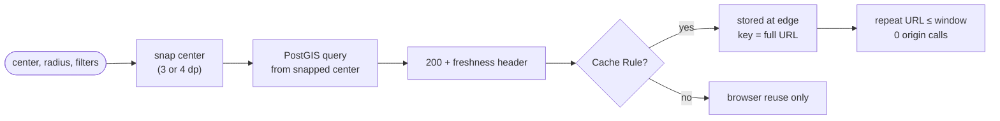

# SC-199 — Phase 2: Use cases

> **Purpose:** the actor goals the hedge serves, and their flows · **Derived from:** 01 · **Delta:** UC-01 modified (SC-10 search); **UC-02 new** (edge serving)

| ID | Name | Basis | Primary actor | Supporting |
|---|---|---|---|---|
| UC-01 | Search listings by location | Existing (Shortcut 36 / sc-10; MCP channel SC-209) — **modified** | U | ET (agent client), CDN |
| UC-02 | Serve a repeated search from the edge cache | **New** — the story's "repeat local requests can be served from edge cache" | CDN (Cloudflare edge) | U, ET |

UC-02 is a new *actor goal* because it is a different actor doing a different thing: the
edge answers without the origin. It exists only because UC-01 now advertises a
freshness window; it disappears entirely if D-5 is declined.

## Business rules

| ID | Rule |
|---|---|
| BR-1 | `center` is untrusted input: validated against WGS84 first, then snapped; only the snapped value reaches the query. |
| BR-2 | Snapping applies on **both** search channels (REST and MCP) through one shared parser, so the same query returns the same answer (D-4). |
| BR-3 | The radius is never snapped; only the centre moves (INV-7). |
| BR-4 | Exactly one freshness header is advertised, and only on a `200`. Every error keeps the platform `no-store` (INV-9). |
| BR-5 | The response is public and user-invariant: no personalization, no cookies, no `Vary: *` (INV-11). |
| BR-6 | The advertised window is bounded by the delisting bound (≤ 600 s): a cached body may not hide a delisting longer than the ratified window (INV-10). |
| BR-7 | A cache hit is indistinguishable from a miss in body and status; caching never changes an answer, only who produced it. |
| BR-8 | An over-precision request is never answered from another cell's entry: the key is still the client's URL, so this is guaranteed by construction (AC-6). |
| BR-9 | No Cache Rule means no edge caching: the header still benefits browsers, and the search semantics are unchanged (E-10). |
| BR-10 | Latency/cost claims in the story are hedges, not requirements: the design does not promise a hit rate. |

## UC-01 — Search listings by location (existing; snapped centre + freshness header)

- **Primary actor:** U · **Supporting:** ET, CDN · **Trigger:** the user (or their agent) searches for halal restaurants near a location
- **Goal:** the same answers as today, from a centre that does not change when the client's GPS jitter does
- **Preconditions:** the endpoint is up; the centre is within WGS84; the precision is configured
- **Precondition (new):** for the edge half of the goal, a Cache Rule exists for the path (D-5)

**Main success scenario**

1. The client calls `GET /v1/listings/search` with `center=<lat>,<lng>`, `radius`, and filters.
2. Tahir's List parses the centre, radius and every filter, rejecting malformed or out-of-range values.
3. Tahir's List **snaps** the centre to the configured precision (4 dp by default).
4. Tahir's List runs the existing PostGIS query **from the snapped centre**: `ST_DWithin` filter, `ST_DistanceSphere` order, offset paging.
5. Tahir's List maps the rows to search cards, `distanceMiles` included, measured from the snapped centre.
6. Tahir's List marks the `200` with the freshness window and returns it.
7. The CDN stores the response under the requested URL if the path is eligible.

**Alternate flows**

- **A1 (from 2)** — the centre already has ≤ `decimals` places: step 3 is a no-op (INV-1).
- **A2 (from 4)** — no listings match: an empty `200`, still cacheable (E-6).
- **A3 (from 4)** — page two, same centre: same snapped centre, a stable ordering, a separately cached URL (E-7).
- **A4 (from 1)** — the request arrives by MCP (`search_restaurants` with `center`): same snapping through the shared parser, no HTTP caching (D-4).

**Exception flows**

| ID | From | Condition → outcome | Resulting state |
|---|---|---|---|
| E-1 | 2 | `center` missing / malformed / non-finite → `400 invalid_input` | Nothing queried; response `no-store` |
| E-2 | 2 | centre outside ±90 / ±180 → `400 invalid_input` | Nothing queried; `no-store` |
| E-3 | 2 | bad radius or filter → `400 invalid_input` (unchanged) | `no-store` |
| E-4 | 4 | database failure → `500 internal_error` | `no-store`; nothing cached |

- **Postconditions:** success — a results page computed from the snapped centre; failure — no cached entry, no partial response.
- **Data:** read — `listing_search` (PostGIS) · created — nothing (the edge copy is not our state)
- **ACs:** AC-1 (INV-1…6) · AC-2 (INV-9) · AC-3 (INV-8) · AC-4 (INV-12) · AC-5 (INV-9) · **Open:** D-1, D-2, D-4

## UC-02 — Serve a repeated search from the edge cache (new)

- **Primary actor:** CDN · **Supporting:** U, ET · **Trigger:** a request whose full URL was answered recently
- **Goal:** answer a repeated local search without spending an origin request or a PostGIS query
- **Preconditions:** a Cache Rule makes `/v1/listings/search*` eligible (D-5); the origin previously returned a cacheable `200`

**Main success scenario**

1. A client repeats a search URL **byte-for-byte** that was answered within the window. Two clients whose GPS fixes differ in the digits produce different URLs and different edge keys; they are not served from each other's entry (see D-3).
2. The edge finds a **fresh** entry.
3. The edge returns the stored `200` with an `Age` header and does not contact Tahir's List.
4. The entry stays fresh until `s-maxage` elapses, then becomes stale.
5. A stale entry is revalidated: one request reaches the origin, the current caller receives the stored copy, and the refreshed copy replaces it.
6. Expired entries are evicted; the next request is a miss and UC-01 runs.

**Alternate flows**

- **A1 (from 2)** — the URL differs by any filter or by a different cell: a miss; UC-01 runs and the response is stored under the new URL.
- **A2 (from 2)** — no Cache Rule (D-5 declined): every request is a miss; browsers may still reuse a response for `max-age`.
- **A3 (from 5)** — the origin returns `400`/`500`: the error is **not** stored; the stale copy is discarded when the SWR budget ends.

**Exception flows**

| ID | From | Condition → outcome | Resulting state |
|---|---|---|---|
| E-1 | 5 | origin unreachable *and* the SWR budget spent → edge error to the client (502/521) | Stale entry evicted |
| E-2 | 5 | operator purges the URL mid-flight → the in-flight response is stored again | Fresh entry |
| E-3 | 2 | entry was cached before a code deploy with a different body shape → it expires within `s-maxage`; no version stamp in the key (accepted, bounded by D-2) | Fresh until expiry |

- **Postconditions:** success — one origin request per URL per window, or zero for a fresh hit; failure — the client sees an error, never a stale body older than the bound.
- **Data:** read — the stored response · created — an edge entry (not our state)
- **ACs:** AC-2 (INV-9, INV-10) · AC-6 (BR-8) · E-10 · **Open:** D-2, D-5
