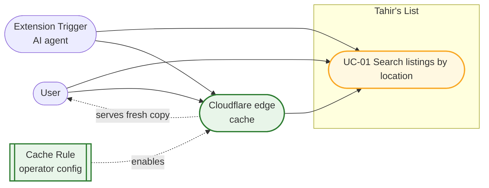
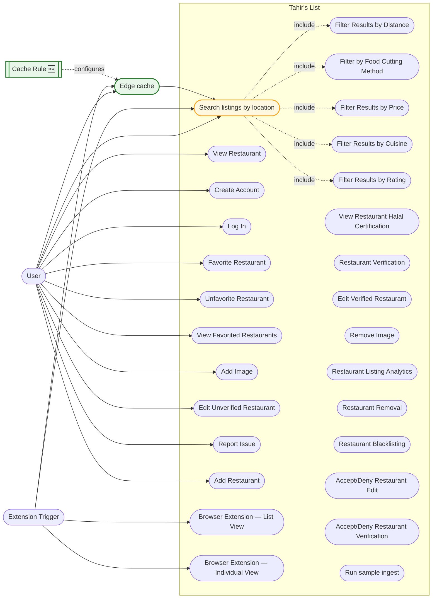

# SC-199 — Phase 3: Use case diagram

> **Purpose:** place the modified and new use cases against the agreed model · **Derived from:** 02 · **Delta:** UC-01 marked modified; UC-02 (edge serving) marked new; no new human actor

## Feature scope

UC-02 is the edge's behaviour, so it is an actor (the CDN) rather than a bubble inside
the system: the origin never sees it. The Cache Rule is operator configuration outside
the codebase, drawn as a dependency so the coupling is visible.

## System-wide (changed items amber; new items green; everything else unchanged)

| Mark | Meaning |
|---|---|
| Amber | Changed by SC-199 (UC-01: centre snapping, freshness header) |
| Green | New by SC-199 (edge serving; the Cache Rule as operator config) |
| Solid arrow | Actor association / request path |
| Dotted arrow | `«include»` or configuration |

All other use cases, actors and associations are unchanged. No new owned data store: the
feature adds no table, and the edge copy is not Tahir's List state.
