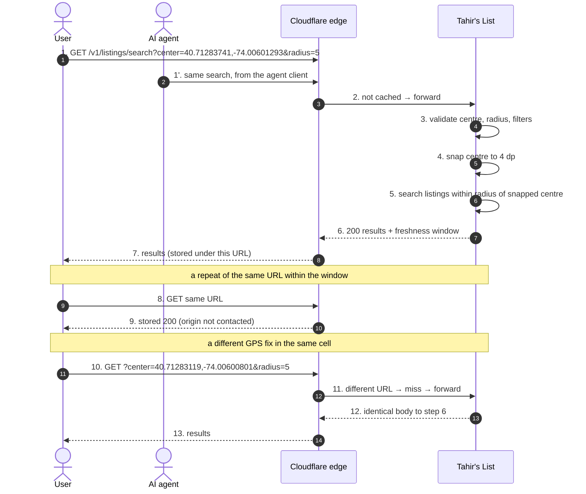
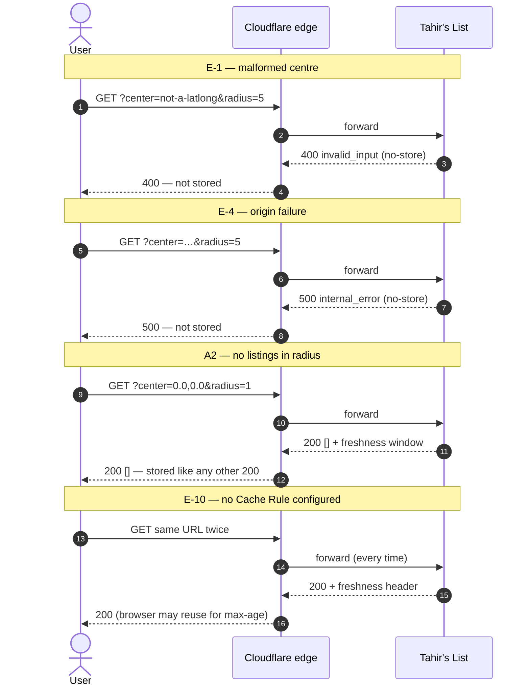

# SC-199 — Phase 4: Black-box sequence, UC-01 Search listings by location

> **Purpose:** what the user and the edge see of the search · **Derived from:** 02 UC-01 · **Delta:** the centre is snapped; the 200 carries a freshness header

## Exception and alternate paths

## What this pins

| Concern | Shown |
|---|---|
| Centre precision | Two different GPS fixes in one cell (steps 1 and 10) return identical bodies (AC-4) |
| Error caching | 400 and 500 never reach the cache (AC-5) |
| Freshness | Step 9 is answered without the origin; E-10 shows the no-rule case |
| Unchanged contract | Same status codes, same body shape, same validation as today |
