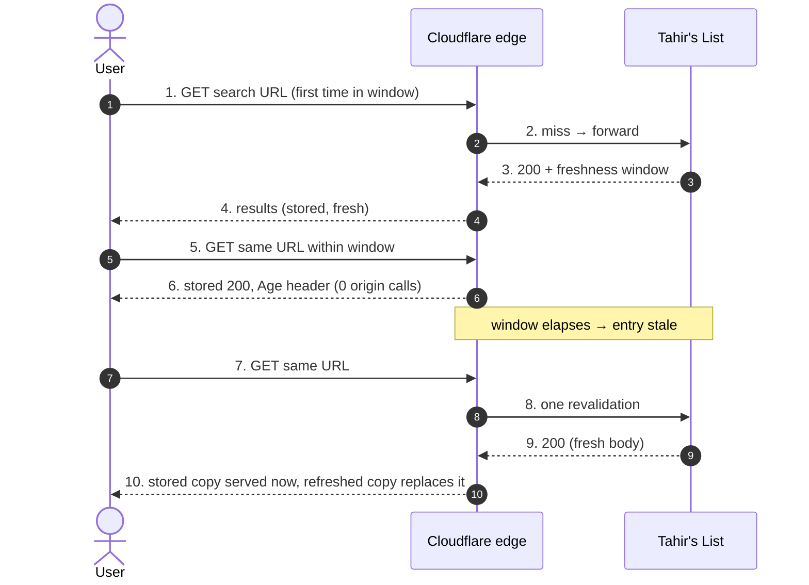
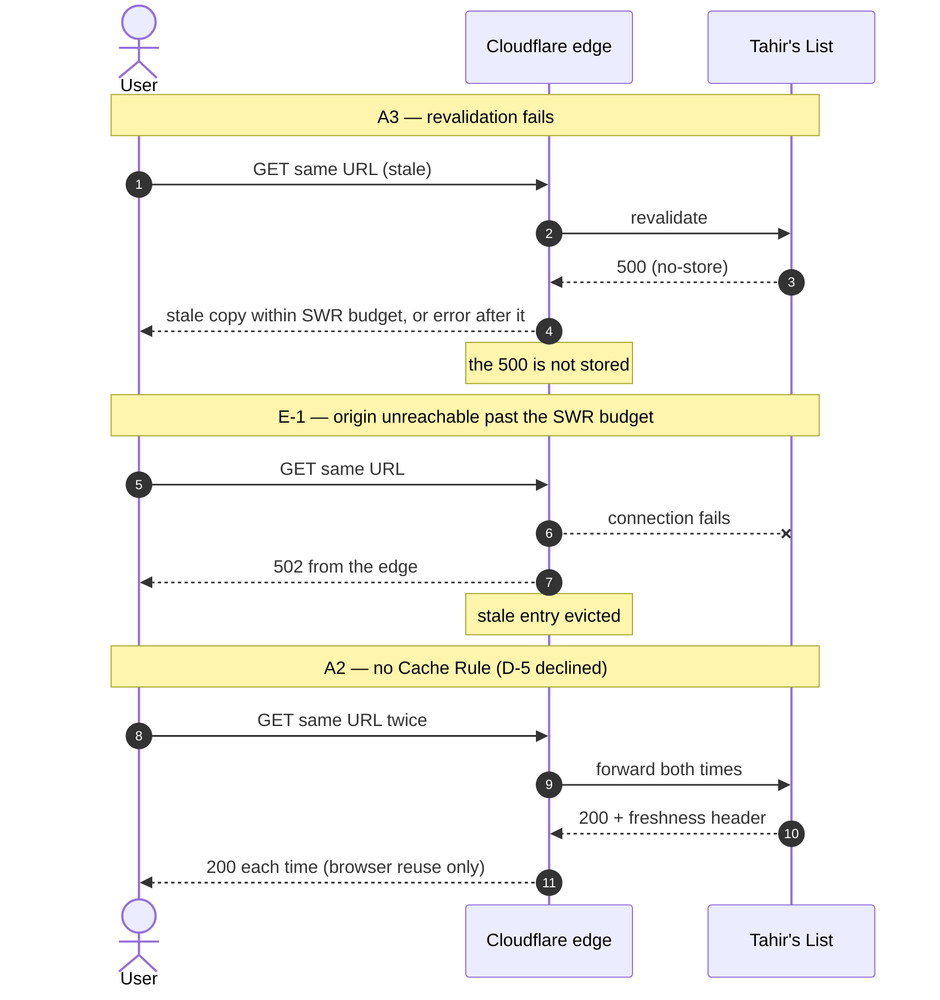

# SC-199 — Phase 4: Black-box sequence, UC-02 Serve a repeated search from the edge cache

> **Purpose:** what the edge does with the freshness window · **Derived from:** 02 UC-02 · **Delta:** new; the origin is contacted only on miss or revalidation

## Exception and alternate paths

## What this pins

| Concern | Shown |
|---|---|
| Origin load | Steps 5–6 cost zero origin calls inside the window |
| Trust bound | Steps 7–10 show staleness ends at the window; INV-10 caps it at 600 s |
| Error safety | A failed revalidation never replaces a good entry with an error |
| Dependency on operator config | The no-rule path shows the hedge is partial without D-5 |
