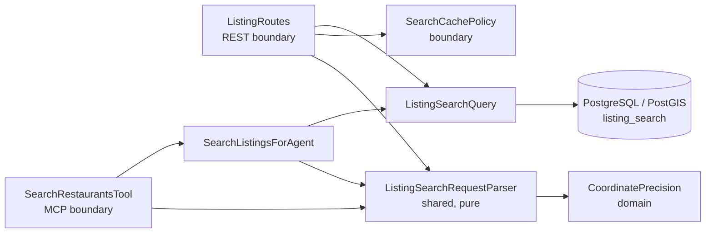
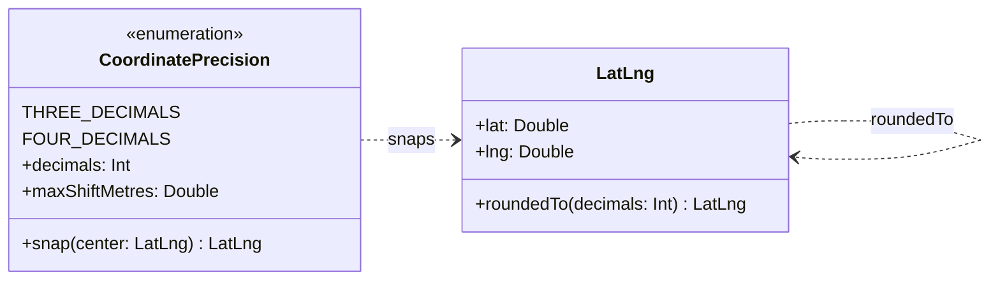
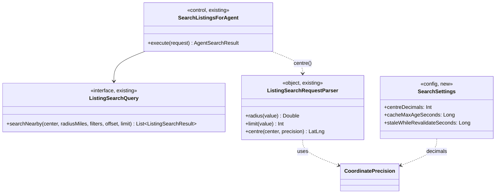
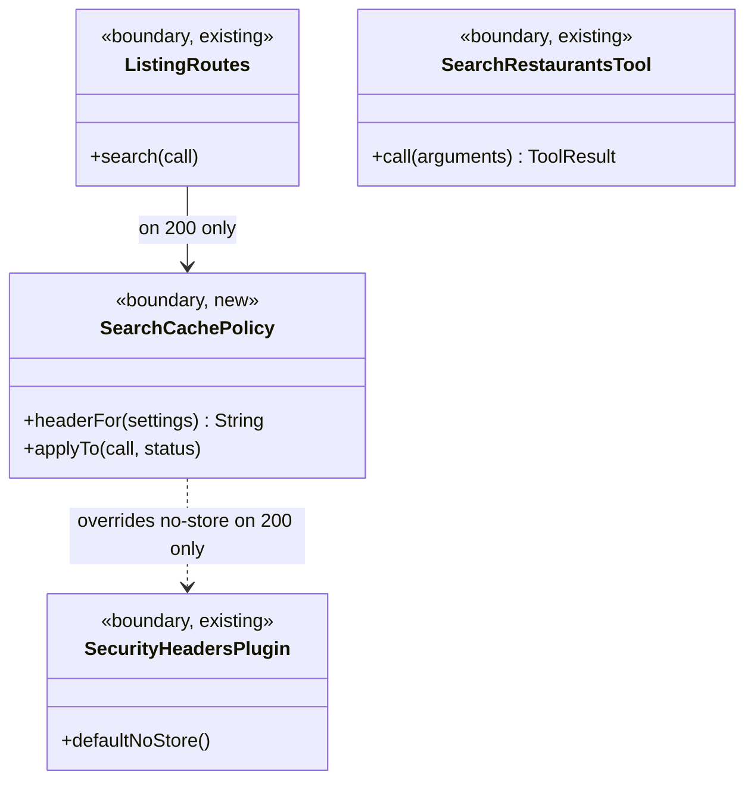

# SC-199 — Phase 5: System class diagram (conceptual)

> **Purpose:** the classes and policies that serve the two use cases · **Derived from:** 01–04 · **Delta:** +1 value operation (`CoordinatePrecision`), +1 shared parser function (`ListingSearchRequestParser.centre`), +1 boundary policy (`SearchCachePolicy`), +1 config record (`SearchSettings`); no new port, no new store

## Overview

Both channels snap through **one** parser function, so REST and MCP cannot drift (D-4).
The cache policy is a boundary concern: it changes HTTP headers, never the domain answer.

## Domain

`roundedTo` is the only new operation on an existing value object; it re-validates the
WGS84 range (INV-4), so a snapped centre is an ordinary `LatLng`.

## Application

`centre` is the single snapping entry point: it accepts a validated `LatLng` and a
`CoordinatePrecision` and returns `precision.snap(center)`. The radius is not passed
through it (INV-7).

## Boundary

`SearchCachePolicy.applyTo` sets the freshness header only when the status is `200`.
Every other status falls through to the existing `SecurityHeadersPlugin` default
`no-store`, which is unchanged (INV-9). The policy writes no cookie and no `Vary` header
(INV-11).

## Ports and adapters

| Port | Operation | Adapter | Store / external |
|---|---|---|---|
| `ListingSearchQuery` (existing) | `searchNearby(centre, radius, filters, offset, limit)` | `ExposedListingSearchQuery` (existing, unchanged) | PostgreSQL/PostGIS `listing_search` |
| — | — | — | No new port, no new store, no new external dependency |

The persistence adapter is unchanged. It receives a `LatLng` and cannot tell a snapped
centre from a client-supplied one.

## Operation coverage

| UC step | Operation |
|---|---|
| UC-01.2 | `ListingRoutes.search` → `ListingSearchRequestParser` (existing validation) |
| UC-01.3 | `ListingSearchRequestParser.centre` → `CoordinatePrecision.snap` → `LatLng.roundedTo` |
| UC-01.4 | `ListingSearchQuery.searchNearby` (existing) with the snapped centre |
| UC-01.5–6 | `ListingRoutes` maps results (unchanged); `SearchCachePolicy.applyTo` on 200 |
| UC-01.A4 (MCP) | `SearchRestaurantsTool.call` → `SearchListingsForAgent.execute` → `ListingSearchRequestParser.centre` → `ListingSearchQuery` |
| UC-02.2–5 | edge behaviour; the origin sees only the miss/revalidation requests and runs UC-01 |
| E-1…E-4 | parser/`LatLng` rejects → `400`; `SearchCachePolicy` not applied; `SecurityHeadersPlugin` `no-store` |

**Existing collaborators:** `ListingRoutes`, `SearchRestaurantsTool`, `SearchListingsForAgent`, `ListingSearchRequestParser`, `ListingSearchQuery`, `ExposedListingSearchQuery`, `SecurityHeadersPlugin`, `LatLng`.
