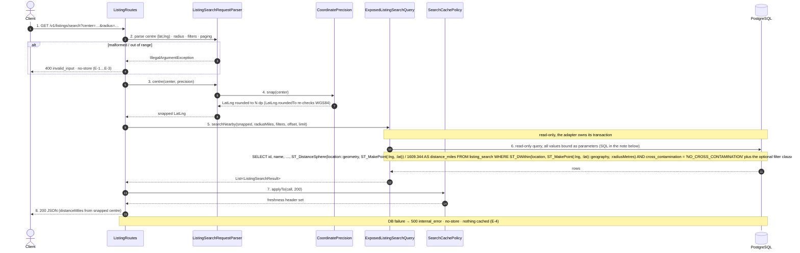
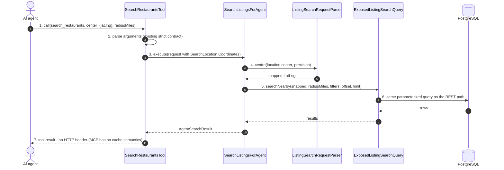

# SC-199 — Phase 6: White-box sequence, UC-01 Search listings by location

> **Purpose:** the classes, operations, transactions and SQL behind 04/UC-01 · **Derived from:** 05 · **Delta:** `ListingSearchRequestParser.centre` snaps before the query; `SearchCachePolicy` sets the 200 header
> **Security:** anonymous, read-only. The snapped centre is a parameter, never concatenated. No identity reaches the cache policy, so the cacheable body is user-invariant (INV-11).

## REST path

## MCP path (`search_restaurants` with `center`)

Place-text searches (`SearchLocation.Place`) snap **after** geocoding, through the same
`centre` call, so SC-198's cache and SC-199's snap compose without either knowing the other.

## Exception paths

| Concern | Where | Concrete outcome |
|---|---|---|
| Malformed centre / non-finite | `ListingRoutes` parse step | `IllegalArgumentException` → `400 invalid_input`, `no-store` |
| Lat/lng out of WGS84 | `LatLng` init, re-checked in `roundedTo` | `400 invalid_input`, `no-store` |
| Bad radius / filter | `ListingSearchRequestParser` | `400 invalid_input`, `no-store` (unchanged) |
| Database failure | `ExposedListingSearchQuery` | `500 internal_error`, `no-store` (generic envelope, unchanged) |
| MCP invalid centre | `SearchRestaurantsTool` | `isError` tool result with the parser's reason (unchanged) |

## What this diagram pins

| Concern | Shown |
|---|---|
| Transaction boundary | One read-only transaction inside `ExposedListingSearchQuery`; the snap is pure and outside it |
| State transition | None: no write, no state change |
| Authorization | None (public surface); the snapped centre carries no identity |
| Query shape | Centre is bound as `:lng,:lat` parameters; the snap changes the value, not the SQL |
| Concrete errors | Each row above maps to one class and one status |
| Cache decision | Header only on step 8; error paths never reach `SearchCachePolicy` |
