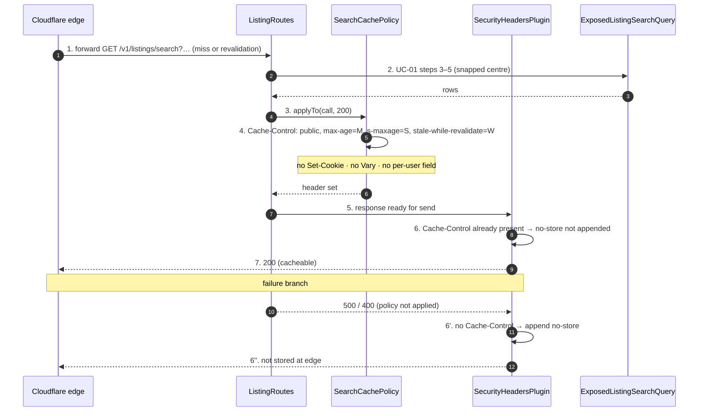

# SC-199 — Phase 6: White-box sequence, UC-02 Serve a repeated search from the edge cache

> **Purpose:** what the origin does so the edge can cache safely · **Derived from:** 05 · **Delta:** `SearchCachePolicy` decides the header; the edge's own cache is external and drawn opaque here
> **Security:** the cached body must be public and identity-free. A `Set-Cookie` or `Vary` header would split or leak the entry, so neither is ever set.

## What this diagram pins

| Concern | Shown |
|---|---|
| Header decision | Set on step 4, only for the `200` branch (INV-9) |
| Default preserved | Step 6′: an unset header still becomes `no-store` |
| Freshness bound | `S + W ≤ 600` enforced at settings load, not per request (INV-10) |
| Identity | No cookie, no `Vary` (INV-11) |
| Transaction / state | None on the origin side; no write |
