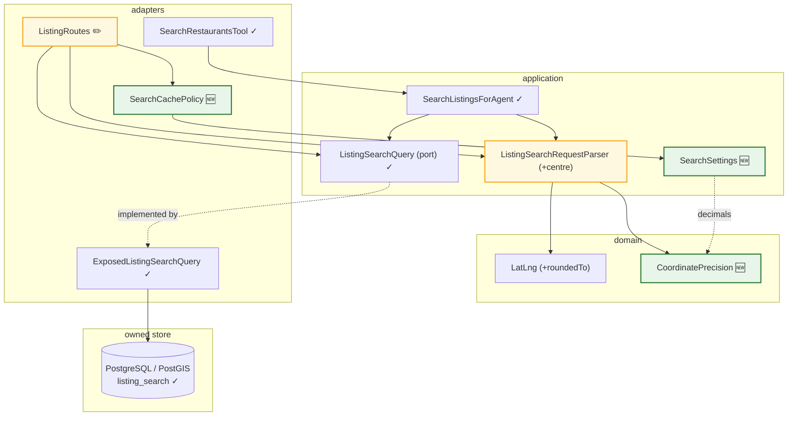
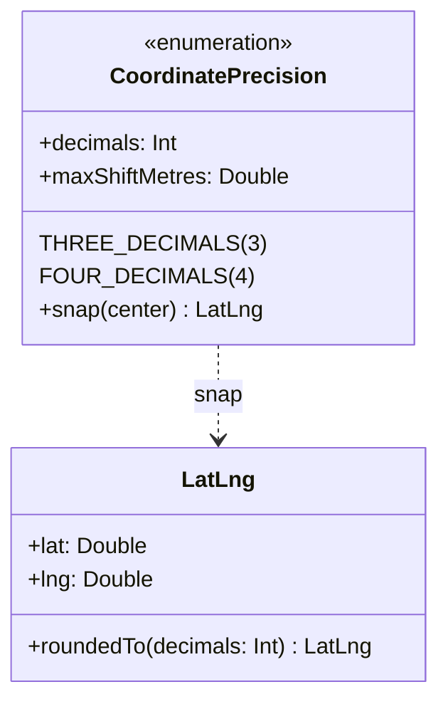
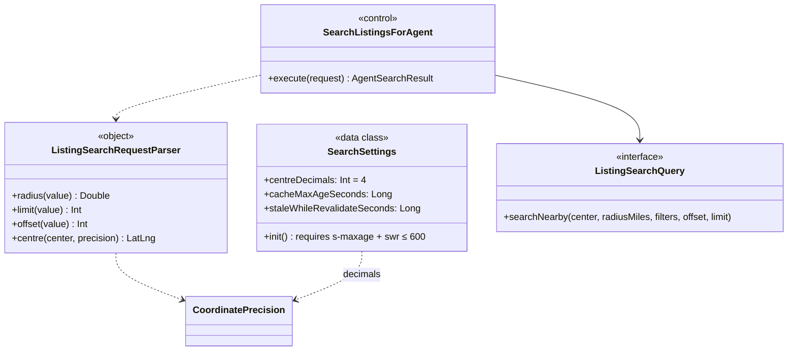
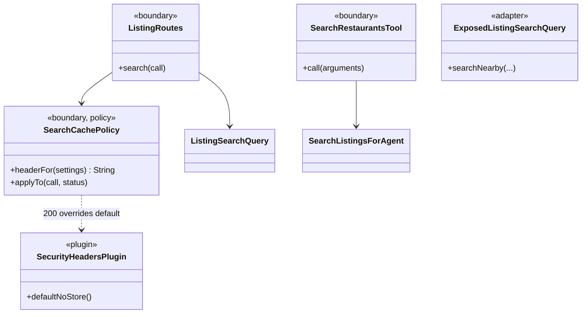

# SC-199 — Phase 7: Complete class diagram

> **Purpose:** the final names and every delta, so implementation has no open naming · **Derived from:** 05, 06 · **Delta:** three new names (`CoordinatePrecision`, `SearchCachePolicy`, `SearchSettings`), one new operation (`LatLng.roundedTo`), one new function (`ListingSearchRequestParser.centre`); no table, no route, no store

## Layer map

Legend: 🆕 new · ✏️ modified · ✓ unchanged. `SearchListingsForAgent` is unchanged
in source: it calls the shared parser function, which is a change to the parser, not to
the control.

## Domain

## Application

## Adapters

## Delta tables

### Persistence

| Element | Change | Notes |
|---|---|---|
| `listing_search` table | unchanged | no migration |
| `ExposedListingSearchQuery` | unchanged | receives a snapped `LatLng` |
| Indexes (GiST on `location`) | unchanged | |

### API / OpenAPI (`backend/openapi/v1.json`)

| Element | Change | Notes |
|---|---|---|
| `GET /v1/listings/search` — `center` description | modified | states the centre is snapped to N dp and the snap is at most `maxShiftMetres` |
| `GET /v1/listings/search` — `distanceMiles` description | modified | measured from the snapped centre |
| `GET /v1/listings/search` — 200 `Cache-Control` header | new (documented) | `public, max-age=…, s-maxage=…, stale-while-revalidate=…` |
| Request / response schemas | unchanged | no new parameter, no field change |
| 400 / 500 responses | unchanged | still `no-store` |

### Frontend

| Element | Change | Notes |
|---|---|---|
| `frontend/src/lib/api/openapi.json` | **unchanged** (corrected at implementation) | it is a curated subset, already stale for this path (no `required: true`, no `deliveryOnly`), and generates types only — nothing in it changes a type |
| `frontend/src/lib/api/schema.d.ts` | unchanged | no type change, so no regeneration; regenerating a stale source would only add unrelated drift |
| `frontend/src/hooks.server.ts` proxy | unchanged | it already forwards `Cache-Control` from upstream and adds no header to `/v1` responses |
| Listing data layer (`lib/listings/data.ts`) | unchanged | the browse/search UI keeps its client-side filter |
| Browser behaviour | observable | identical responses; a repeat search can be served from browser cache for `max-age` |

### Operations (outside the repository)

| Element | Change | Notes |
|---|---|---|
| Cloudflare Cache Rule for `/v1/listings/search*` | new — **D-5** | without it the header only helps browsers; the edge cache key is the full URL |
| Runbook (KB `operations/`) | new note at ship time | records purge command and the window values |

### Configuration

| Env var | Default | Meaning |
|---|---|---|
| `APP_SEARCH_CENTRE_DECIMALS` | `4` | 3 or 4; any other value fails startup (D-1) |
| `APP_SEARCH_CACHE_MAX_AGE_SECONDS` | `60` | browser freshness (D-2) |
| `APP_SEARCH_CACHE_S_MAXAGE_SECONDS` | `300` | shared/edge freshness (D-2) |
| `APP_SEARCH_CACHE_SWR_SECONDS` | `60` | stale-while-revalidate (D-2) |

## Tests that prove each AC (planned, TDD)

| AC | Test (new) | Layer |
|---|---|---|
| AC-1 | `CoordinatePrecisionTest.snap keeps the configured number of decimals` · `ListingSearchRequestParserTest.centre snaps the search centre` | domain · application |
| AC-2 | `ListingSearchEndpointTest.a successful search advertises the freshness window` | bootstrap |
| AC-3 | `CoordinatePrecisionTest.the snapped shift never exceeds the advertised maximum` (INV-8 covered by the QA spot check) | domain |
| AC-4 | `CoordinatePrecisionTest.two centres in one rounding basin…` · `ListingSearchEndpointTest.two centres in one 4 dp rounding basin…` | domain · bootstrap |
| AC-5 | `ListingSearchEndpointTest.an error response keeps no-store` · `ErrorMappingTest.an error replaces an opt-in cache policy` | bootstrap · web-api |
| AC-6 | structural: the cache key is the client URL; stated in 00/08, no code to assert | design |
| INV-4 | `LatLngRoundingTest.rounding near a pole / the antimeridian stays inside WGS84` | domain |
| INV-7 | `ListingSearchRequestParserTest.centre leaves the radius untouched` | application |
| INV-10 | `SearchSettingsTest` (per-channel and composed bounds) · `SearchSettingsFromEnvTest` | application · bootstrap |
| INV-11 | `ListingSearchEndpointTest.the cacheable search response carries no cookie…` | bootstrap |
