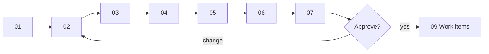

# Design walkthrough — SC-199 search coordinate quantization + cache headers

> **Purpose:** the founder review surface · **Derived from:** 00–07 · **Delta:** one value-object operation, one shared parser function, one boundary policy, one config record; no migration, no API shape change
> Design branch: `docs/SC-199-search-quantization` · Date: 2026-11-08 · **Status: awaiting approval**

| Date | Change | Phases re-run |
|---|---|---|
| 2026-11-08 | Initial walkthrough | — |
| 2026-11-08 | Corrected the edge model: the cache key is the raw URL, so server-side snapping alone does not merge edge entries. Added D-3 | 00, 02, 08 |



## 0. Story (read first)
**Shows:** the story's two directives, verbatim, and what they do and do not buy.
**Locks in:** the freshness window and precision are product-visible and need ratification before any code.
**Need:** the founder decisions D-1, D-2, and especially **D-3**, which changes what this story delivers.

## 1. Domain model
**Shows:** one new operation on `LatLng` and one precision enum; no aggregate changes.
**Locks in:** snapping is plain rounding, idempotent, bounded by half a cell diagonal (INV-1…INV-6).
**Need:** approve. Confirm the shift table: 4 dp moves a centre at most 7.9 m; 3 dp at most 78.5 m.

## 2. Use cases
**Shows:** UC-01 search (modified) and UC-02 edge serving (new), with the edge's real key behaviour.
**Locks in:** identical repeat URLs are the only edge hits; a different GPS fix, even in the same basin, is a miss at the edge.
**Need:** approve; confirm D-3 and D-5.

## 3. Use case diagram
**Shows:** UC-01 amber, the CDN and the Cache Rule green; no new human actor, no new store.
**Locks in:** the edge is an actor because the origin never sees UC-02.
**Need:** approve.

## 4. Black-box sequences
**Shows:** two GPS fixes in one rounding basin return identical bodies, but the edge sends the second to the origin (steps 10–11).
**Locks in:** 400 and 500 never cached; a repeat URL is served with zero origin calls.
**Need:** approve. **Read step 11 against D-3.** It is the honest limit of the as-filed design.

## 5. System class diagram
**Shows:** both channels (REST and MCP) snap through one parser function; the cache policy is a boundary concern.
**Locks in:** no new port, no new store; the persistence adapter is unchanged.
**Need:** approve; confirm D-4 (both channels snap).

## 6. White-box sequences
**Shows:** `centre → snap → roundedTo → searchNearby` with the parameterised query; the header is set only on the 200 path, and the default `no-store` still applies to every other status.
**Locks in:** no SQL change; read-only; no identity in the cacheable body (no cookie, no `Vary`).
**Need:** approve.

## 7. Complete class diagram (the design being approved)
**Shows:** final names, the layer map, the delta tables (persistence none, OpenAPI description only, frontend codegen only, operations Cache Rule outside the repo), the config env vars, and the test that proves each AC.
**Locks in:** no migration, no route, no store; `S + W ≤ 600` enforced at settings load.
**Need:** approve, including D-1, D-2, D-5.

## Decision items

| # | Question | Recommendation | Decision |
|---|---|---|---|
| D-1 | Precision: 4 dp (≈8–11 m cells; a distance error ≤ 0.005 mi) or 3 dp (≈80–111 m; ≤ 0.049 mi)? | **4 dp** (default; `APP_SEARCH_CENTRE_DECIMALS`, 3 allowed) | decided 2026-11-08 — **4 dp** (founder) |
| D-2 | Freshness window: `max-age=60`, `s-maxage=300`, `stale-while-revalidate=60`; `s-maxage + swr ≤ 600` | As proposed | decided 2026-11-08 — **as proposed** (founder) |
| D-3 | What snapping buys: **A** as filed (server snap + header; edge helps identical URLs only); **B** origin cache keyed on the snapped request; **C** client-side rounding | **A** | decided 2026-11-08 — **option A** (founder). B is **not** in this story; it is the follow-up that would cut PostGIS load for near-duplicate fixes and needs its own story and design |
| D-4 | Snap on both REST and MCP through one parser function | Yes | decided 2026-11-08 — **yes** (founder) |
| D-5 | Cloudflare Cache Rule for `/v1/listings/search*` (query string in the key) | Under option A the edge is the only thing the header buys beyond browsers, so the rule is in scope | decided 2026-11-08 — **yes, per D-3 / A** (founder). Operator applies it; the runbook note ships with the PR |
| D-6 | **Verified-badge freshness.** The cached search body carries `verificationStatus`. KB `architecture/scalability-and-reliability-goals` §5.2 (still `status: draft`) sets approve/deny propagation at **5 s**; the ratified search window is 360 s. **Corrected premise (Omar round 2, N1):** the certificate and image proxies are already `public, max-age=86400` — 24 h — so the authoritative certificate surface does not meet a 5 s target either; that predates SC-199. Options were: **A** accept 360 s on search cards; **B** purge the edge on verification changes; **C** ship snapping only | **A** | decided 2026-11-09 — **A** (founder): there is no strict SLA, and stale verified state is accepted. B is not pursued |
| D-7 | The pre-existing 24 h cache on the certificate and image proxies (`public, max-age=86400`) | File a follow-up story | decided 2026-11-09 — **accepted as-is; no follow-up, no change** (founder). Stale certificates for 24 h are acceptable to the product |

## Approval

```
Approved by: founder · Date: 2026-11-08 · Design commit: 7934b73 · Design PR: #83
D-1 4 dp · D-2 as proposed · D-3 option A · D-4 yes · D-5 yes (per A)
D-6 decided 2026-11-09: option A — stale verified state accepted, no SLA
D-7 decided 2026-11-09: the 24 h certificate/image cache is accepted as-is, no follow-up
```

**Accepted limits (founder):**
- Distinct GPS fixes in the same rounding basin still run PostGIS on every request (D-3 A). Only
  identical repeat URLs are served from the edge or browser.
- A search card may show a stale verified badge for up to the freshness window (D-6 A).
- The certificate and image proxies are cached for 24 h (D-7). No change is planned.
