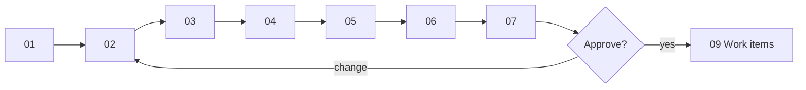

# Design walkthrough — SC-199 search coordinate quantization + cache headers

> **Purpose:** the founder review surface · **Derived from:** 00–07 · **Delta:** one value-object operation, one shared parser function, one boundary policy, one config record; no migration, no API shape change
> Design branch: `docs/SC-199-search-quantization` · Date: 2026-11-08 · **Status: awaiting approval**

| Date | Change | Phases re-run |
|---|---|---|
| 2026-11-08 | Initial walkthrough | — |
| 2026-11-08 | Corrected the edge model: the cache key is the raw URL, so server-side snapping alone does not merge edge entries. Added D-3 | 00, 02, 08 |



## 0. Story (read first)
**Shows:** the story's two directives, verbatim, and what they do and do not buy.
**Locks in:** the freshness window and precision are product-visible and need ratification before any code.
**Need:** the founder decisions D-1, D-2, and especially **D-3**, which changes what this story delivers.

## 1. Domain model
**Shows:** one new operation on `LatLng` and one precision enum; no aggregate changes.
**Locks in:** snapping is plain rounding, idempotent, bounded by half a cell diagonal (INV-1…INV-6).
**Need:** approve. Confirm the shift table: 4 dp moves a centre at most 7.9 m; 3 dp at most 78.5 m.

## 2. Use cases
**Shows:** UC-01 search (modified) and UC-02 edge serving (new), with the edge's real key behaviour.
**Locks in:** identical repeat URLs are the only edge hits; a different GPS fix in the same cell is a miss at the edge.
**Need:** approve; confirm D-3 and D-5.

## 3. Use case diagram
**Shows:** UC-01 amber, the CDN and the Cache Rule green; no new human actor, no new store.
**Locks in:** the edge is an actor because the origin never sees UC-02.
**Need:** approve.

## 4. Black-box sequences
**Shows:** two GPS fixes in one cell return identical bodies, but the edge sends the second to the origin (steps 10–11).
**Locks in:** 400 and 500 never cached; a repeat URL is served with zero origin calls.
**Need:** approve. **Read step 11 against D-3.** It is the honest limit of the as-filed design.

## 5. System class diagram
**Shows:** both channels (REST and MCP) snap through one parser function; the cache policy is a boundary concern.
**Locks in:** no new port, no new store; the persistence adapter is unchanged.
**Need:** approve; confirm D-4 (both channels snap).

## 6. White-box sequences
**Shows:** `centre → snap → roundedTo → searchNearby` with the parameterised query; the header is set only on the 200 path, and the default `no-store` still applies to every other status.
**Locks in:** no SQL change; read-only; no identity in the cacheable body (no cookie, no `Vary`).
**Need:** approve.

## 7. Complete class diagram (the design being approved)
**Shows:** final names, the layer map, the delta tables (persistence none, OpenAPI description only, frontend codegen only, operations Cache Rule outside the repo), the config env vars, and the test that proves each AC.
**Locks in:** no migration, no route, no store; `S + W ≤ 600` enforced at settings load.
**Need:** approve, including D-1, D-2, D-5.

## Decision items

| # | Question | Recommendation | Decision |
|---|---|---|---|
| D-1 | Precision: 4 dp (≈8–11 m cells; a distance error ≤ 0.005 mi) or 3 dp (≈80–111 m; ≤ 0.049 mi)? The story asks for 3 or 4 | **4 dp.** Radius-boundary changes stay negligible; 3 dp reduces distinct keys more but moves listings at the boundary by up to ~0.05 mi | **open — founder** |
| D-2 | Freshness window: `max-age=60`, `s-maxage=300`, `stale-while-revalidate=60`, with `s-maxage + swr ≤ 600` as the delisting bound | Ratify the values. The bound is the honest answer to "how long can a delisted restaurant still show" | **open — founder** |
| D-3 | **What snapping buys.** The edge keys on the raw URL. Options: **A** as filed (server snap + header): edge helps identical URLs only; every distinct GPS URL still runs PostGIS. **B** A plus an origin cache keyed on the snapped request (bounded, TTL = `s-maxage`): removes PostGIS work for near-duplicate fixes, a new component not yet designed. **C** clients round before sending: makes edge keys collide, but is a frontend and extension change outside this story | **Choose one.** Recommend **B**, because the story's stated cost is PostGIS load, and A alone does not reduce it. A is designed here. B needs its own delta before implementation | **open — founder** |
| D-4 | Snap on both REST and MCP through one parser function | Yes — the surfaces cannot drift | **open — recommended** |
| D-5 | Cloudflare Cache Rule for `/v1/listings/search*` (query string in the key). Without it the header only helps browsers | Yes, after D-3 is decided. The rule lives in the Cloudflare zone, not the repo; it needs an operator and a runbook note | **open — operator** |

## Approval

```
Approved by: ______ · Date: ______ · Design commit: ______ · Design PR: #____
Decision items: D-1 ____  D-2 ____  D-3 ____  D-4 ____  D-5 ____
```

**Not approved.** Implementation does not start. The story itself is blocked on the
founder's ratification of precision and TTL (D-1, D-2); D-3 is a new finding that
changes what the story delivers and must be decided before those values matter.
