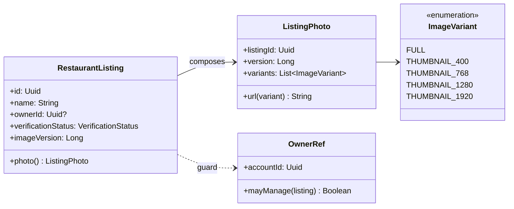

# SC-205 — Phase 1: Domain model

> **Purpose:** the photo, its owner rule and its version · **Derived from:** 00 · **Delta:** extends `RestaurantListing` with one attribute (`imageVersion`); one derived value `ListingPhoto`; no new aggregate

**ARCHITECTURE.md §1.2 impact: extends.** `RestaurantListing` gains one audit attribute, `imageVersion: Long`, and one derived value object, `ListingPhoto`. Ownership (`ownerId`) and `VerificationStatus` are unchanged; no state transition of the listing aggregate changes. The photo itself is not a domain entity — it is a set of stored objects whose *identity* is the listing id plus a version.

`ListingPhoto` is derived, not stored as a row: it exists only when the listing has a non-zero `imageVersion` and the stored variants exist. `imageVersion` is a monotonically increasing stamp (epoch millis of the last successful ingest), not a content hash — it exists so a URL changes when the bytes change.

## Invariants

| # | Invariant | Becomes test |
|---|---|---|
| INV-1 | A listing has at most one hero photo; a second upload replaces it (last write wins) | `AddListingImageTest.replacesThePreviousPhoto` |
| INV-2 | A successful upload makes `imageVersion` strictly greater than before | `AddListingImageTest.bumpsVersionOnSuccess` |
| INV-3 | Only the recorded `ownerId` may change a photo; a different account is refused and nothing is written | `AddListingImageTest.refusesNonOwner` (existing) |
| INV-4 | An unauthenticated request writes nothing and returns 401 before the route body is read | endpoint test (existing auth suite) |
| INV-5 | A rejected upload (bad bytes, oversized, non-owner, missing listing) leaves the previous bytes and `imageVersion` untouched | `AddListingImageTest.failedUploadLeavesVersionAndBytes` |
| INV-6 | Every variant of one photo is served under the same version | `ListingReadEndpointTest.srcsetSharesOneVersion` |
| INV-7 | The stored media type is derived from the bytes, never from the upload's `Content-Type` | `ListingImageEndpointTest.storedTypeComesFromBytes` (existing) |
| INV-8 | A photo URL's version is opaque and never changes after a successful commit | DTO test: two reads of an unchanged listing return identical URLs |
| INV-9 | A listing with no photo renders a labelled empty state, never a broken image | `PhotoSection.test.ts` empty state |
| INV-10 | Uploading again is idempotent in effect: one photo, one current version, no orphan rows | `AddListingImageTest.repeatUploadKeepsOnePhoto` |

## States

| From | Event | To | Guard |
|---|---|---|---|
| No photo (`imageVersion = 0`) | owner uploads a decodable image ≤ 8 MiB | Photo v1 | owner + bytes decodable + storage writes succeed |
| Photo v*n* | owner uploads another image | Photo v*n+1* | same guards; previous variants overwritten |
| Photo v*n* | owner uploads an undecodable / oversized file | Photo v*n* (unchanged) | rejection happens before the version stamp |
| Photo v*n* | non-owner uploads | Photo v*n* (unchanged) | 403 before any storage call |
| Photo v*n* | listing removed (SC-206 path) | No photo | out of this story's UI; DELETE endpoint exists |

## Glossary

| Term | Meaning |
|---|---|
| Hero photo | The one image a listing shows on cards and the detail page |
| Variant | One stored rendition: the FULL original or a fixed thumbnail width (400/768/1280/1920 px) |
| Photo version | `imageVersion` — the epoch-millis stamp of the last successful ingest; used as an opaque cache key in image URLs |
| Empty state | The labelled frame shown when a listing has no photo |
| Manage signal | The server's answer to "may this viewer change this listing's photo?" (D-2) |
| Owner | The account recorded in `restaurant_listings.owner_id` — never the client's claim |
| Last write wins | A second successful upload replaces the first; there is no gallery in this story |
