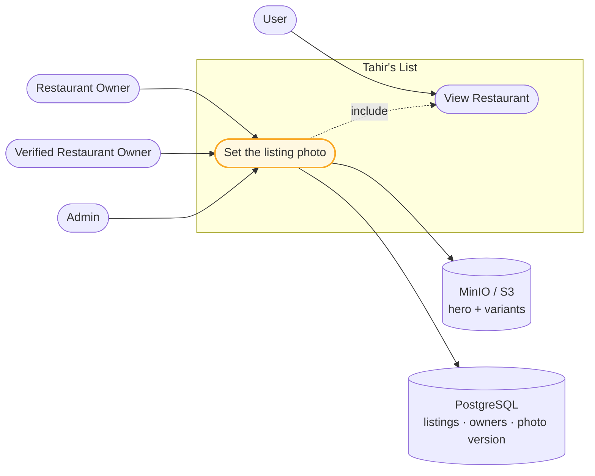
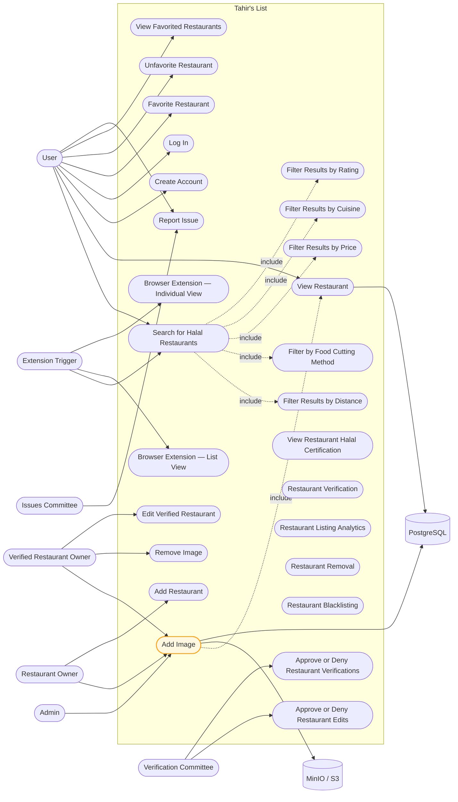

# SC-205 — Phase 3: Use case diagram

> **Purpose:** where the photo goal sits in the product's use-case model · **Derived from:** 02 · **Delta:** the existing *Add Image* goal becomes reachable from the web app; no new actor, no new use case

## Feature scope

`«include»`: the photo goal always needs the restaurant page rendered, so it includes *View Restaurant*. There is no `«extend»` — replace is a stored flow inside the same goal, not a variant use case (D-5), and SC-206's delete stays a separate goal.

**Two actors, one goal.** The owner sets their own listing's photo; the admin sets any listing's photo (AC-6). They are not separate bubbles because the goal and the system contract are identical — only the authorization differs, and that lives inside the use case. The admin role is new to the system (D-10), which is why this is a small product change, not just a UI one.

## System-wide (changed item amber; everything else unchanged)

| Mark | Meaning |
|---|---|
| Amber | Reached by real UI for the first time in SC-205 (the goal existed since SC-53; its backend is unchanged) |
| Solid arrow | Actor association / store access |
| Dotted arrow | `«include»` |

Every other bubble, actor and association is unchanged. `I2 Remove Image` keeps its own frontend story (SC-206) and is deliberately not amber.
