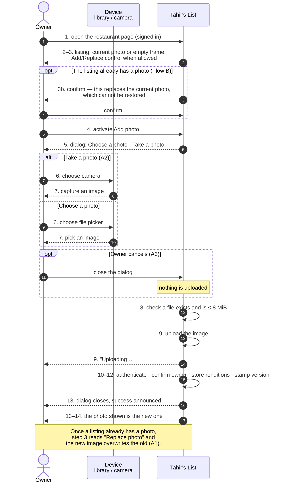
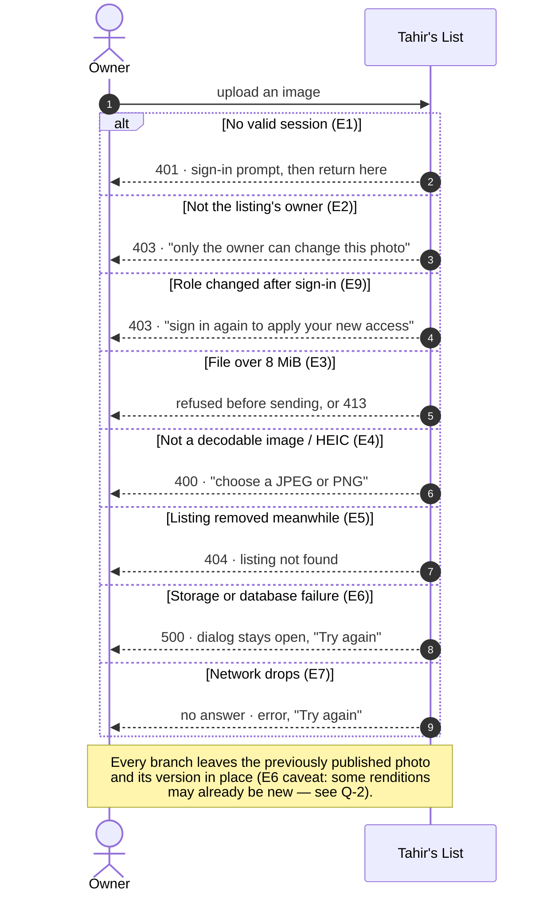
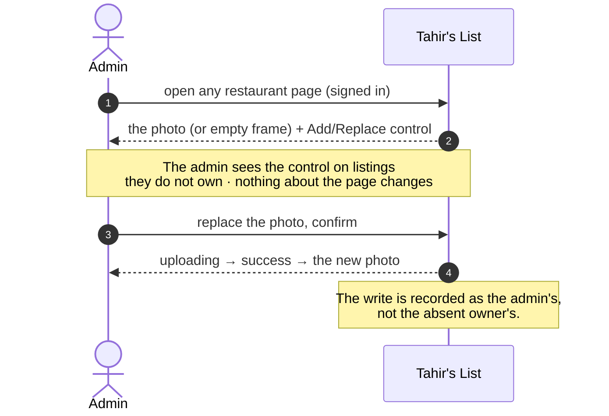

# SC-205 · UC-01 — Black-box sequence: add or replace the listing photo

> **Purpose:** what the owner and an outside observer see, with no internal names · **Derived from:** 02 UC-01 · **Delta:** one new interaction on the restaurant page

The only external participant is the owner's own device (photo library or camera); no third-party service is involved. Storage and the database are inside *Tahir's List* and stay invisible at this level.

| UC step | What is observable |
|---|---|
| 1–3 | The page renders one photo (or a labelled empty frame) and the control, for the owner **and for an admin** |
| 3b | Replacing discloses the loss before anything is uploaded |
| 4–7 | A dialog offers both sources; the device supplies the image |
| 8 | An oversized or missing file never leaves the browser |
| 9 | A visible uploading state; the actor cannot double-submit |
| 10–12 | Server-side decision: may *this* actor write, and are the bytes an image |
| 13–14 | The new photo is what the page shows, immediately and after a reload |

## The admin path, seen from outside

An admin on a listing with no owner sees exactly the same thing as an admin on an owned one; the owner's absence is invisible at this level.
