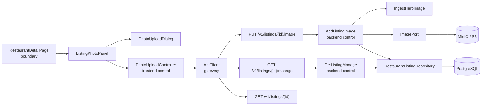
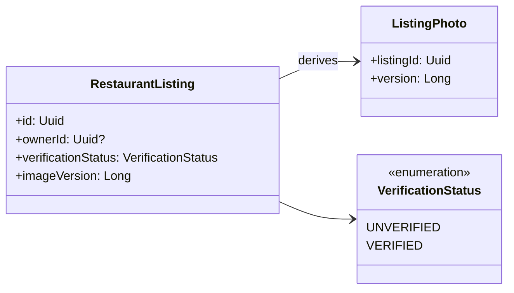
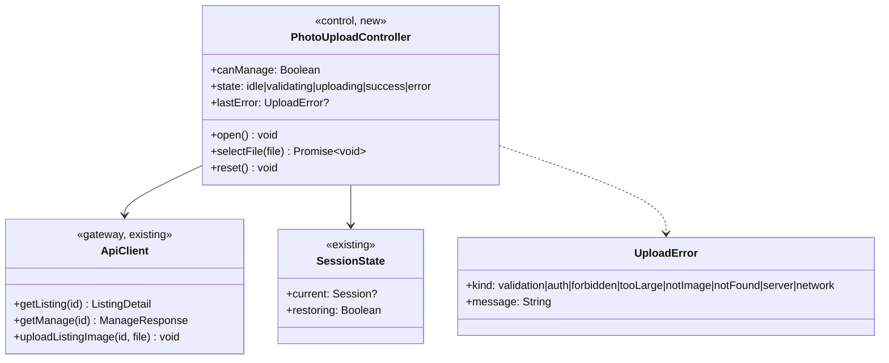
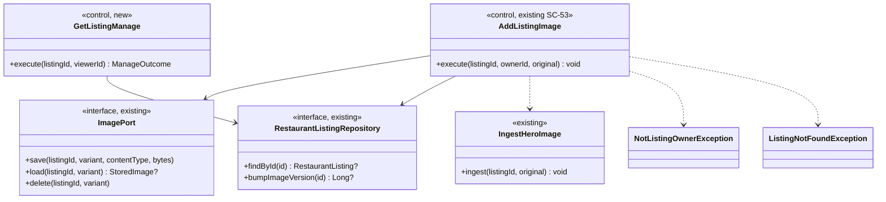
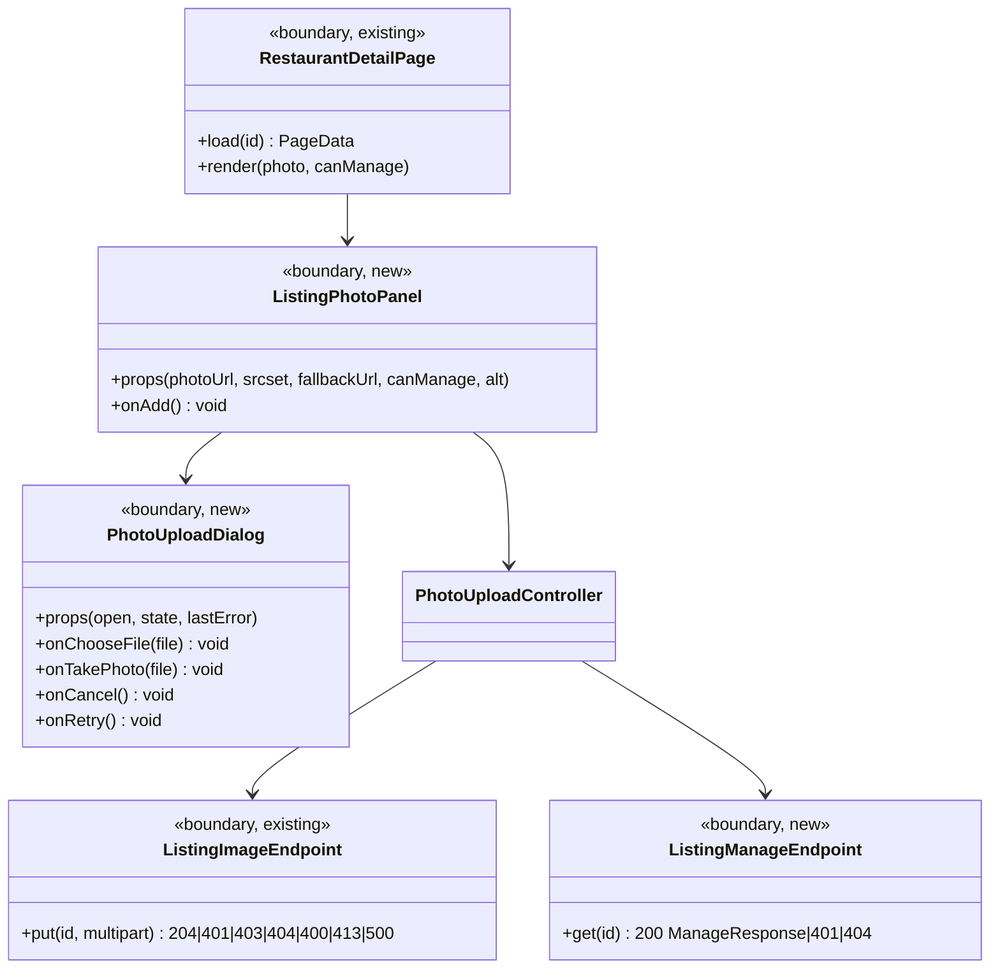

# SC-205 — Phase 5: System class diagram (conceptual)

> **Purpose:** the classes that serve UC-01, and nothing else · **Derived from:** 01–04 · **Delta:** +3 frontend classes (panel, dialog, controller), +1 backend control (`GetListingManage`), +2 client calls; existing upload use case reused and extended

## Overview

Two controls: `PhotoUploadController` owns the browser's state machine; `AddListingImage` owns the server's authorization and write. The `/manage` read is the only new endpoint (D-2).

## Domain (unchanged apart from one attribute)

## Application (frontend)

`PhotoUploadController` is a runes singleton scoped to the page, not a module-level store: the page owns one instance so SSR never shares upload state between requests.

## Application (backend)

`AddListingImage` keeps its guard order (exists → owner → decode → store → **stamp**). The stamp is last, so every failure path leaves the version untouched (INV-5).

## Boundary

## Ports and adapters

| Port | Operation | Adapter | Store / external |
|---|---|---|---|
| `ApiClient` (frontend gateway) | `uploadListingImage(id, file)` | `fetch` + `FormData`, same-origin `/v1` proxy | backend |
| `ApiClient` | `getManage(id)` | `fetch` GET, bearer token | backend |
| `RestaurantListingRepository` | `bumpImageVersion(id): Long?` | `ExposedRestaurantListingRepository` | PostgreSQL `restaurant_listings.image_version` |
| `ImagePort` (existing) | `save` / `load` / `delete` | `S3ImageStorage` | MinIO / S3 |
| `ImagePort` (existing) | same | `InMemoryImageStorage` (tests) | in-memory |
| `Clock` | `now()` | `kotlin.time.Clock` | — |

## Operation coverage

| UC step | Operation |
|---|---|
| 1–2 | `RestaurantDetailPage.load` → existing `getListing` + new `ApiClient.getManage` (only when a session exists) |
| 3 | `ListingPhotoPanel` renders photo or empty state; control iff `PhotoUploadController.canManage` |
| 4–5 | `PhotoUploadController.open` → `PhotoUploadDialog` (two inputs) |
| 6–7 | `PhotoUploadDialog.onChooseFile` / `onTakePhoto` |
| 8 | `PhotoUploadController.selectFile` → client size/type pre-check |
| 9 | `ApiClient.uploadListingImage` → `PUT /v1/listings/{id}/image` |
| 10 | Ktor `authenticate(JWT_AUTH_PROVIDER)` → `AddListingImage.execute` guard 1–2 |
| 11 | `IngestHeroImage.ingest` → `ImageResizer` → `ImagePort.save` ×5 |
| 12 | `RestaurantListingRepository.bumpImageVersion` → `204` |
| 13 | `ApiClient.getListing` re-read; versioned URLs from the DTO |
| 14 | `ListingPhotoPanel` shows the new URL; dialog closes; focus restored |
| A1 | step 3 label only; same operations |
| A2 | `onTakePhoto` uses the `capture="environment"` input |
| A3 | `PhotoUploadController.reset`; no request |
| E1 / E7 | `401` → controller `auth` error; sign-in link with `redirect` |
| E2 | `403 not_listing_owner` → controller `forbidden` error |
| E3 | client pre-check, or `413 payload_too_large` |
| E4 | `400 invalid_input` from `ImageResizer.contentType` |
| E5 | `404 not_found` |
| E6 | `500 internal_error`; controller `server` error, retry available |

**Existing collaborators reused unchanged:** `IngestHeroImage`, `ImagePort` + both adapters, `ListingImageEndpoint` route, `ListingReadDtos.imageUrl/srcset` (values only), `SessionState`, `RestaurantPhoto`.
