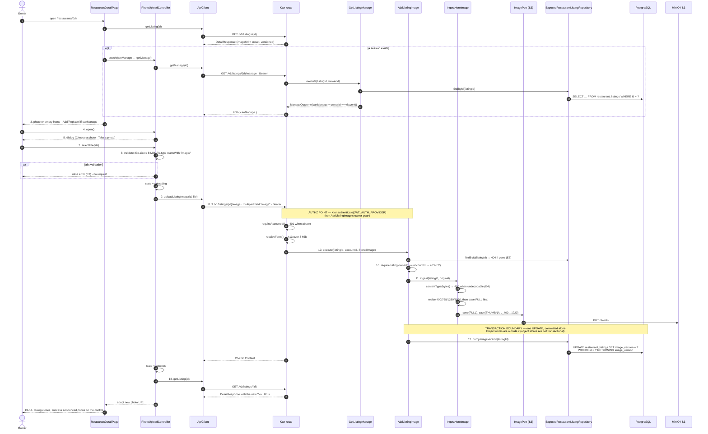
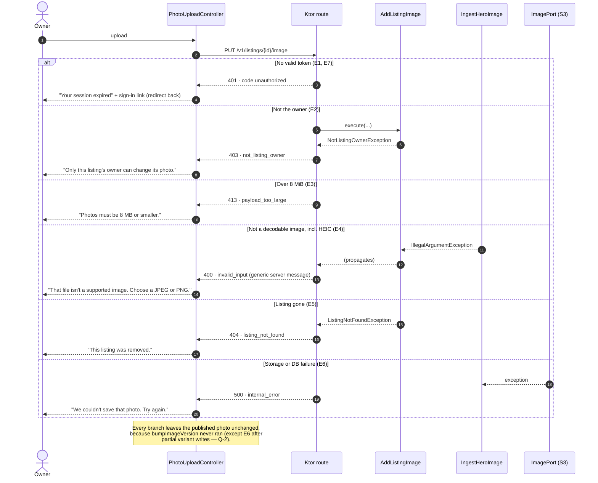

# SC-205 · UC-01 — White-box sequence: add or replace the listing photo

> **Purpose:** the real calls behind UC-01, 1:1 with Phase 4 · **Derived from:** 02, 04, 05 · **Delta:** one new endpoint, one new repository operation, one new column; storage path untouched

## Main flow

### State transition

`PhotoUploadController.state`: `idle → validating → uploading → success`, with `uploading → error → uploading` on retry and any state → `idle` on cancel. The listing's own transition is `imageVersion n → n+1`, written only by `bumpImageVersion` (INV-2).

### What the database sees

| Statement | When | Effect |
|---|---|---|
| `SELECT … FROM restaurant_listings WHERE id = ?` | manage read, and again inside `AddListingImage` | read only |
| `UPDATE restaurant_listings SET image_version = ? WHERE id = ? RETURNING image_version` | after every variant is stored | the only write in this story |
| object `PUT` ×5 | before the UPDATE | FULL + 4 thumbnails under the listing's key prefix |

## Failure paths

### Error mapping (the concrete value for each branch)

| Branch | Thrown / produced | HTTP | Code the client sees | Client copy |
|---|---|---|---|---|
| E1, E7 | `JwtAuthenticationProvider` rejects | 401 | `unauthorized` | session expired → sign in |
| E2 | `NotListingOwnerException` | 403 | `not_listing_owner` | owner-only message |
| E3 | `PayloadTooLargeException` (route) or client pre-check | 413 | `payload_too_large` | 8 MB limit |
| E4 | `IllegalArgumentException` from `ImageResizer.contentType` | 400 | `invalid_input` | supported formats |
| E5 | `ListingNotFoundException` | 404 | `listing_not_found` | listing removed |
| E6 | storage/DB exception | 500 | `internal_error` | retry |
| E7 (network) | `fetch` rejects | — | `network_error` (client-thrown) | retry |

The 400 body carries a **generic** server message by design (`WebApi` never echoes the raw reason), so the client owns the "choose a JPEG or PNG" copy.

### Authz and privacy notes

- Ownership is decided from `restaurant_listings.owner_id` and the verified JWT `sub` — never from a client-supplied id.
- `/v1/listings/{id}/manage` returns only a boolean for the *caller*; it never exposes `owner_id`, so the public detail payload stays viewer-independent and cacheable.
- The upload client sends the access token as `Authorization: Bearer` from memory; no token is written to storage.
- The browser never talks to MinIO: image bytes and credentials stay server-side.
