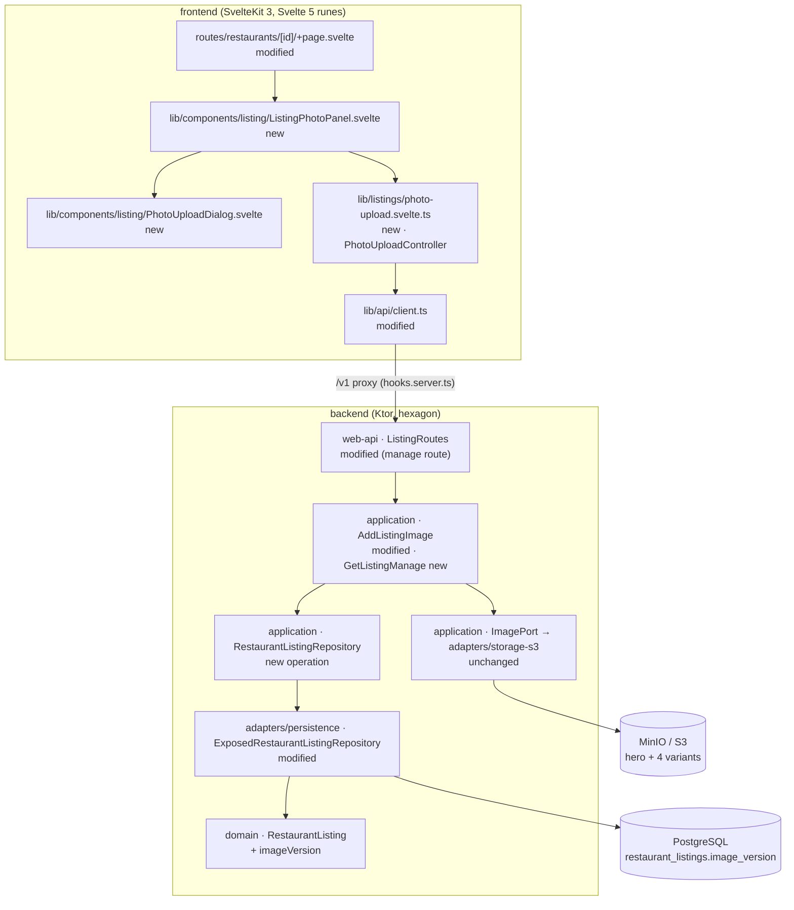

# SC-205 — Phase 7: Complete class diagram and deltas

> **Purpose:** the design being approved, with final names · **Derived from:** 01–06 · **Delta:** 1 migration column · 1 new endpoint · 3 new frontend classes · 5 modified files

## Layer map

The frontend reaches the backend only through the same-origin `/v1` proxy; no key or credential reaches the browser.

## Persistence delta

| Object | Change | Final name / shape |
|---|---|---|
| `restaurant_listings.image_version` | **new column** | `BIGINT NOT NULL DEFAULT 0`; `V25__sc_205_image_version.sql` sets `image_version = 1` on every existing row so old cached URLs are re-fetched once |
| `RestaurantListing` | **modified** | `val imageVersion: Long = 0`; `fromStorage(imageVersion: Long = 0)` |
| `RestaurantListingRepository` | **modified** | `suspend fun bumpImageVersion(id: Uuid): Long?` — returns the new version, `null` when the listing is gone |
| `ExposedRestaurantListingRepository` | **modified** | `LISTING_COLUMNS` + `toListing` read `image_version`; new `UPDATE … RETURNING image_version` |
| `AddListingImage` | **modified** | after `IngestHeroImage.ingest`, call `bumpImageVersion`; a `null` result means the listing vanished mid-write → `ListingNotFoundException` |
| `restaurant_listings` other columns | **unchanged** | photo bytes never enter PostgreSQL |
| existing migrations V1–V24 | **unchanged** | V25 is the next free number |

## API / OpenAPI delta

| Endpoint | Change | Contract |
|---|---|---|
| `GET /v1/listings/{id}/manage` | **new** | auth required · `200 {canManage: boolean}` · `401`, `404 listing_not_found`. Returns no owner id. |
| `GET /v1/listings/{id}` | **modified (values only)** | `imageUrl` and every `imageSrcset[].url` gain `&v=<imageVersion>` when the version is non-zero; field names, types and the schema are unchanged |
| `PUT /v1/listings/{id}/image` | **unchanged** | owner-only multipart, 204 |
| `DELETE /v1/listings/{id}/image` | **unchanged** | owner-only, 204 (SC-206 UI is out of scope) |
| `GET /v1/listings/{id}/image` | **unchanged** | `public, max-age=86400`; the `v` param is ignored by the route and only varies the cache key |
| `GET /v1/listings/search`, `GET /v1/listings` | **unchanged** | already carry versioned `imageThumbnailUrl` / `imageSrcset` through the same builder |
| `ErrorCodes.PAYLOAD_TOO_LARGE` | **unchanged (now consumed)** | already emitted by the route; the frontend type union gains it |

## Frontend delta

| File | Change | Responsibility |
|---|---|---|
| `frontend/src/lib/components/listing/ListingPhotoPanel.svelte` | **new** | the images section: hero photo or labelled empty frame; Add/Replace control; success announcement |
| `frontend/src/lib/components/listing/PhotoUploadDialog.svelte` | **new** | native `<dialog>`; *Choose a photo* / *Take a photo*; uploading, error and retry states; focus return |
| `frontend/src/lib/listings/photo-upload.svelte.ts` | **new** | `PhotoUploadController`: `canManage`, `state`, `lastError`, `open`, `selectFile`, `reset` |
| `frontend/src/lib/api/client.ts` | **modified** | `uploadListingImage(id, file)` (FormData, no JSON content-type), `getManage(id)`, `ApiErrorCode` += `payload_too_large` / `unauthorized` |
| `frontend/src/routes/restaurants/[id]/+page.svelte` | **modified** | render `ListingPhotoPanel` in place of the bare hero frame; pass `canManage` |
| `frontend/src/lib/api/schema.d.ts` | **regenerated** | `pnpm codegen:api` after the OpenAPI change — never hand-edited |
| `frontend/src/lib/listings/data.ts` | **unchanged** | `toRestaurant` already preserves `/v1` paths with their query string |
| `frontend/src/lib/components/listing/RestaurantPhoto.svelte` | **unchanged** | already handles srcset, fallback and on-error placeholder |

## Tests this design introduces

| Test | Proves |
|---|---|
| `PersistenceSchemaMigrationTest` (extension) | V25 column exists, defaults to 0, backfills 1 |
| `ExposedRestaurantListingRepositoryTest.bumpImageVersion*` | version increases; unknown id → null |
| `AddListingImageTest.bumpsVersionOnSuccess` / `failedUploadLeavesVersionAndBytes` | INV-2, INV-5 |
| `ListingReadEndpointTest.srcsetSharesOneVersion` | INV-6, AC-4 |
| `ListingManageEndpointTest` | 200 owner / 200 non-owner `{canManage:false}` / 401 / 404 |
| `PhotoUploadController.test.ts` | state machine, 8 MiB pre-check, each error mapping |
| `PhotoUploadDialog.test.ts` | both inputs, `capture="environment"`, focus return |
| `ListingPhotoPanel.test.ts` | empty state, control gating, success announcement (INV-9, AC-1, AC-2) |
| `restaurants/[id]/page.test.ts` (extension) | end-to-end page flow with a stubbed API (AC-3, AC-5) |

## Names that must not drift

`imageVersion`, `image_version`, `v` (query param), `canManage`, `PhotoUploadController`, `ListingPhotoPanel`, `PhotoUploadDialog`, `uploadListingImage`, `getManage`, `bumpImageVersion`, `GetListingManage`, `V25__sc_205_image_version.sql`. No counter-category vocabulary appears anywhere; the feature touches no halal attribute.
