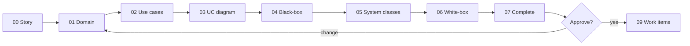

# Design walkthrough — SC-205 owner photo upload

> **Purpose:** the founder review surface · **Derived from:** 00–07 · **Delta:** 2 columns/constraints, 1 endpoint, 3 frontend classes, 1 new role
> Design commit: `5350b68` · Date: 2026-11-09 · Design PR: #88 · **Status: approved**

| Date | Change | Phases re-run |
|---|---|---|
| 2026-11-09 | Initial walkthrough | — |
| 2026-11-09 | **Admin override added (AC-6)**: `Role.ADMIN` (V26) + `PhotoWritePolicy` + attribution; add/replace written as two named flows (D-5); D-10…D-13 added | 00, 01, 02, 03, 04, 05, 06, 07 |



## 1. Story and domain model

**Shows:** one goal with two actors (owner, admin) — `RestaurantListing` gains `imageVersion`, and a single `Actor` value plus `PhotoWritePolicy` expresses who may write.
**Locks in:** one hero photo (last write wins), strictly increasing version, `role == ADMIN || accountId == ownerId` as the only rule, the role coming from the verified token, and an admin override being attributable.
**Need:** D-1 (durable version), D-10 (how an account becomes admin — **the role does not exist today**), D-13 (token claim vs database read).

## 2. Use cases

**Shows:** UC-01 with two actors and two named flows — **add** (no photo) and **replace** (photo exists, destructive, confirmed at 3b) — plus admin branches A4/A5 and the stale-role case E9.
**Locks in:** replace is not merely an add with a different label; it discloses that the old photo is destroyed. Every failure leaves the published photo untouched.
**Need:** confirm D-5 (one use case, two flows — not two use cases) and D-2.

## 3. Use case diagram

**Shows:** *Set the listing photo* reached by RO, VRO **and Admin**, `«include»`-ing *View Restaurant*; no new bubble for the admin, because the goal and contract are identical.
**Locks in:** scope — photos only for the admin (D-12); *Remove Image* stays SC-206.
**Need:** approve.

## 4. Black-box sequences

**Shows:** the owner's flow with the device as the only external participant, the replace confirmation, one fragment per exception, and a separate admin path where the page looks identical but the write is attributed to the admin.
**Locks in:** the admin sees no different UI; the ownerless listing case is invisible at this level.
**Need:** approve.

## 5. System class diagram

**Shows:** `PhotoUploadController` and `AddListingImage` as the two controls, `PhotoWritePolicy` as the single rule, `GetListingManage` as the one new read, `AuditRecorder` as the attribution seam.
**Locks in:** the button and the server ask the same policy object, so they cannot disagree; `owner_id` never leaves the server.
**Need:** D-2 (owner-or-admin signal) and D-11 (log vs table).

## 6. White-box sequences

**Shows:** the real calls with the authz point now `authenticate → Actor(sub, role) → PhotoWritePolicy`, the audit call only on an override, and the transaction boundary (one `UPDATE … RETURNING` after the object writes).
**Locks in:** the 401/403/413/400/404/500 table including E9, and the stated staleness bound for a role change.
**Need:** D-13 and D-6.

## 7. Complete class diagram (the design being approved)

**Shows:** the layer map, final names, V25 (`image_version`) and V26 (`ck_users_role` + `ADMIN`), the `/manage` contract, every frontend file, and the test that proves each invariant.
**Locks in:** V26 promotes nobody; there is no role-granting route; the frontend contains no role logic at all.
**Need:** approve, including D-1 … D-13.

## Decision items

| # | Question | Recommendation | Decision |
|---|---|---|---|
| D-1 | Make the photo version **durable** (`restaurant_listings.image_version`, V25, `&v=` on image URLs) instead of only cache-busting in the browser after upload | Yes — otherwise the owner refreshes and their new photo is invisible for up to 24 h (`max-age=86400`). Also fixes stale images after seed/ingest refreshes | _open_ |
| D-2 | Gate the control on a dedicated authenticated `GET /v1/listings/{id}/manage → {canManage}` instead of showing it to every signed-in user and mapping the 403 | Yes — the signal now answers *owner or admin*, leaks no owner id, and stops offering a control that will fail | _open_ |
| D-3 | Two inputs in one dialog — file picker (`accept="image/*"`) and camera (`accept="image/*" capture="environment"`) — rather than `getUserMedia` | Yes — no permission prompt, no preview component, documented mobile path | _open_ |
| D-4 | Native `<dialog>` + `showModal()` for the upload sheet | Yes — built-in focus trap and Esc handling; shadcn-svelte is disabled | _open_ |
| D-5 | **One use case with two named flows** (add, replace) rather than two use cases | Yes — same actor goal and same `PUT` contract; replace is destructive but mechanically identical. Split only if replace later gains history, review or a different actor | _open_ |
| D-6 | Accept that a storage failure can leave some variants newer than others; no revert work item | Accept — the version stamp does not advance, and a retry overwrites every variant | _open_ |
| D-7 | `PUT` keeps `204`; the client re-reads the detail for the new versioned URLs | Yes — no response-schema change | _open_ |
| D-8 | HEIC uploads (iPhone default) are rejected with explicit copy; no client transcoding | Yes, for this story | _open_ |
| D-9 | Enable the `svelte` MCP before the frontend work items | Yes — it was absent from this worktree's catalog | _open_ |
| D-10 | **Create the `ADMIN` role.** Add it to `Role`, extend `ck_users_role` (V26), promote the founder's account by a documented operator step. No promotion endpoint, no self-service, no default admin | Yes — with the promotion runbook written before implementation, because without it AC-6 cannot be exercised in production | _open_ |
| D-11 | Attribution for an admin override: structured log line now, or a persisted `listing_image_audit` row (V27) from the start | Log now, table if the founder wants a durable trail — a log is cheap but not queryable by the committee | _open_ |
| D-12 | Does "admin may freely modify **listings**" belong in this story? | No — this story covers photos only. Content edit (`PATCH`), removal and claims are a separate story with their own guards and audit | _open_ |
| D-13 | Role authority: the verified JWT `role` claim (bounded staleness: effective at the next refresh) vs reading `users.role` on every write (immediate, one extra query) | Token claim — consistent with the committee route and the existing auth model; the bound is documented in INV-13 | _open_ |

## Environment note

This design was produced in the `sc-201-location-search` worktree; the `basic-memory` MCP was not available in that session catalog, so the KB was consulted from the main checkout before the move and no KB write was possible from here. That gap is recorded rather than hidden.

## Approval

```
Approved by: founder (Arham) · Date: 2026-11-09 · Design commit: 5350b68 · Design PR: #88
Decision items: D-1 … D-13 resolved as tabled, with these founder calls:
  D-10  promote by a one-line operator SQL runbook (no endpoint)
  D-11  structured log line now; no audit table in this story
  D-13  the verified JWT role claim is the authority (bounded staleness accepted)
```

Work items (`09`) and traceability (`10`) are written only after this line exists, and append to this PR. Implementation starts on `feat/SC-205-photo-upload` from `main` once the design PR merges.
