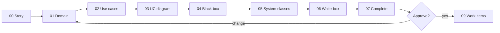

# Design walkthrough — SC-205 owner photo upload

> **Purpose:** the founder review surface · **Derived from:** 00–07 · **Delta:** 1 column, 1 endpoint, 3 frontend classes
> Design commit: _(filled on push)_ · Date: 2026-11-09 · **Status: awaiting approval**



## 1. Story and domain model

**Shows:** one owner-initiated goal; `RestaurantListing` gains `imageVersion`; the photo is a derived `ListingPhoto` of FULL + four thumbnail variants, not a new aggregate.
**Locks in:** one hero photo per listing (last write wins), strictly increasing version, owner-only writes, and a rejected upload never moves the version.
**Need:** approve D-1 (durable version) — without it, "show the new image" is only true until the next reload.

## 2. Use cases

**Shows:** UC-01 as 14 numbered steps with three alternates (replace, camera, cancel) and eight exception branches, each mapped to a resulting state.
**Locks in:** the UI never writes directly; every failure path leaves the published photo untouched; the ACs map to specific steps.
**Need:** confirm D-2 (who sees the control) and D-8 (HEIC is rejected, not transcoded).

## 3. Use case diagram

**Shows:** *Add Image* reached from the web app for the first time, `«include»`-ing *View Restaurant*; no new actor, and *Remove Image* deliberately stays untouched (SC-206).
**Locks in:** scope — no gallery, no delete UI, no new persona.
**Need:** approve.

## 4. Black-box sequences

**Shows:** the owner's view with the device (library/camera) as the only external participant, plus one fragment per exception in the failure diagram.
**Locks in:** the observable contract — control only when allowed, uploading state, success announcement, and exactly one photo after any number of attempts.
**Need:** approve.

## 5. System class diagram

**Shows:** `PhotoUploadController` (browser) and `AddListingImage` (server) as the two controls; `GetListingManage` as the one new backend control; `ImagePort` and the object store untouched.
**Locks in:** the manage signal is a boolean for the caller only — no `owner_id` leaves the server; the upload endpoint's shape does not change.
**Need:** confirm D-2 and D-7 (204 + re-read, rather than a richer PUT response).

## 6. White-box sequences

**Shows:** the real operations with the **authz point** (JWT → `AddListingImage` owner guard) and the **transaction boundary** (one `UPDATE … RETURNING`, after all object writes).
**Locks in:** the error table (401/403/413/400/404/500), the generic-400 copy rule, and that no DB transaction wraps object storage.
**Need:** confirm D-6 (accept the partial-variant window on storage failure).

## 7. Complete class diagram (the design being approved)

**Shows:** the layer map, final names, V25 schema, endpoint contract, frontend files, and the test that proves each invariant.
**Locks in:** `image_version` is the only schema change; one new endpoint; image URLs gain an opaque `&v=`; existing endpoints' shape is unchanged.
**Need:** approve, including D-1 … D-8.

## Decision items

| # | Question | Recommendation | Decision |
|---|---|---|---|
| D-1 | Make the photo version **durable** (`restaurant_listings.image_version`, V25, `&v=` on image URLs) instead of only cache-busting in the browser after upload | Yes — otherwise the owner refreshes and their new photo is invisible for up to 24 h (`max-age=86400`). Also fixes stale images after seed/ingest refreshes | _open_ |
| D-2 | Gate the control on a dedicated authenticated `GET /v1/listings/{id}/manage → {canManage}` instead of showing it to every signed-in user and mapping the 403 | Yes — the edit screen (SC-47/48) shows its control to everyone and fails late; a boolean is cheap, leaks no owner id, and can later gate Edit too | _open_ |
| D-3 | Two inputs in one dialog — file picker (`accept="image/*"`) and camera (`accept="image/*" capture="environment"`) — rather than `getUserMedia` | Yes — `getUserMedia` needs a permission prompt and a live preview component; the file input with `capture` is the documented mobile path and needs no new code path on desktop | _open_ |
| D-4 | Native `<dialog>` + `showModal()` for the upload sheet | Yes — built-in focus trap and Esc handling, no dependency; shadcn-svelte is disabled and this screen needs none of its parts | _open_ |
| D-5 | One use case, with *replace* as an alternate flow | Yes — same actor goal and same server operation; a second UC would duplicate 12 steps | _open_ |
| D-6 | Accept that a storage failure can leave some variants newer than others; no revert work item | Accept for now — object storage has no transaction; the version stamp still does not advance, so clients keep the old URL, and a retry overwrites every variant. Logged as a follow-up candidate | _open_ |
| D-7 | `PUT` keeps `204`; the client re-reads `GET /v1/listings/{id}` to obtain the new versioned URLs | Yes — no response-schema change, and the re-read refreshes any other field that changed | _open_ |
| D-8 | HEIC uploads (iPhone default) are rejected with explicit copy; no client-side transcoding | Yes, for this story — `ImageResizer` (JDK ImageIO) cannot decode HEIC; transcoding needs a WASM dependency in the bundle. Offer "Choose a photo" copy that names JPEG/PNG | _open_ |
| D-9 | Implementation needs the `svelte` MCP (registered but disabled, and absent from this worktree's session catalog) | Enable it before the frontend WIs; otherwise the component work is written against repo convention alone | _open_ |

## Environment note

This design was produced in the `sc-201-location-search` worktree; the `basic-memory` MCP was not available in that session catalog, so the KB was consulted from the main checkout before the move and no KB write was possible from here. That gap is recorded rather than hidden.

## Approval

```
Approved by: ________ · Date: ________ · Design commit: ________ · Design PR: #____
Decision items: D-1 … D-9 resolved as tabled / amended: ________
```

Work items (`09`) and traceability (`10`) are written only after this line exists, and append to this PR. Implementation starts on `feat/SC-205-photo-upload` from `main` once the design PR merges.
