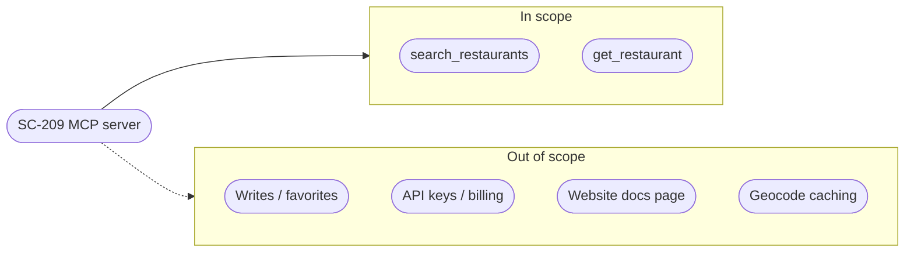

> **Purpose:** lock the Shortcut requirement and its verbatim ACs · **Derived from:** Shortcut SC-209 · **Delta:** new MCP channel for the existing Search/View use cases

# 00 — Story lock: SC-209

| Field | Value |
|---|---|
| Story | [SC-209 — Search for halal restaurants from AI agents (MCP server)](https://app.shortcut.com/halal-food-finder/story/209) |
| Type | Feature |
| Epic | [M2 Agent & API Surface (207)](https://app.shortcut.com/halal-food-finder/epic/207) |
| Iteration | [M2 Sprint 1 — Agent API (MCP) (208)](https://app.shortcut.com/halal-food-finder/iteration/208) |
| State | Ready for Development at creation; Shortcut auto-moved it to In Development when the design branch linked |
| Owner | Arham |
| Priority | Proposed first in the iteration. Prioritization docs not discoverable (G-2 / D-2) |
| Personas | U (User) via an AI agent client (supporting external actor — D-9) |

**Context:** the public search exists but needs a bespoke HTTP integration and
exact coordinates; MCP exposes search and detail as agent tools.

## Acceptance criteria (verbatim)

| AC | Criterion (verbatim from Shortcut) |
|----|-----------------------------------|
| AC-1 | **Transport & discovery.** A remote MCP client completes an MCP session over Streamable HTTP against `POST /mcp` without authentication, and `tools/list` returns exactly `search_restaurants` and `get_restaurant`. Each tool declares a JSON Schema object `inputSchema` and an `outputSchema`, and a description that explains halal-domain terms (hand-cut, verification status, halal scope) for a model with no domain context. |
| AC-2 | **Search by coordinates.** `search_restaurants` accepts `center` (lat/lng) and `radiusMiles` (> 0) and returns the listings within the straight-line radius, ordered by distance ascending. Each result exposes id, name, address parts (address/city/province/postal/country), lat, lng, distanceMiles, cuisine, isHandCut (`true\|false\|null`), halalScope (`FULLY_HALAL\|PARTIALLY_HALAL\|NOT_DISCLOSED`), isDelivery (`true\|false\|null`), verificationStatus (`VERIFIED\|UNVERIFIED`), rating (number\|null) and websiteUrl. |
| AC-3 | **Search by place.** When `place` is supplied instead of `center`, the server geocodes it server-side via the existing geocoder port and searches around the resolved point. An unresolvable place returns a tool error (`isError=true`) telling the caller to try a nearby city or provide lat/lng. A geocoder outage returns a distinct, actionable error recommending lat/lng. |
| AC-4 | **Filter parity.** The tool supports `handCutOnly` (extra on/off filter; `true` excludes unknown and not-hand-cut), `deliveryOnly`, `cuisines` + `cuisineLogic` (AND/OR, default OR), `minPrice`/`maxPrice` (0..Price.MAX, min <= max), `minRating` (0..5), `limit` (1..100, default 20), `offset` (>= 0) with the **same semantics as the public REST search**. Every invalid value returns an actionable tool error — never a protocol-level failure or 500. |
| AC-5 | **Detail.** `get_restaurant` takes a listing id and returns the full listing detail including `crossContamination` and, for a VERIFIED listing with an approved certificate, the certificate facts (certifier, reviewedOn, expiresOn, certificateUrl) plus imageUrl. An unknown or malformed id returns a tool error stating the restaurant was not found, without leaking internal detail. |
| AC-6 | **Public access & rate limiting.** The endpoint requires no JWT or API key. Requests beyond the configured per-client budget are rejected with HTTP 429 **before tool execution** (no database or geocoder work for rejected calls). The budget is configuration-driven. |
| AC-7 | **Origin/CORS conformance.** The MCP endpoint validates the `Origin` header as required by the MCP Streamable HTTP specification and supports browser-based MCP clients (e.g. MCP Inspector), while non-browser agents that send no `Origin` are unaffected. |
| AC-8 | **No REST regression.** `GET /v1/listings/search` and `GET /v1/listings/{id}` behavior (status codes, bodies, ordering, validation) is unchanged; their existing tests pass unmodified. |
| AC-9 | **Protocol robustness.** Malformed JSON-RPC, unknown methods/tools, missing or invalid tool arguments, and oversized request bodies produce spec-conformant JSON-RPC errors or `isError` tool results, with no internal exception text, stack traces, or server paths. |
| AC-10 | **Operability.** The server advertises the correct implementation name/version; every tool call is logged with tool name, outcome and duration (no PII); the stateless endpoint requires no session state and survives concurrent calls. |

## Edge cases

| Area | Cases |
|---|---|
| Input | both place and center; neither; radius zero/negative/NaN; limit 0/101; negative offset; minPrice > maxPrice; rating outside 0..5; blank/over-long cuisine |
| Results | unknown cuisine → empty success; null hand-cut/delivery/rating; empty set → count 0; full page → nextOffset |
| Trust data | PARTIALLY_HALAL + VERIFIED; VERIFIED without an approved archived certificate → no certificate block |
| Transport | no Origin; disallowed Origin; concurrent stateless calls; no `Mcp-Session-Id`; nth/n+1 rate-limit boundary |
| Content | prompt-injection attempts in listing text (treated as data) |
| Detail | malformed or non-existent UUID |

## Definition of done

- Design package approved by the founder before implementation; backend TDD.
- Containerized suites green; PR convergence with Omar (security) and Yusuf (QA).
- Merged and verified on dev.tahirslist.com; then the story moves to Done.

## Open questions

| ID | Unknown | Owner | Needed by |
|----|---------|-------|-----------|
| U-1 | Which prioritization document applies; where SC-209 sits against it (docs search returned none). | Adnan | Before implementation |
| U-2 | README persona table has no "AI agent"; confirm supporting actor only (D-9). | Founder / Adnan | Design approval |
| U-3 | Final per-client rate budget and Origin allow-list (D-3, D-4). | Omar | Design approval |
| U-4 | SDK protocol support and ContentNegotiation coexistence (WI-01 spike, D-11). | Hamza | Implementation start |
| U-5 | Production public web/API base URLs (D-10). | Founder / Adnan | Deploy |

## Story-lock checks

- [x] Story exists in Shortcut, in an epic (207) and an iteration (208).
- [x] ACs are testable and numbered (AC-1 … AC-10).
- [x] Edge cases listed.
- [x] Every unknown has an owner and a "needed by".
- [x] Requirement provenance recorded; nothing invented beyond the approved session.
