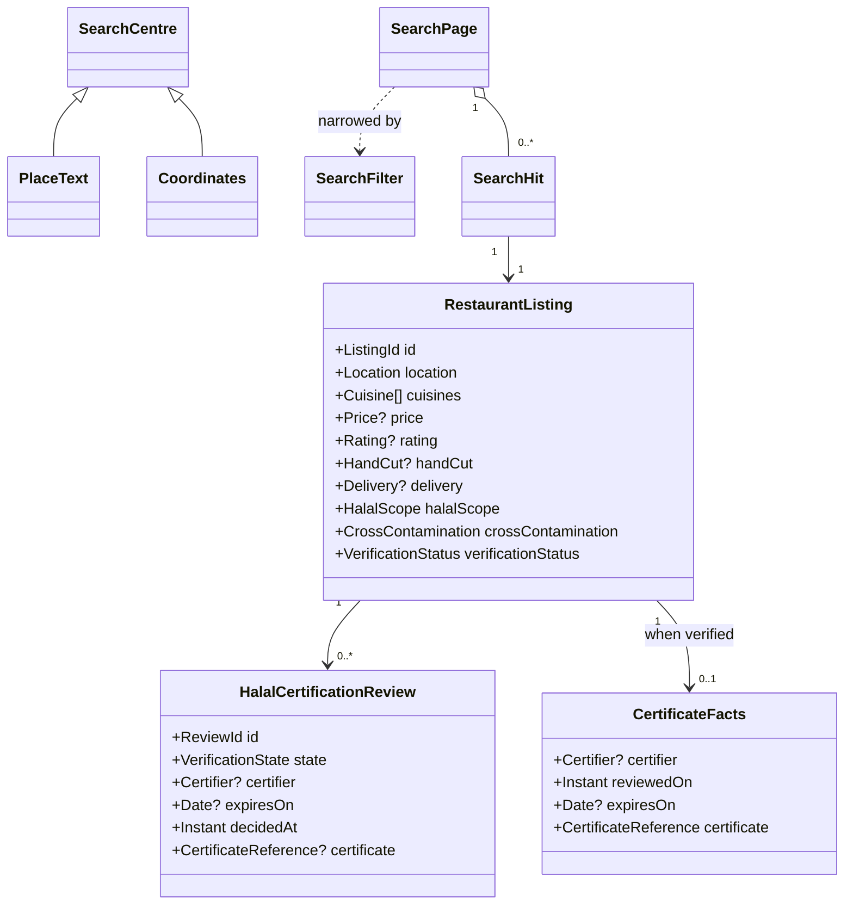

> **Purpose:** show the read-side model this feature touches · **Derived from:** 00 · **Delta:** none — no persisted model change; new read-side vocabulary only

# 01 — Domain model: SC-209

## Entities

| Entity | Role | Lifecycle |
|---|---|---|
| Restaurant listing | Aggregate root; search and detail target | Created unverified → edited → verified; **never mutated by this feature** |
| Halal certification review | Entity; source of certificate facts | SUBMITTED → AI_REVIEW → AI_SUGGESTED → HUMAN_REVIEW → APPROVED/DENIED (+REVERSED); read-only here |
| Location (lat/lng) | Value object; listing point and search centre | Immutable |
| Cuisine | Value object; normalised, ≤ 64 chars | Immutable |
| Price | Value object; positive, ≤ 100000, optional | Immutable |
| Rating | Value object; 0..5, optional | Immutable |
| Hand-cut status | Tri-state boolean; true = Zabiha claim | Immutable |
| Delivery status | Tri-state boolean; delivery is the extra claim | Immutable |
| Halal scope | Fully / partially / not disclosed | Immutable |
| Halal item set | Which items are halal (partial listings) | Immutable |
| Cross-contamination state | Enum; only "no cross-contamination" is indexed | Immutable (index gate) |
| Verification status | Unverified / verified | Immutable per read |
| Search centre (new) | Place text or coordinates | Per request; not persisted |
| Place resolution (new) | Place text → point | Per request; not persisted |
| Radius / distance (new) | Statute miles | Per request; not persisted |
| Certificate facts (new) | Read model derived from the latest approved review | Derived per read |
| Agent tool call (new) | Protocol concept, not domain | Per request |

## Invariants

| # | Invariant | Becomes test |
|---|---|---|
| INV-01 | Only no-cross-contamination listings are searchable. | `McpSearchPostgisTest.indexGateExcludesCrossContamination` |
| INV-02 | Results are ordered by straight-line distance ascending; metres ÷ 1609.344. | `McpSearchPostgisTest.filtersAndOrdersByDistance` |
| INV-03 | A radius of zero or less is a caller error; no search. | `SearchRestaurantsToolTest.rejectsNonPositiveRadius` |
| INV-04 | Page size 1..100; offset ≥ 0. | `SearchRestaurantsToolTest.rejectsLimitOutsideOneToOneHundred` |
| INV-05 | Hand-cut-only excludes unknown and false; absent means any. | `McpSearchPostgisTest.handCutOnlyExcludesUnknownAndFalse` |
| INV-06 | Delivery-only follows the same tri-state pattern. | `SearchRestaurantsToolTest.preservesTriStateHandCutAndDelivery` |
| INV-07 | Cuisine OR = any, AND = all; no-cuisine listings never match. | `McpSearchPostgisTest.cuisineAndOrSemantics` |
| INV-08 | Price bounds 0..100000, min ≤ max; unknown price never matches. | `McpSearchPostgisTest.priceAndRatingExcludeUnknowns` |
| INV-09 | Rating 0..5; unknown rating never matches. | `McpSearchPostgisTest.priceAndRatingExcludeUnknowns` |
| INV-10 | "No match" and "provider unavailable" are distinct outcomes. | `SearchListingsForAgentTest.geocoderOutageIsDistinctAndActionable` |
| INV-11 | Certificate facts only for verified + latest approved + archived key. | `GetRestaurantToolTest.unverifiedOrUnapprovedOmitsCertificate` |
| INV-12 | Halal scope and verification status are orthogonal. | `GetRestaurantToolTest.partialHalalReportsScopeAndItems` |
| INV-13 | No agent-facing operation mutates anything. | `McpDiscoveryTest.listsExactlyTwoTools` |
| INV-14 | A refused request performs no geocoding, read or tool execution. | `McpRateLimitTest.rejectsBeyondBudgetBeforeToolExecution` |
| INV-15 | Unknown hand-cut/delivery/rating stay unknown (null), never false/0. | `SearchRestaurantsToolTest.preservesTriStateHandCutAndDelivery` |

## States

| From | Event | To | Guard |
|---|---|---|---|
| SUBMITTED | claim persisted | AI_REVIEW | review created |
| AI_REVIEW | AI verdict returned | AI_SUGGESTED | provider answered |
| AI_SUGGESTED | reviewer opens | HUMAN_REVIEW | committee role |
| HUMAN_REVIEW | approve | APPROVED | committee role |
| HUMAN_REVIEW | deny | DENIED | committee role |
| APPROVED | reverse | REVERSED | committee role |
| — | — | — | Search is stateless: **no new state machine** |

## Glossary

| Term | Meaning |
|---|---|
| AI agent | Software acting for a user; a supporting external actor, not a persona |
| MCP | Model Context Protocol; the JSON-RPC protocol used to discover and call tools |
| Tool | A named, model-callable read operation exposed over MCP |
| Structured content | Machine-readable tool output (not prose) |
| Place | Free-text location input resolved to coordinates before searching |
| Search centre | The point a radius is measured from (resolved place or coordinates) |
| Straight-line distance | Great-circle distance in statute miles; not driving distance |
| Hand-cut (Zabiha) | Hand-slaughtered meat; a listing claims it or not, and may be unknown |
| Verification status | Whether Tahir's List reviewed and approved the certification; unverified ≠ not halal |
| Halal scope | Whole establishment / some items / not disclosed |
| Cross-contamination | Whether halal food may contact non-halal; only "no" is indexed |
| Certificate facts | Certifier, review date, expiry and archived reference for a verified listing |
| Index-qualified | Eligible for search (no cross-contamination) |

**`ARCHITECTURE.md` §1.2 impact: none** — nothing persisted; §1.0 gains the MCP delivery row (D-1); agent is a supporting actor (D-9).
