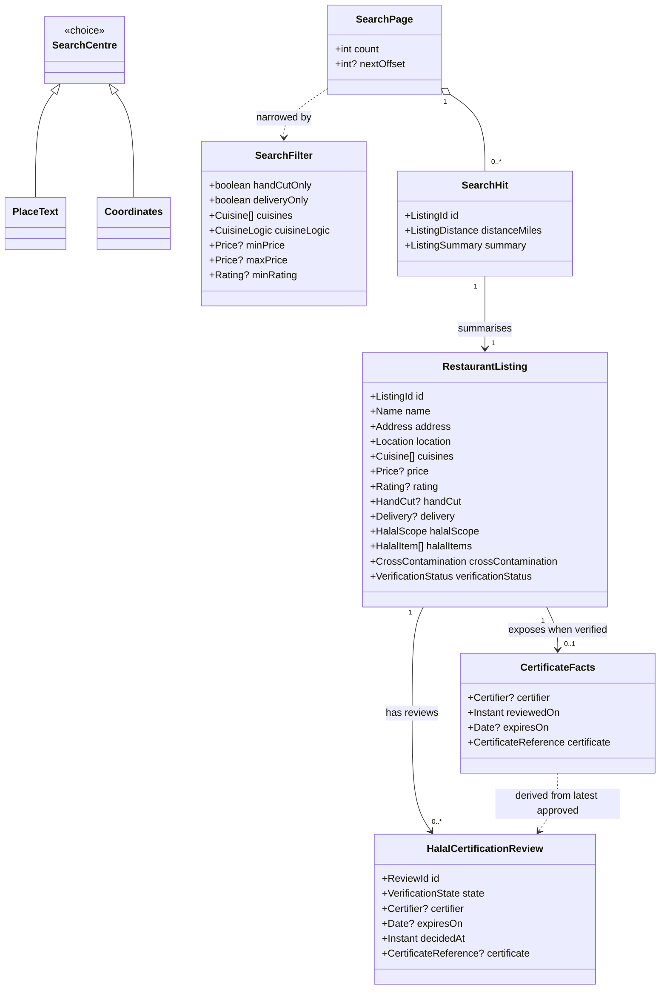

# 01 — Domain model: SC-209 (MCP search for AI agents)

Technology-free. Nouns and rules only: no tables, HTTP, frameworks or class
names from the implementation.

## 1. Scope of the model change

**`ARCHITECTURE.md` §1.2 is unchanged.** This feature adds no aggregate, entity,
value object or domain event to the agreed model. It is a new *way to read*
existing concepts (a restaurant listing and its certification facts) and a new
*external actor* (an AI agent acting for a user).

What this feature does add to the agreed architecture is a delivery decision —
an MCP server embedded in the backend — which belongs in `ARCHITECTURE.md` §1.0,
not §1.2. That ratification is open (U-2 in the walkthrough).

## 2. Aggregates, entities and value objects (existing, reused)

| Concept | Kind | Role in this feature |
|---------|------|----------------------|
| **Restaurant listing** | Aggregate root (existing) | The thing searched and read. Carries name, address, location, cuisine, price, rating, hand-cut flag, delivery flag, halal scope, halal items, cross-contamination state and verification status. |
| **Halal certification review** | Entity (existing) | Source of the certificate facts displayed for a verified listing. |
| **Location** (latitude/longitude) | Value object (existing) | A listing's point and the resolved search centre. |
| **Cuisine** | Value object (existing) | Free-form, normalised (trimmed, lowercase, ≤ 64 chars); a listing may have several. |
| **Price** | Value object (existing) | Positive, bounded (≤ 100000); absent means "unknown". |
| **Rating** | Value object (existing) | Closed 0..5 scale; absent means "unknown". |
| **Hand-cut status** | Tri-state boolean (existing) | true = claims hand-cut (Zabiha); false = not hand-cut; unknown = not claimed. There is **no machine-cut concept**. |
| **Delivery status** | Tri-state boolean (existing) | true = offers delivery; false = pickup only; unknown = not claimed. |
| **Halal scope** | Enumeration (existing) | Fully halal / partially halal / not disclosed. Orthogonal to verification. |
| **Cross-contamination state** | Enumeration (existing) | Only "no cross-contamination" qualifies for the search index. |
| **Verification status** | Enumeration (existing) | Unverified / verified. |
| **Halal item set** | Value objects (existing) | Which items are halal for a partially halal listing (detail only). |

## 3. Concepts new to this feature (read-side vocabulary, not persisted)

| Concept | Kind | Meaning |
|---------|------|---------|
| **Search centre** | Choice | Either *place text* ("Chicago", "78704") that must be resolved to a point, or *coordinates* supplied directly. |
| **Place resolution** | Read operation | Turning place text into a point. Two failure modes are distinct: *no match* and *provider unavailable*. |
| **Search radius** | Value | Positive distance in **statute miles**. |
| **Listing distance** | Value | Straight-line (great-circle) distance from the search centre to a listing, in miles. Not travel distance. |
| **Search filter** | Value (existing) | Optional narrowing: hand-cut only, delivery only, cuisines + logic, price range, minimum rating. |
| **Search page** | Value | Ordered results plus a hint for the next page (offset + page size reached). |
| **Certificate facts** | Read model | The certifier, review date, expiry date and archived certificate reference for a verified listing's latest approved certificate review. |
| **Agent tool call** | Protocol concept (not domain) | A request from an AI agent client to perform a named read operation with a structured argument set. |
| **AI agent client** | External actor | Software acting for a user; not a system persona (see U-2). |

No new persisted state exists: the feature is read-only and stateless.

## 4. Conceptual model

## 5. Invariants

Each is written so it can become a test name.

- **INV-01 — Index gate.** A search never returns a listing whose
  cross-contamination state is not "no cross-contamination".
- **INV-02 — Distance order.** Results are ordered by straight-line distance
  ascending; the distance is great-circle miles (metres ÷ 1609.344).
- **INV-03 — Positive radius.** A radius of zero or less is a caller error; no
  search is performed.
- **INV-04 — Bounded page.** The page size is between 1 and 100; the offset is
  non-negative.
- **INV-05 — Hand-cut is an extra filter.** When hand-cut-only is requested, a
  listing qualifies only if it claims hand-cut; unknown and not-hand-cut are
  excluded. When not requested, every hand-cut status qualifies.
- **INV-06 — Delivery follows the same pattern.** Delivery-only excludes unknown
  and pickup-only; absent means any.
- **INV-07 — Cuisine logic.** With OR (default), a listing qualifies if it has
  any selected cuisine; with AND, only if it has all selected cuisines. A listing
  with no cuisine never qualifies once a cuisine filter is present.
- **INV-08 — Price bounds.** A price bound is non-negative and ≤ 100000; both
  bounds together require min ≤ max. A listing with no known price never
  qualifies once a price filter is present.
- **INV-09 — Rating bounds.** Minimum rating is on the closed 0..5 scale. A
  listing with no known rating never qualifies once a rating filter is present.
- **INV-10 — Place resolution is distinct from outage.** "No match" and
  "provider unavailable" are different outcomes with different guidance to the
  caller.
- **INV-11 — Certificate visibility.** Certificate facts exist only for a
  verified listing whose latest approved review carries an archived certificate
  reference. Nothing else is advertised.
- **INV-12 — Scope is not verification.** A partially halal listing may be
  verified; a verified listing is not necessarily fully halal. The two are never
  collapsed into one tag.
- **INV-13 — Read-only agent surface.** No agent-facing operation mutates
  listings, certifications, favorites, accounts or reviews.
- **INV-14 — No work when refused.** A rate-limited or origin-refused request
  performs no geocoding, no database read and no tool execution.
- **INV-15 — Unknown is visible.** Unknown hand-cut, delivery and rating are
  reported as unknown — never silently coerced to false or zero.

## 6. State machines

**None added.** Search and detail reads are stateless; there is no lifecycle and
no per-caller session. The existing certification review state machine
(`SUBMITTED → AI_REVIEW → AI_SUGGESTED → HUMAN_REVIEW → APPROVED/DENIED`, plus
`REVERSED`) is unchanged, and this feature only *reads* its outcome.

## 7. Glossary (terms the use cases use)

- **AI agent / agent client** — software acting for a user (e.g. an assistant
  connected to the MCP server). It is a supporting external actor, not a persona.
- **MCP** — Model Context Protocol; the JSON-RPC protocol an agent uses to
  discover and call tools.
- **Tool** — a named, model-callable read operation exposed over MCP.
- **Structured content** — machine-readable tool output (as opposed to prose).
- **Place** — free-text location input ("Chicago", "Austin, TX", "78704") that
  must be resolved to coordinates before searching.
- **Search centre** — the point a radius is measured from (resolved place or
  supplied coordinates).
- **Straight-line distance** — great-circle distance in statute miles; explicitly
  not driving distance.
- **Hand-cut (Zabiha)** — meat slaughtered by hand; a listing claims it or not,
  and may be unknown. There is no machine-cut concept.
- **Verification status** — whether Tahir's List has reviewed and approved the
  listing's halal certification. "Unverified" means *not yet reviewed*, never
  "not halal".
- **Halal scope** — whether the whole establishment, only some items, or an
  undisclosed portion is halal.
- **Cross-contamination state** — whether halal food may contact non-halal food;
  only "no cross-contamination" is indexed.
- **Certificate facts** — the certifier, review date, expiry and archived
  certificate reference for a verified listing.
- **Index-qualified listing** — a listing eligible for search (no
  cross-contamination).

## 8. Reconciliation with `ARCHITECTURE.md`

- **§1.2 (domain model):** unchanged. No new aggregate/entity/value object is
  persisted; the new concepts in §3 are read-side and protocol vocabulary.
- **§1.0 (resolved decisions):** this feature needs a new row — "MCP server for
  AI agents: Kotlin SDK, embedded `adapters/mcp` driving adapter, stateless
  Streamable HTTP at `/mcp`, public read-only, rate-limited". Ratification is
  requested in the walkthrough (U-2 / D-1).
- **§1.4 (process):** followed — this design package precedes implementation.
- **Personas:** the AI agent client is added as a *supporting external actor* in
  the use case diagram; adding a new persona to the README is explicitly left
  open (U-2).
