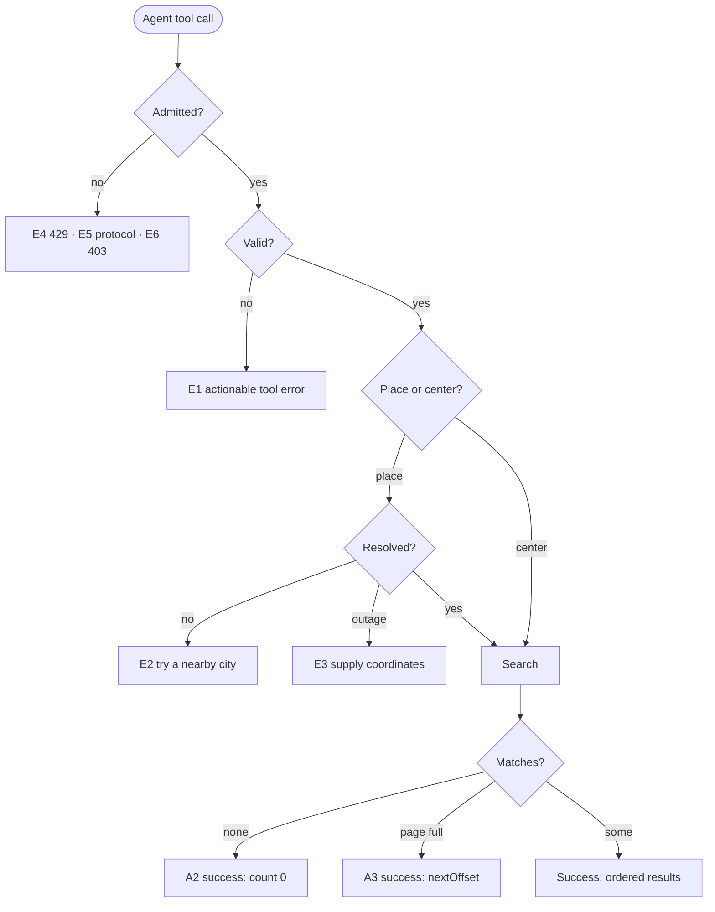
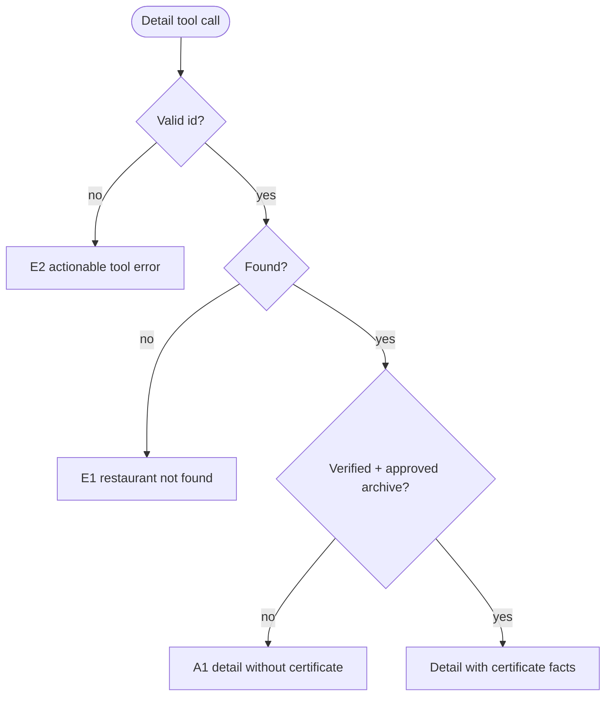

> **Purpose:** define the two actor goals and their flows · **Derived from:** 00, 01 · **Delta:** new UC-01, UC-02; existing UI use cases unchanged

# 02 — Use cases: SC-209

| ID | Name | Primary actor | Supporting actors |
|----|------|---------------|-------------------|
| UC-01 | Search for halal restaurants (via an AI agent) | U (User) | AI agent client; Geocoding provider |
| UC-02 | View a restaurant's details (via an AI agent) | U (User) | AI agent client |

> **Protocol precondition (both):** MCP initialization + tool discovery. Not a
> user goal, so not a use case; exercised by AC-1.

## Business rules

| ID | Rule |
|----|------|
| BR-1 | Radius is positive; zero/negative/non-numeric is a caller error. |
| BR-2 | Page size 1..100 (default 20); offset ≥ 0. |
| BR-3 | Results are ordered by straight-line distance ascending. |
| BR-4 | Only index-qualified (no cross-contamination) listings are returned. |
| BR-5 | Hand-cut is an extra filter: true excludes unknown and false; absent means any. |
| BR-6 | Delivery follows the same tri-state pattern. |
| BR-7 | Cuisines combine with OR (default) or AND; no-cuisine listings never match a cuisine filter. |
| BR-8 | Price bounds 0..100000, min ≤ max; unknown-price listings never match. |
| BR-9 | Minimum rating 0..5; unknown-rating listings never match. |
| BR-10 | Place text is resolved server-side; "no match" ≠ "provider unavailable". |
| BR-11 | The surface is read-only: it mutates nothing. |
| BR-12 | Requests are rate-limited per client before any work. |
| BR-13 | The id must be valid; a malformed id is a caller error. |
| BR-14 | An unknown id is reported as "restaurant not found". |
| BR-15 | Certificate facts only for verified + latest approved + archived reference; otherwise omitted. |
| BR-16 | Halal scope and verification status are reported independently. |
| BR-17 | The detail surface is read-only. |
| BR-18 | The detail request is rate-limited per client before any work. |

## UC-01 — Search for halal restaurants (via an AI agent)

- **Primary actor:** U · **Supporting:** AI agent client; Geocoding provider
- **Goal:** find halal restaurants near a place or coordinate, with optional filters.
- **Trigger:** the user asks their AI agent to find halal restaurants nearby.
- **Preconditions:** MCP endpoint healthy; agent initialized; the user stated a place/profile.

**Main success scenario**

1. The user asks for halal restaurants near a place, optionally with filters.
2. The agent calls the search tool with place **or** coordinates, a radius, and filters.
3. Tahir's List validates radius, page and every filter value.
4. If place text was supplied, Tahir's List resolves it to a search centre.
5. Tahir's List finds index-qualified listings within the radius matching the filters.
6. Results are ordered by distance, paged, and returned with halal/verification facts and links.
7. The agent presents the results.

**Alternate flows**

- **A1 (from 2)** — coordinates supplied: steps 3, 5–7; step 4 skipped.
- **A2 (from 5)** — no match: empty page, count 0. Success.
- **A3 (from 6)** — page full: next-offset hint returned for paging.
- **A4 (from 6)** — detail wanted: continue in UC-02 with the listing id.

**Exception flows**

- **E1 (from 3)** — invalid argument → tool error with the specific reason; no search; no state change.
- **E2 (from 4)** — place has no match → tool error: try a nearby city or supply coordinates; no search.
- **E3 (from 4)** — provider unavailable → distinct tool error recommending coordinates; no search.
- **E4 (from 2)** — budget exhausted → HTTP 429 before tool work; retry after the window.
- **E5 (from 2)** — malformed protocol → JSON-RPC error; no tool executes.
- **E6 (from 2)** — browser origin not allowed → HTTP 403; no tool executes.
- **E7 (from 5)** — store unavailable → generic non-internal tool error; no state change.

**Postconditions** — success: ordered page with facts and links, **no state change**;
failure: actionable error or protocol refusal, **no state change**.

- **Data:** read — search index, geocoder (place path) · created/updated — none
- **ACs:** AC-1, AC-2, AC-3, AC-4, AC-6, AC-7, AC-8, AC-9, AC-10
- **Open:** Q-1, Q-3, Q-6, Q-7

## UC-02 — View a restaurant's details (via an AI agent)

- **Primary actor:** U · **Supporting:** AI agent client
- **Goal:** get the full trust-relevant detail of one restaurant.
- **Trigger:** the user asks for more about a restaurant found by a search.
- **Preconditions:** MCP endpoint healthy; agent initialized; the caller holds a listing id.

**Main success scenario**

1. The user asks for details about a restaurant found earlier.
2. The agent calls the detail tool with the listing id.
3. Tahir's List validates the id format.
4. Tahir's List loads the listing.
5. If verified, Tahir's List derives certificate facts from the latest approved review.
6. The detail is returned with trust facts, image, certificate (when eligible) and listing link.
7. The agent presents the detail.

**Alternate flows**

- **A1 (from 5)** — unverified or no archived approval: detail without certificate facts; no broken link.
- **A2 (from 5)** — partially halal: partial scope and halal items reported; verification independent.

**Exception flows**

- **E1 (from 4)** — unknown id → tool error "restaurant not found"; no state change.
- **E2 (from 3)** — malformed id → tool error "id must be valid"; no lookup.
- **E3 (from 2)** — budget exhausted → HTTP 429 before tool work.
- **E4 (from 2)** — malformed protocol → JSON-RPC error; no tool executes.
- **E5 (from 2)** — browser origin not allowed → HTTP 403.
- **E6 (from 4)** — store unavailable → generic non-internal error; no state change.

**Postconditions** — success: full detail, **no state change**; failure: actionable
error or protocol refusal, **no state change**.

- **Data:** read — listing, latest approved certification review · created/updated — none
- **ACs:** AC-1, AC-5, AC-6, AC-7, AC-8, AC-9, AC-10
- **Open:** Q-1, Q-3, Q-6, Q-7

## AC coverage

| AC | Covered by |
|----|-----------|
| AC-1 | Protocol precondition; UC-01.2–3; UC-02.2–3 |
| AC-2 | UC-01.3, 5, 6; A1 |
| AC-3 | UC-01.4; E2, E3 |
| AC-4 | UC-01.3, 5; E1 |
| AC-5 | UC-02.3–6; A1, A2; E1, E2 |
| AC-6 | UC-01.E4; UC-02.E3 |
| AC-7 | UC-01.E6; UC-02.E5 |
| AC-8 | Both (no REST change) |
| AC-9 | UC-01.E5; UC-02.E4; E1s |
| AC-10 | Both (stateless, logged, sessionless) |

## Open questions

| ID | Question | Owner | Needed by |
|----|----------|-------|-----------|
| Q-1 | Final per-client budget and Origin allow-list. | Omar | Design approval |
| Q-2 | Epic/iteration/priority confirmation (207 / 208, first in state). | Adnan | Design approval |
| Q-3 | LLM-facing tool-description wording. | Fatima | Before implementation |
| Q-4 | `ARCHITECTURE.md` §1.0 ratification. | Founder | Design approval |
| Q-5 | SDK mounting/protocol spike outcome (WI-01). | Hamza | Implementation start |
| Q-6 | Production base URLs for listing and certificate/image links. | Founder / Adnan | Deploy |
| Q-7 | Agent as supporting actor only, or a new persona? | Founder / Adnan | Design approval |
