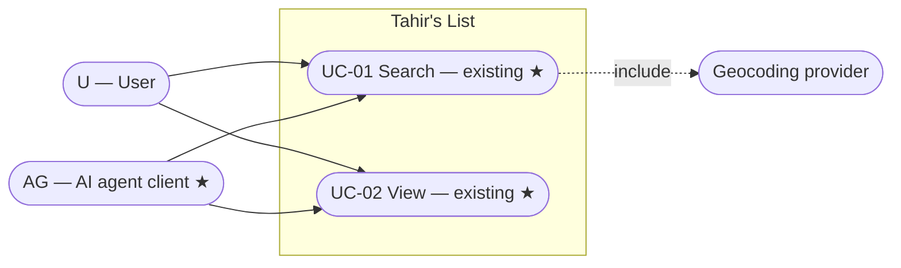
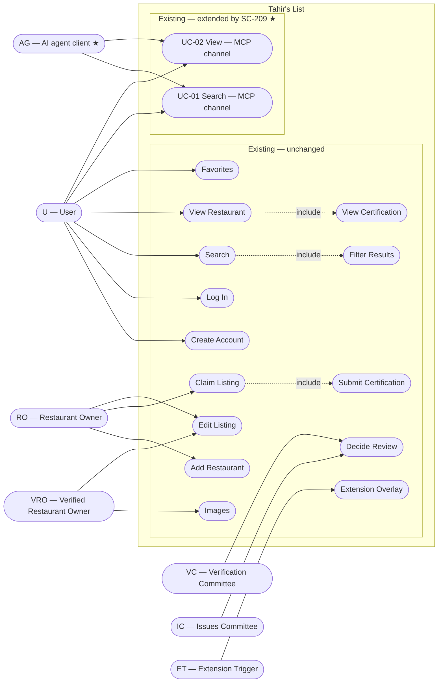

> **Purpose:** place the MCP channel in the system · **Derived from:** 02 · **Delta:** existing Search/View use cases extended by a new actor and channel; no new use-case goals

# 03 — Use case diagram: SC-209

## Feature view

## System-wide view

## Legend

| Mark | Meaning |
|------|---------|
| ★ | New actor or channel; the use-case goals themselves are existing |
| Extended | Existing goal with new MCP flows (actor + channel added) |
| `«include»` | Required sub-flow, not a top-level actor goal |

**Actors:** U = User · RO = Restaurant Owner · VRO = Verified Restaurant Owner · VC = Verification Committee · IC = Issues Committee · ET = Extension Trigger · AG = AI agent client (supporting, new).

The agent introduces **no new goal**: it is a supporting actor on the existing
Search and View use cases; MCP is a new channel. **Actor → use case** means "may
initiate", not "benefits from".
