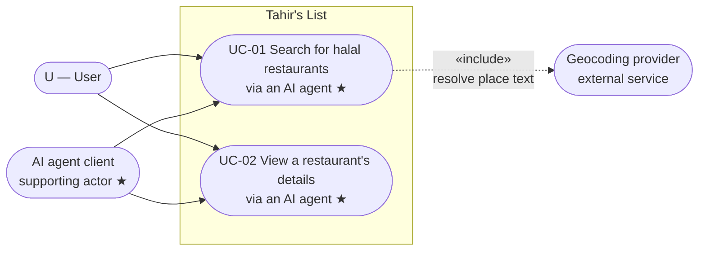
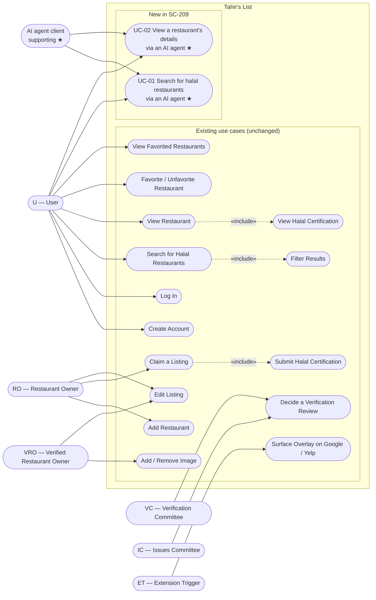

# 03 — Use case diagram: SC-209

Two views: the feature's own use cases, then the updated system-wide diagram
(the Shortcut "Update Use Case Diagram" step).

**Legend:** `★` = new in SC-209. Everything else is existing and unchanged. The
authoritative system-wide use-case catalog lives in Shortcut; the existing set
below is derived from the workspace stories and is shown for placement, not
re-authored here.

## 3.1 Feature view

- **U (User)** initiates the goal.
- **AI agent client** performs the MCP tool call on the user's behalf. It is a
  supporting external actor, not a README persona (open question Q-7).
- **Geocoding provider** is included by UC-01 only when place text is used
  (coordinates bypass it).

## 3.2 System-wide view (delta placement)

### Coverage and consistency checks

- **Phase 2 ↔ Phase 3:** exactly one diagram node per use case in
  `02-use-cases.md` (UC-01, UC-02). No orphan nodes.
- **Actors:** U, RO, VRO, VC, IC, ET match the README persona table. The AI
  agent client is the only added actor and is explicitly flagged as a supporting
  actor (Q-7).
- **Boundary:** named "Tahir's List".
- **`«include»`:** the new feature includes the geocoding provider (external)
  only for place text; it does **not** include the existing UI search use case —
  it reaches the same read model directly, without an HTTP hop.
- **New vs existing:** marked with `★` and grouped.
