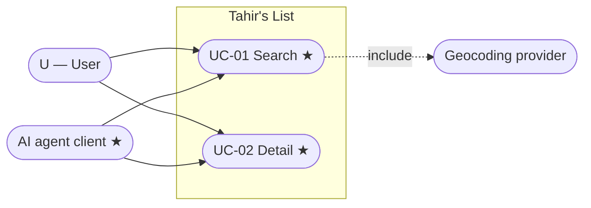
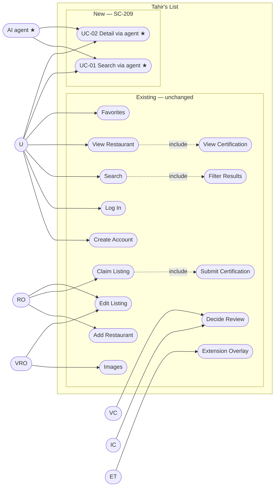

> **Purpose:** place the new use cases in the system · **Derived from:** 02 · **Delta:** +UC-01, +UC-02; no existing use case changes

# 03 — Use case diagram: SC-209

## Feature view

## System-wide view

## Legend

| Mark | Meaning |
|------|---------|
| ★ | New in SC-209 |
| Existing | Derived from Shortcut stories; the authoritative catalog lives in Shortcut |
| `«include»` | Required sub-flow, not a top-level actor goal |

**Actor → use case** means "may initiate", not "benefits from". The AI agent is a
supporting external actor, not a README persona (D-9). The agent surface reaches
the read model directly — it does not include the UI search use case.
