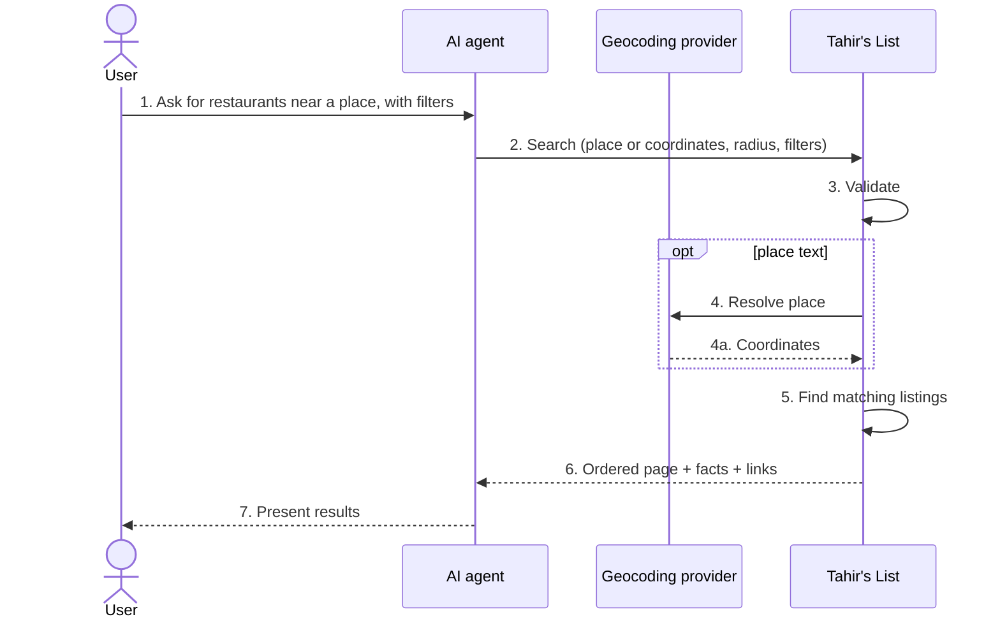
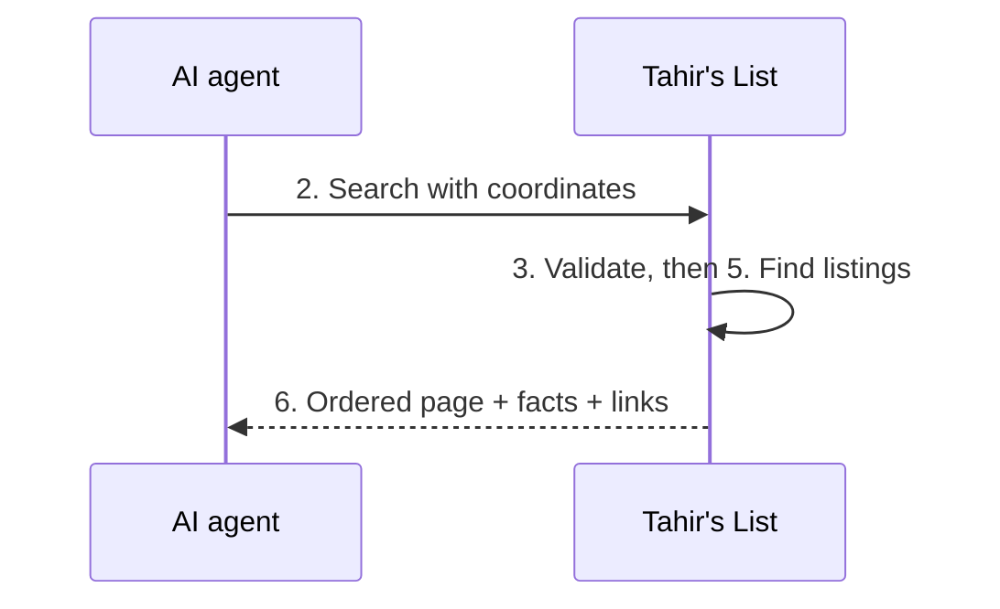
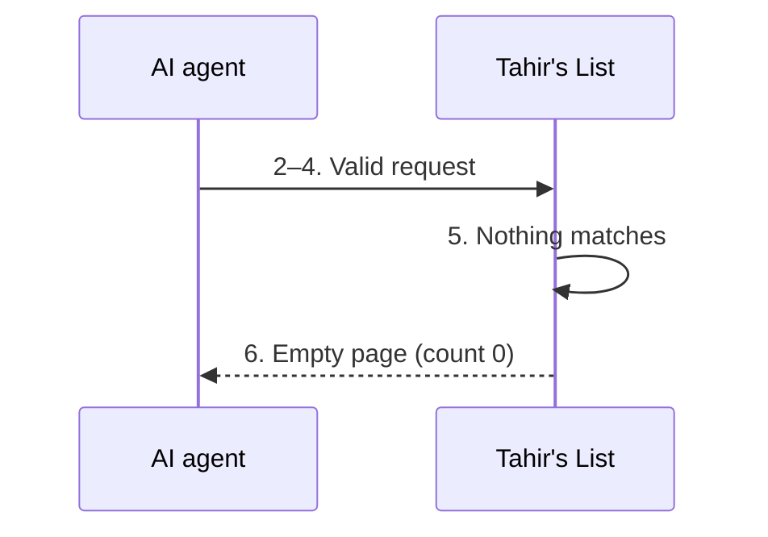
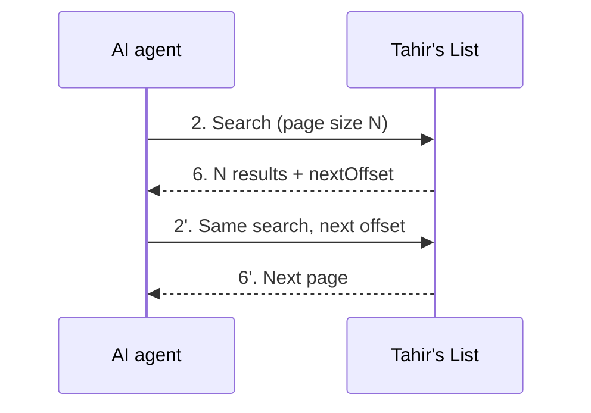
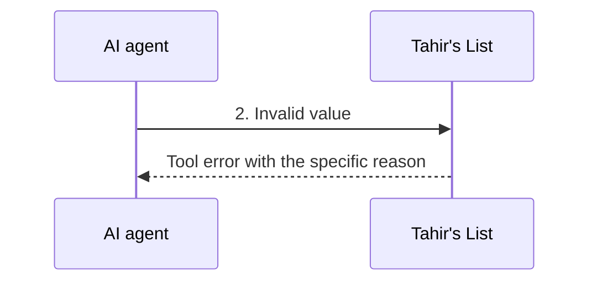
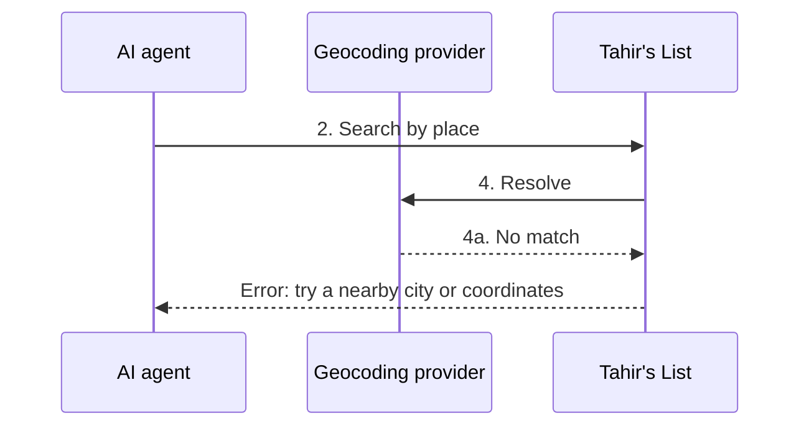
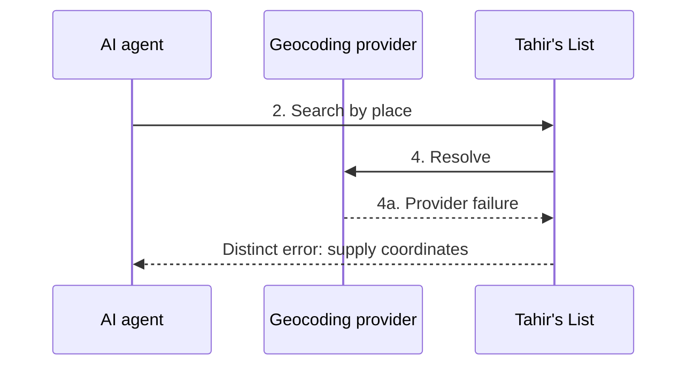

> **Purpose:** actor-visible behavior of the MCP channel for existing UC-01 · **Derived from:** 02 · **Delta:** new channel flows · **Security:** public read-only; refusals are 429/403; listing text is untrusted

# 04 — Black-box: UC-01 Search for Halal Restaurants (MCP channel)

**Main** — validated search returns a distance-ordered page with facts and links.

**A1** — coordinates skip the external lookup.

**A2** — no match is a successful empty page.

**A3** — a full page carries a next-offset hint.

**A4** — detail continues in UC-02 with the listing id.

**E1** — invalid input returns an actionable tool error.

**E2** — an unresolvable place returns guidance.

**E3** — a provider outage recommends coordinates.

**E4–E7** — refusals and failures before or during work.

| Flow | Condition | Agent observes | State |
|------|-----------|----------------|-------|
| E4 | Budget exhausted | 429 before tool work; retry later | Unchanged |
| E5 | Malformed protocol | JSON-RPC error; no tool | Unchanged |
| E6 | Origin disallowed | 403; no tool | Unchanged |
| E7 | Store unavailable | Generic non-internal error | Unchanged |
