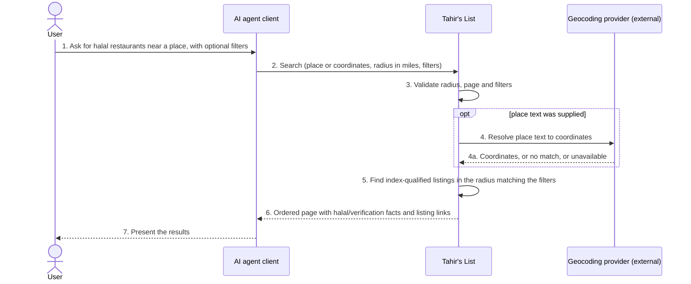
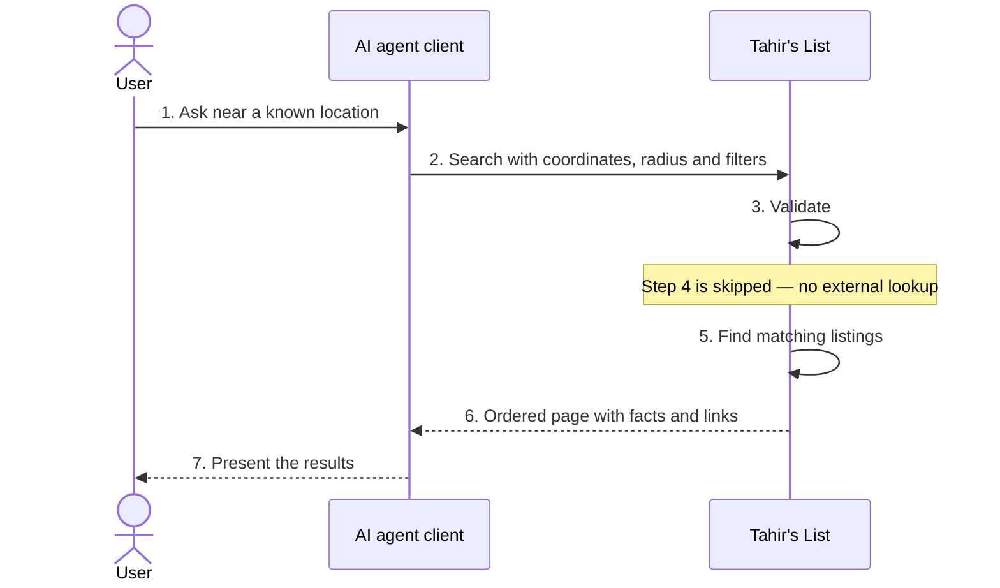
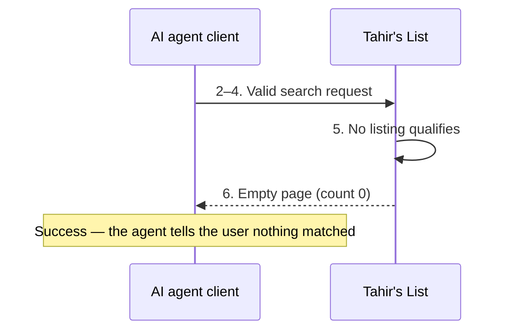
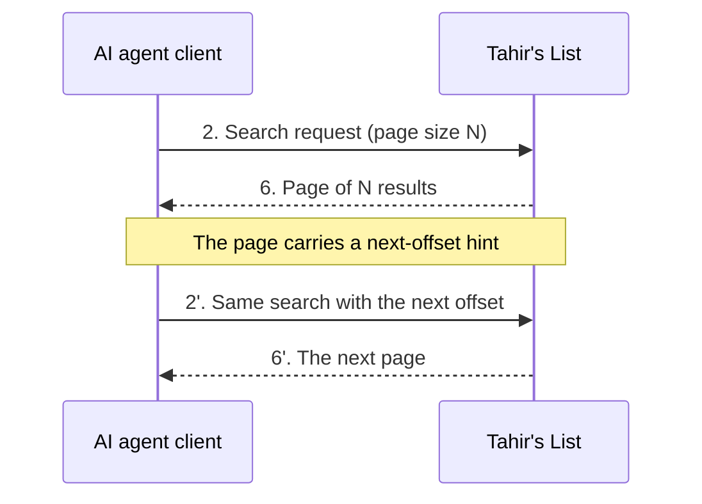
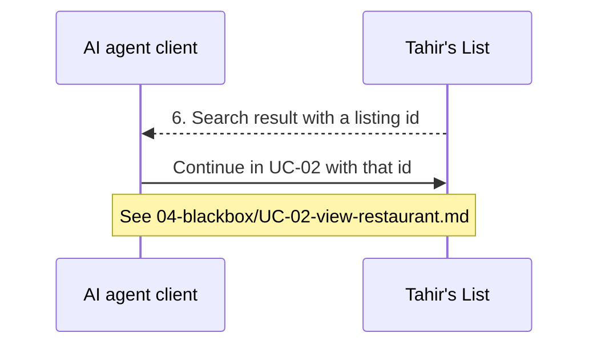
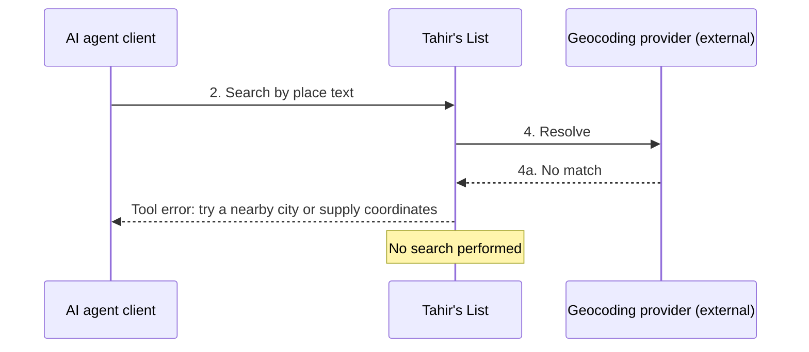
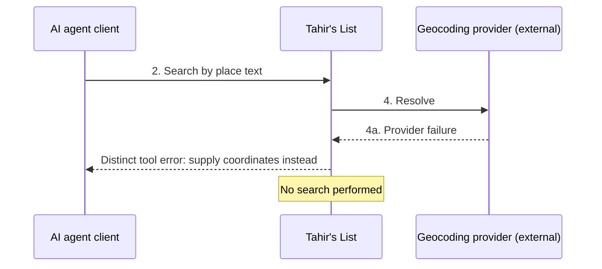

# 04 — Black-box sequence: UC-01 Search for halal restaurants (via an AI agent)

**Security-relevant:** public anonymous read surface; rate limiting and Origin
validation are refusal paths; listing text is untrusted community content shown
to a model.

Participants are only the actors, **one** lifeline for Tahir's List, and the
external geocoding provider. No internal names appear.

## Main success scenario



## Alternate flows

### A1 — Coordinates supplied instead of place text (from step 2)



### A2 — No listing matches (from step 5)



### A3 — More matches than the page size (from step 6)



### A4 — The agent needs more detail on one result (from step 6)



## Exception flows

### E1 — Invalid argument (from step 3)

```mermaid
sequenceDiagram
    participant AG as AI agent client
    participant TL as Tahir's List

    AG->>TL: 2. Search request with an invalid value
    TL->>TL: 3. Validation fails
    TL-->>AG: Tool error: the specific reason and how to correct it
    Note over TL: No search performed; no state changed
```

### E2 — Place has no match (from step 4)



### E3 — Geocoding provider unavailable (from step 4)



### E4–E7 — Refusals and failures (from steps 2 and 5)

| Flow | Condition | What the agent observes | State |
|------|-----------|-------------------------|-------|
| E4 | Per-client budget exhausted | HTTP 429 refusal before any tool work; may retry after the window | Unchanged |
| E5 | Malformed protocol request | Protocol-level error response; no tool executes | Unchanged |
| E6 | Browser origin not allowed | HTTP 403 refusal; no tool executes | Unchanged |
| E7 | Data store unavailable | Generic, non-internal error result | Unchanged |
