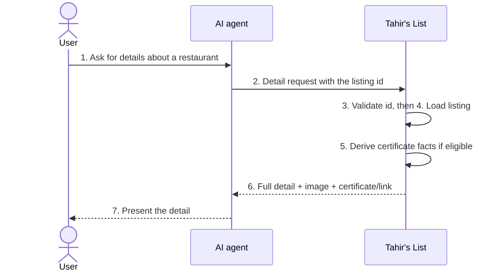
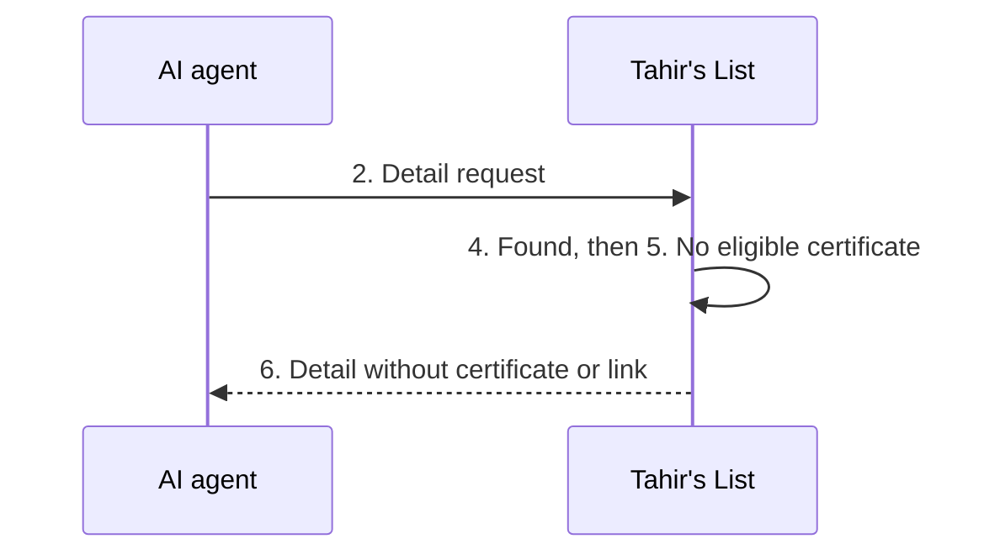
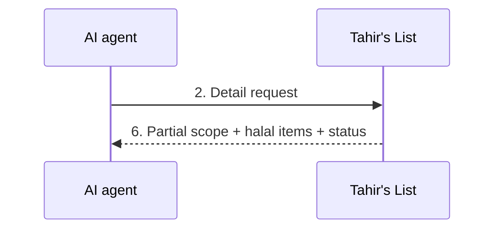
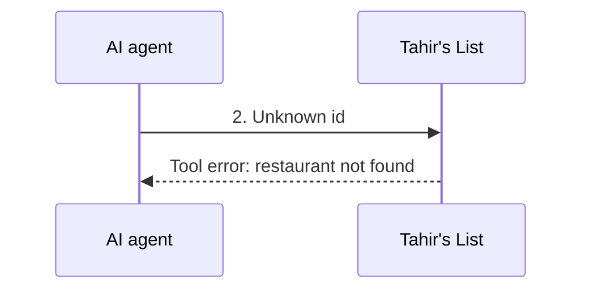
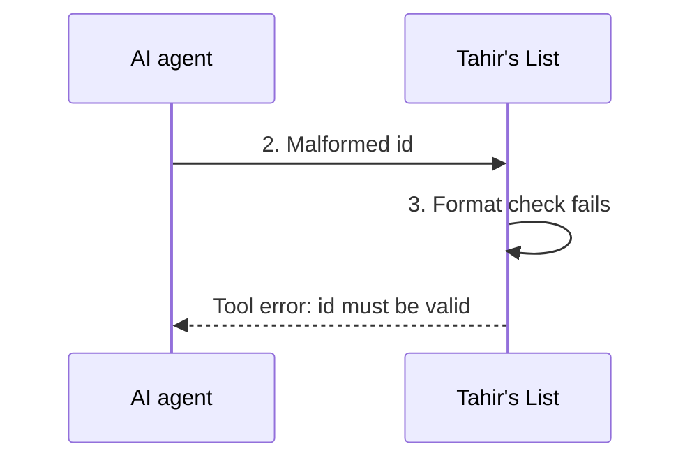

> **Purpose:** actor-visible behavior of the MCP channel for existing UC-02 · **Derived from:** 02 · **Delta:** new channel flows · **Security:** public read-only; certificate facts only for verified + approved + archived

# 04 — Black-box: UC-02 View Restaurant (MCP channel)

**Main** — validated detail request returns trust facts and links.

**A1** — ineligible certificate: detail without a certificate block.

**A2** — partial halal: scope and items reported independently of verification.

**E1** — unknown id returns "not found".

**E2** — malformed id returns an actionable error.

**E3–E6** — refusals and failures before or during work.

| Flow | Condition | Agent observes | State |
|------|-----------|----------------|-------|
| E3 | Budget exhausted | 429 before tool work | Unchanged |
| E4 | Malformed protocol | JSON-RPC error; no tool | Unchanged |
| E5 | Origin disallowed | 403; no tool | Unchanged |
| E6 | Store unavailable | Generic non-internal error | Unchanged |
