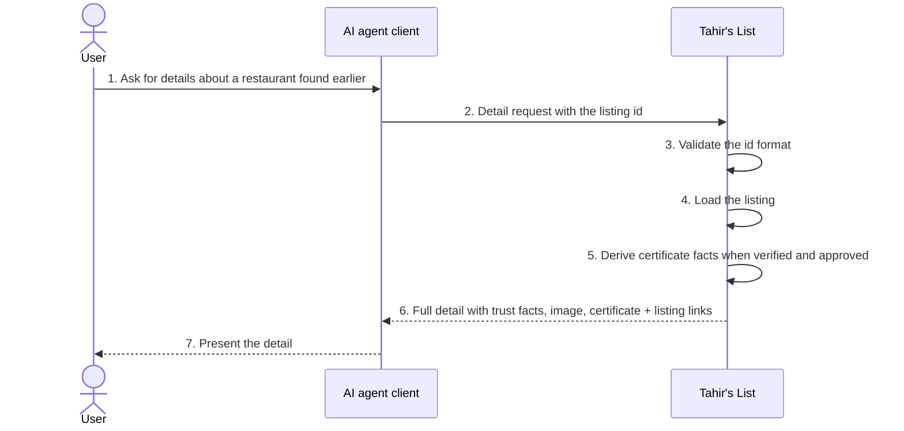
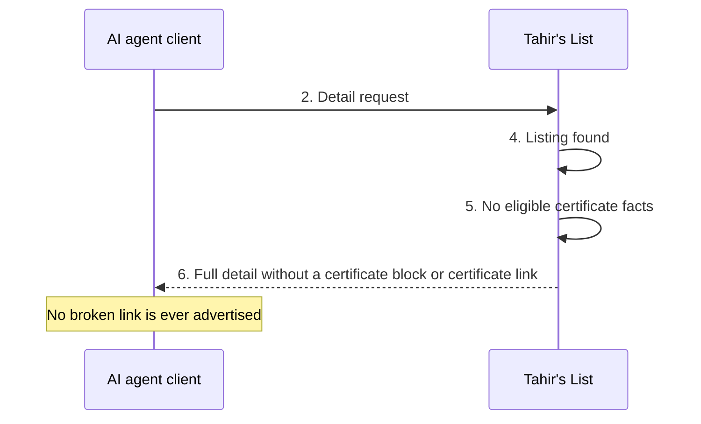
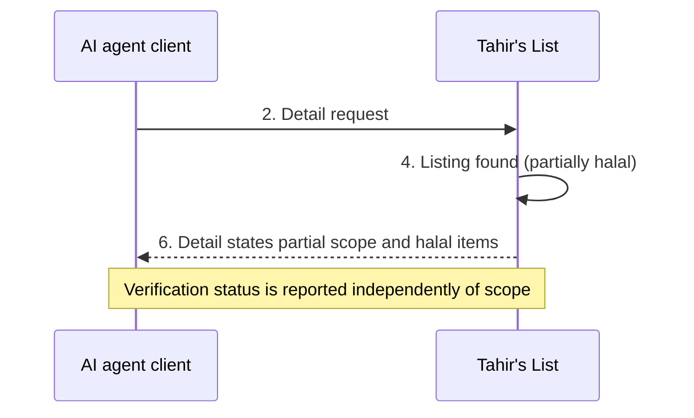
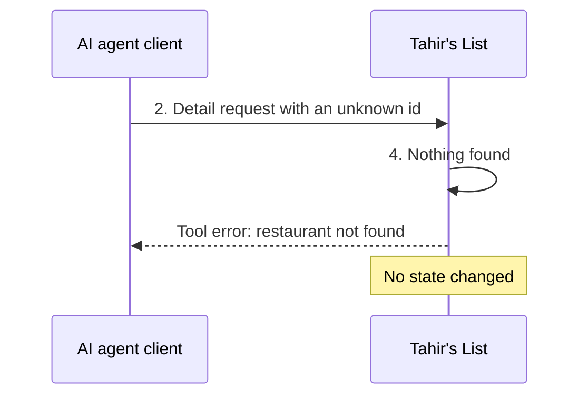
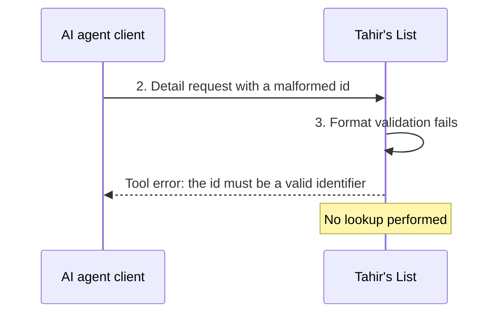

# 04 — Black-box sequence: UC-02 View a restaurant's details (via an AI agent)

**Security-relevant:** public anonymous read surface; certificate facts are only
advertised for verified listings with an approved, archived certificate (never a
broken or private URL).

Participants are only the actors and **one** lifeline for Tahir's List.

## Main success scenario

## Alternate flows

### A1 — Unverified, or approved without an archived certificate (from step 5)

### A2 — Partially halal listing (from step 5)

## Exception flows

### E1 — No listing with that id (from step 4)

### E2 — Id is not a valid identifier (from step 3)

### E3–E6 — Refusals and failures (from steps 2 and 4)

| Flow | Condition | What the agent observes | State |
|------|-----------|-------------------------|-------|
| E3 | Per-client budget exhausted | HTTP 429 refusal before any tool work | Unchanged |
| E4 | Malformed protocol request | Protocol-level error; no tool executes | Unchanged |
| E5 | Browser origin not allowed | HTTP 403 refusal; no tool executes | Unchanged |
| E6 | Data store unavailable | Generic, non-internal error result | Unchanged |
