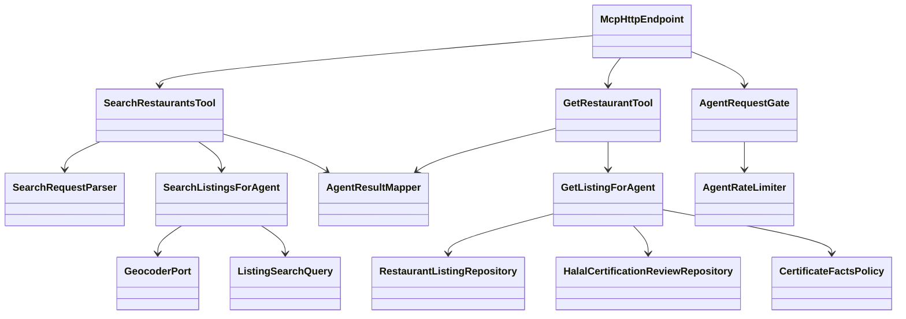
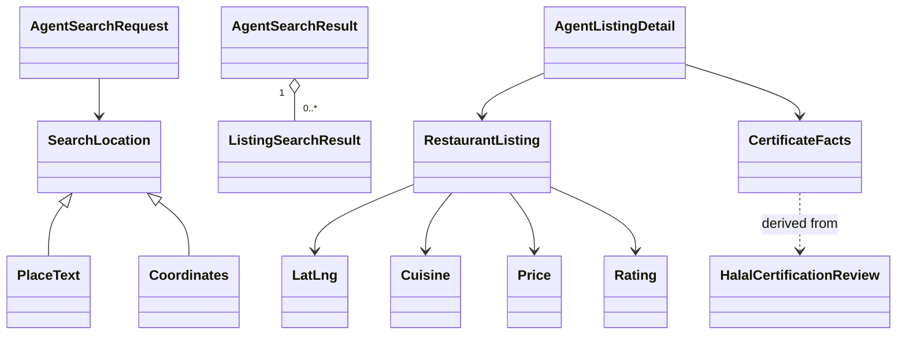
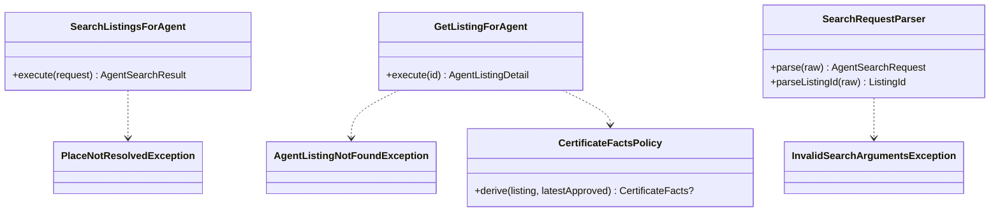
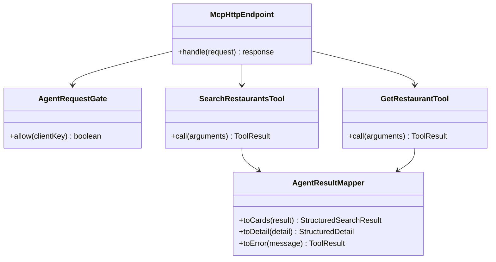
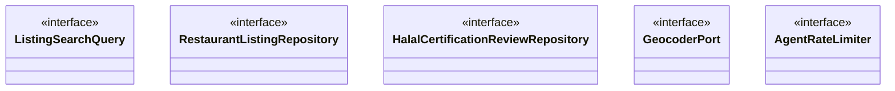

> **Purpose:** show the system shape before technology · **Derived from:** 01, 02 · **Delta:** +2 controls, +5 boundaries, +2 policy helpers, +1 port

# 05 — System class diagram: SC-209

## Overview

## Domain

## Application

## Boundary

## Ports

| Port | Operation | Adapter stub | Store / external |
|---|---|---|---|
| `ListingSearchQuery` | `searchNearby(centre, radius, filters, offset, limit)` | `ExposedListingSearchQuery` | PostgreSQL/PostGIS |
| `RestaurantListingRepository` | `findById(id)` | `ExposedRestaurantListingRepository` | PostgreSQL/PostGIS |
| `HalalCertificationReviewRepository` | `findLatestApprovedByListing(id)` | `ExposedHalalCertificationReviewRepository` | PostgreSQL/PostGIS |
| `GeocoderPort` | `geocode(address)` | `PhotonGeocoder` | Photon API (HTTP) |
| `AgentRateLimiter` | `tryAcquire(key)` | `Bucket4jAgentRateLimiter` | in-process |

UC-01 and UC-02 are existing goals; this feature serves them through the MCP channel.

## Operation inventory

| Use case step | Operation |
|---|---|
| UC-01.2–3 | `McpHttpEndpoint.handle` → `AgentRequestGate.allow` → `SearchRestaurantsTool.call` → `SearchRequestParser.parse` |
| UC-01.4 | `SearchListingsForAgent.execute` → `GeocoderPort.geocode` |
| UC-01.5–6 | `ListingSearchQuery.searchNearby` → `AgentResultMapper.toCards` |
| UC-01.A1–A3 | Coordinates skip the place branch; empty/nextOffset are mapped |
| UC-01.A4 | Hand-off to `GetRestaurantTool.call` |
| UC-01.E1 | `SearchRequestParser.parse` throws → `AgentResultMapper.toError` |
| UC-01.E2–E3 | `GeocoderPort.geocode` null/throws → `PlaceNotResolvedException` / provider error → `toError` |
| UC-01.E4–E7 | Gate false / protocol / origin / store failure at the boundary |
| UC-02.2–3 | `McpHttpEndpoint.handle` → gate → `GetRestaurantTool.call` → `parseListingId` |
| UC-02.4–6 | `GetListingForAgent.execute` → `findById` → `findLatestApprovedByListing` → `CertificateFactsPolicy.derive` → `toDetail` |
| UC-02.A1–A2 | Policy returns null; scope/items reported independently |
| UC-02.E1–E6 | `findById` null → `AgentListingNotFoundException`; parse/transport/store failures |

**Check:** every UC step resolves to an operation; every external dependency sits
behind an interface; one control class per use case; no orphan classes.
