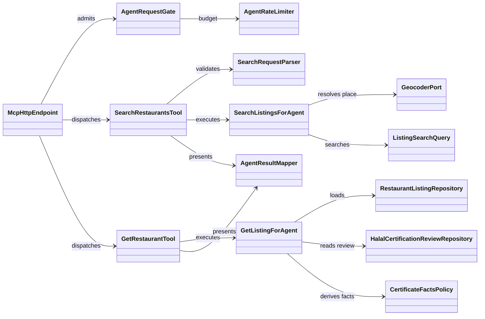
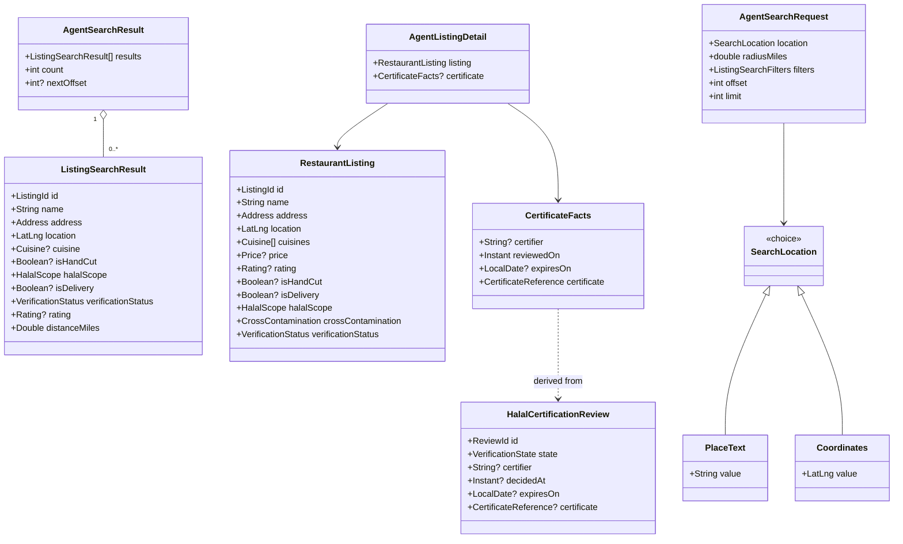
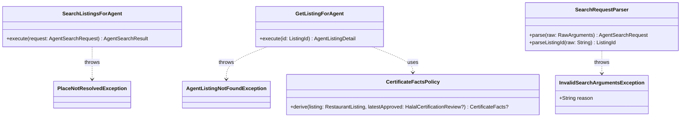
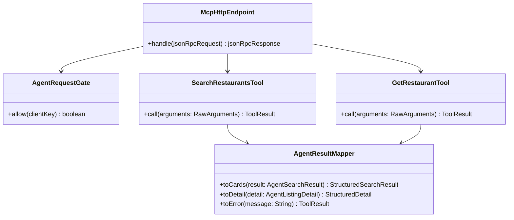
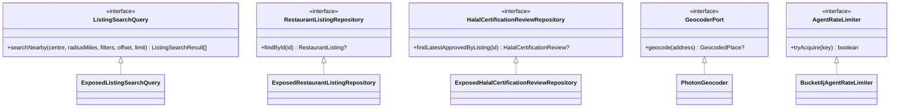

# 05 — System class diagram (conceptual): SC-209

Analysis-level shape only: entities, one control class per use case, boundary
classes, ports as interfaces, and adapter stubs. No tables, columns, JSON shapes
or framework annotations (those are Phase 7).

## 5.1 Overview

## 5.2 Domain / read model

## 5.3 Application (controls and policy)

## 5.4 Boundary

## 5.5 Ports and adapter stubs

## 5.6 Operation inventory (every use-case step resolves to an operation)

| Use case step | Operation |
|---|---|
| UC-01.2 | `McpHttpEndpoint.handle` → `AgentRequestGate.allow` → `SearchRestaurantsTool.call` |
| UC-01.3 | `SearchRequestParser.parse` (throws `InvalidSearchArgumentsException`) |
| UC-01.4 | `SearchListingsForAgent.execute` → `GeocoderPort.geocode` (place branch) |
| UC-01.5 | `ListingSearchQuery.searchNearby` |
| UC-01.6 | `AgentResultMapper.toCards`; `SearchRestaurantsTool.call` returns the tool result |
| UC-01.A1 | Same as main, with the place branch skipped |
| UC-01.A2 | `SearchRestaurantsTool.call` maps an empty `AgentSearchResult` |
| UC-01.A3 | `AgentSearchResult.nextOffset` |
| UC-01.A4 | Hand-off to UC-02 (`GetRestaurantTool.call`) |
| UC-01.E1 | `SearchRequestParser.parse` → `InvalidSearchArgumentsException` → `AgentResultMapper.toError` |
| UC-01.E2 | `GeocoderPort.geocode` returns null → `PlaceNotResolvedException` → `AgentResultMapper.toError` |
| UC-01.E3 | `GeocoderPort.geocode` throws provider failure → `AgentResultMapper.toError` |
| UC-01.E4 | `AgentRequestGate.allow` false → HTTP 429 |
| UC-01.E5 | `McpHttpEndpoint` protocol error |
| UC-01.E6 | `AgentRequestGate` origin refusal → HTTP 403 |
| UC-01.E7 | `ListingSearchQuery.searchNearby` failure → `AgentResultMapper.toError` (generic) |
| UC-02.2 | `McpHttpEndpoint.handle` → `AgentRequestGate.allow` → `GetRestaurantTool.call` |
| UC-02.3 | `SearchRequestParser.parseListingId` |
| UC-02.4 | `GetListingForAgent.execute` → `RestaurantListingRepository.findById` |
| UC-02.5 | `HalalCertificationReviewRepository.findLatestApprovedByListing` → `CertificateFactsPolicy.derive` |
| UC-02.6 | `AgentResultMapper.toDetail` |
| UC-02.A1 | `CertificateFactsPolicy.derive` returns null |
| UC-02.A2 | `AgentResultMapper.toDetail` reports scope and items independently |
| UC-02.E1 | `RestaurantListingRepository.findById` null → `AgentListingNotFoundException` |
| UC-02.E2 | `SearchRequestParser.parseListingId` throws `InvalidSearchArgumentsException` |
| UC-02.E3–E6 | Gate refusal / protocol error / generic error mapping |

## 5.7 Consistency checks

- Every entity/value object from Phase 1 appears (listing, review, location,
  cuisine, price, rating, hand-cut, delivery, halal scope, cross-contamination,
  verification, halal item set are carried through the existing types).
- Every use case has exactly one control class: UC-01 → `SearchListingsForAgent`,
  UC-02 → `GetListingForAgent`.
- Every external dependency is behind an interface: search query, listing
  repository, review repository, geocoder, rate limiter.
- No orphan classes; every class is used by a Phase 6 sequence or a work item.
- No framework or persistence detail leaks into this phase.
