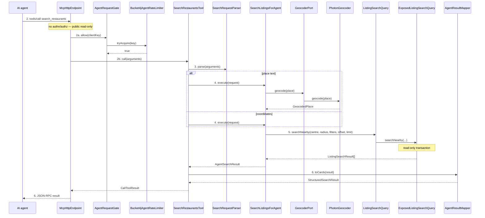

> **Purpose:** show how the MCP channel serves existing UC-01 internally · **Derived from:** 02, 05 · **Delta:** new channel flows
> **Transaction:** one read-only `suspendTransaction` in `ExposedListingSearchQuery`; nothing writes.

# 06 — White-box: UC-01 Search for Halal Restaurants (MCP channel)

**Authorization:** none; `AgentRequestGate` is a budget, not identity, and runs
before tool execution. **State transitions:** none.

## Delta notes

| Flow | Concrete cause | Result |
|---|---|---|
| E1 | `InvalidSearchArgumentsException` | `isError=true`, specific reason |
| E2 | `GeocoderPort.geocode` → null → `PlaceNotResolvedException` | `isError=true`, "try a nearby city or coordinates" |
| E3 | `GeocoderPort.geocode` throws `GeocodingException` | `isError=true`, "location lookup unavailable; supply coordinates" |
| E4 | `AgentRateLimiter.tryAcquire` false | HTTP 429 + `Retry-After`, no tool work |
| E5 | SDK JSON-RPC failure | JSON-RPC error, no tool work |
| E6 | Origin not in allow-list | HTTP 403, no tool work |
| E7 | Persistence failure | `isError=true`, generic message; logged only |

**A1** — coordinates: the `place text` branch is skipped; the rest is unchanged.
**A2** — empty result: `AgentSearchResult([], 0, null)` maps to success.
**A3** — full page: `nextOffset = offset + results.size`; a follow-up call repeats the path.
**A4** — detail: the tool result carries the listing id; see UC-02 white-box.

**Error hygiene:** no exception text, SQL, stack trace or server path reaches the agent.
