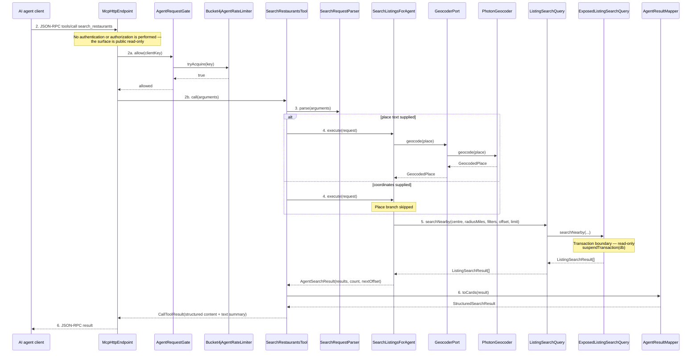

# 06 — White-box sequence: UC-01 Search for halal restaurants (via an AI agent)

1:1 with `04-blackbox/UC-01-search-restaurants.md`. Participants are exact
classes/interfaces from `05-class-diagram-system.md`.

## Main success scenario



**Transaction boundaries:** the only persistence boundary is
`ExposedListingSearchQuery.searchNearby`, which opens a read-only
`suspendTransaction(db)`. Nothing in this use case writes.

**Authorization placement:** none. The endpoint is public and read-only by
product decision; `AgentRequestGate` enforces a *budget*, not identity, and is
placed before tool execution so a refused call does no work.

**Aggregate state transitions:** none — the use case is read-only.

## Alternate flows

### A1 — Coordinates supplied instead of place text

Same as the main scenario with the `place text` branch skipped: `CTRL` never
calls `GeocoderPort`.

### A2 — No listing matches

`ListingSearchQuery.searchNearby` returns an empty array →
`AgentSearchResult(results = [], count = 0, nextOffset = null)` →
`AgentResultMapper.toCards` → a successful tool result, not an error.

### A3 — More matches than the page size

`SearchListingsForAgent` sets `nextOffset = offset + results.size` when the
returned page is full; the mapper exposes it. A follow-up call with the new
offset repeats the same sequence.

### A4 — Hand-off to UC-02

The tool result carries each listing id; the agent then invokes
`GetRestaurantTool.call` (see `06-whitebox/UC-02-view-restaurant.md`).

## Exception flows and concrete error mapping

```mermaid
sequenceDiagram
    participant AG as AI agent client
    participant EP as McpHttpEndpoint
    participant GATE as AgentRequestGate
    participant RL as Bucket4jAgentRateLimiter
    participant TOOL as SearchRestaurantsTool
    participant PARSER as SearchRequestParser
    participant CTRL as SearchListingsForAgent
    participant GEO as GeocoderPort
    participant MAP as AgentResultMapper

    Note over AG,EP: E4 — budget exhausted
    EP->>GATE: allow(clientKey)
    GATE->>RL: tryAcquire(key)
    RL-->>GATE: false
    GATE-->>EP: refused
    EP-->>AG: HTTP 429 + Retry-After (no tool work)

    Note over AG,EP: E5 — malformed protocol request
    AG->>EP: invalid JSON-RPC
    EP-->>AG: JSON-RPC error (parse/invalid request)
    Note over EP: No tool executes

    Note over AG,EP: E6 — disallowed browser origin
    AG->>EP: request with a disallowed Origin
    EP-->>AG: HTTP 403
    Note over EP: No tool executes

    Note over TOOL,MAP: E1 — invalid arguments
    TOOL->>PARSER: parse(arguments)
    PARSER-->>TOOL: throws InvalidSearchArgumentsException
    TOOL->>MAP: toError(reason)
    MAP-->>TOOL: ToolResult(isError = true, reason)
    TOOL-->>EP: tool result
    EP-->>AG: JSON-RPC result with isError = true

    Note over CTRL,GEO: E2 — place has no match
    CTRL->>GEO: geocode(place)
    GEO-->>CTRL: null
    CTRL-->>TOOL: throws PlaceNotResolvedException
    TOOL->>MAP: toError("try a nearby city or supply coordinates")
    MAP-->>TOOL: ToolResult(isError = true)
    TOOL-->>EP: tool result
    EP-->>AG: JSON-RPC result with isError = true

    Note over CTRL,GEO: E3 — geocoding provider unavailable
    CTRL->>GEO: geocode(place)
    GEO-->>CTRL: throws GeocodingException
    CTRL-->>TOOL: propagates handling to the tool boundary
    TOOL->>MAP: toError("location lookup unavailable; supply coordinates")
    MAP-->>TOOL: ToolResult(isError = true)
    TOOL-->>EP: tool result
    EP-->>AG: JSON-RPC result with isError = true
```

| Black-box flow | Concrete exception / condition | Externally visible result |
|---|---|---|
| E1 | `InvalidSearchArgumentsException(reason)` | `CallToolResult(isError=true)` with the specific reason |
| E2 | `PlaceNotResolvedException` | `isError=true`, "try a nearby city or supply coordinates" |
| E3 | `GeocodingException` | `isError=true`, "location lookup unavailable; supply coordinates" |
| E4 | `AgentRateLimiter.tryAcquire` false | HTTP 429 + `Retry-After`; no tool work |
| E5 | SDK JSON-RPC parse/validation failure | JSON-RPC error response; no tool work |
| E6 | Origin not in the allow-list | HTTP 403; no tool work |
| E7 | Persistence failure inside `ExposedListingSearchQuery` | `isError=true` with a generic message; details logged only |

**Error hygiene:** no exception text, SQL, stack trace or server path ever
reaches the agent. Each tool error carries a stable, actionable message built by
`AgentResultMapper`.
