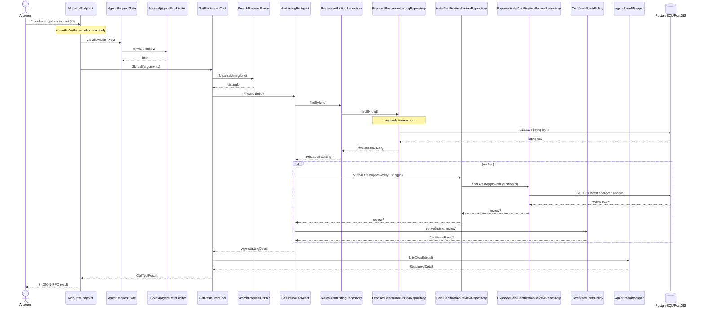

> **Purpose:** show how the MCP channel serves existing UC-02 internally · **Derived from:** 02, 05 · **Delta:** new channel flows
> **Transaction:** two read-only `suspendTransaction` calls (listing, review); no writes.

# 06 — White-box: UC-02 View Restaurant (MCP channel)

**Authorization:** none; detail is public. Certificate bytes stay behind the
existing `/v1/listings/{id}/certificate` verified/approved/archived rule.
**State transitions:** none.

## Delta notes

| Flow | Concrete cause | Result |
|---|---|---|
| E1 | `findById` null → `AgentListingNotFoundException` | `isError=true`, "restaurant not found" |
| E2 | `parseListingId` → `InvalidSearchArgumentsException` | `isError=true`, "id must be valid" |
| E3 | `AgentRateLimiter.tryAcquire` false | HTTP 429 + `Retry-After` |
| E4 | SDK JSON-RPC failure | JSON-RPC error |
| E5 | Origin not in allow-list | HTTP 403 |
| E6 | Persistence failure | `isError=true`, generic message |

**A1** — ineligible certificate: `CertificateFactsPolicy` returns null; no
`certificateUrl` is advertised (never a 404 link).
**A2** — partial halal: scope and the declared per-item status are emitted independently of verification; absence = unknown.

**Error hygiene:** no exception text, SQL, stack trace or server path reaches the agent.
