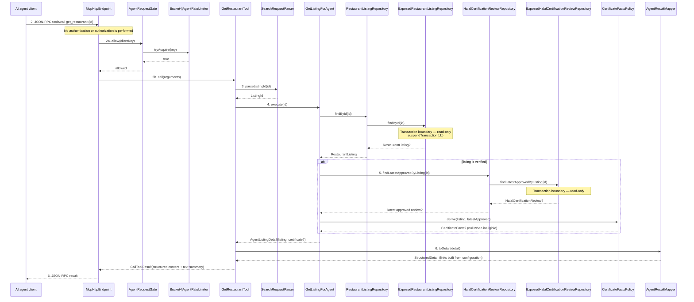

# 06 — White-box sequence: UC-02 View a restaurant's details (via an AI agent)

1:1 with `04-blackbox/UC-02-view-restaurant.md`. Participants are exact
classes/interfaces from `05-class-diagram-system.md`.

## Main success scenario



**Transaction boundaries:** two bounded read-only `suspendTransaction` calls —
one in `ExposedRestaurantListingRepository.findById`, one in
`ExposedHalalCertificationReviewRepository.findLatestApprovedByListing`. No
writes; no transaction spans an external call.

**Authorization placement:** none; the listing detail is public data. The gate is
a budget check, not an identity or permission check.

**Aggregate state transitions:** none.

## Alternate flows

### A1 — Unverified, or approved without an archived certificate

`CertificateFactsPolicy.derive` returns `null` (not verified, no approved review,
or no archived certificate reference). `AgentResultMapper.toDetail` emits the
detail without a certificate block and without a `certificateUrl`; it never emits
a URL that would 404.

### A2 — Partially halal listing

`AgentResultMapper.toDetail` reports `halalScope = PARTIALLY_HALAL` together with
the halal item set, and reports `verificationStatus` independently. A partially
halal listing may still be verified; the two facts are never merged.

## Exception flows and concrete error mapping

```mermaid
sequenceDiagram
    participant AG as AI agent client
    participant EP as McpHttpEndpoint
    participant GATE as AgentRequestGate
    participant RL as Bucket4jAgentRateLimiter
    participant TOOL as GetRestaurantTool
    participant PARSER as SearchRequestParser
    participant CTRL as GetListingForAgent
    participant REPO as RestaurantListingRepository
    participant MAP as AgentResultMapper

    Note over AG,EP: E3 — budget exhausted
    EP->>GATE: allow(clientKey)
    GATE->>RL: tryAcquire(key)
    RL-->>GATE: false
    EP-->>AG: HTTP 429 + Retry-After (no tool work)

    Note over AG,EP: E4 — malformed protocol request
    AG->>EP: invalid JSON-RPC
    EP-->>AG: JSON-RPC error
    Note over EP: No tool executes

    Note over AG,EP: E5 — disallowed browser origin
    AG->>EP: request with a disallowed Origin
    EP-->>AG: HTTP 403

    Note over TOOL,PARSER: E2 — malformed id
    TOOL->>PARSER: parseListingId(id)
    PARSER-->>TOOL: throws InvalidSearchArgumentsException
    TOOL->>MAP: toError("id must be a valid identifier")
    MAP-->>TOOL: ToolResult(isError = true)
    TOOL-->>EP: tool result
    EP-->>AG: isError = true

    Note over CTRL,REPO: E1 — unknown id
    CTRL->>REPO: findById(id)
    REPO-->>CTRL: null
    CTRL-->>TOOL: throws AgentListingNotFoundException
    TOOL->>MAP: toError("restaurant not found")
    MAP-->>TOOL: ToolResult(isError = true)
    TOOL-->>EP: tool result
    EP-->>AG: isError = true

    Note over CTRL,REPO: E6 — data store unavailable
    CTRL->>REPO: findById(id)
    REPO-->>CTRL: throws persistence failure
    CTRL-->>TOOL: propagates to the tool boundary
    TOOL->>MAP: toError("detail temporarily unavailable")
    MAP-->>TOOL: ToolResult(isError = true)
    TOOL-->>EP: tool result
    EP-->>AG: isError = true (generic; details logged only)
```

| Black-box flow | Concrete exception / condition | Externally visible result |
|---|---|---|
| E1 | `RestaurantListingRepository.findById` returns null → `AgentListingNotFoundException` | `isError=true`, "restaurant not found" |
| E2 | `SearchRequestParser.parseListingId` → `InvalidSearchArgumentsException` | `isError=true`, "id must be a valid identifier" |
| E3 | `AgentRateLimiter.tryAcquire` false | HTTP 429 + `Retry-After` |
| E4 | SDK JSON-RPC parse/validation failure | JSON-RPC error |
| E5 | Origin not in the allow-list | HTTP 403 |
| E6 | Persistence failure | `isError=true` with a generic message |

**Authorization note:** certificate bytes are served by the existing public
`/v1/listings/{id}/certificate` proxy, which independently enforces
verified + approved + archived-key. The MCP tool only advertises the URL when
that same policy holds (`CertificateFactsPolicy`), so no private evidence is
exposed through the agent surface.
