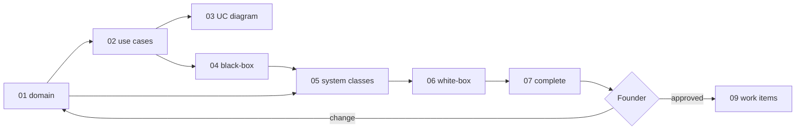

> **Purpose:** one review pass over the design · **Derived from:** 00–07 · **Delta:** existing Search/View use cases reused (new actor + channel); format retrofit otherwise
> Design branch: `docs/SC-209-mcp-design` · PR [#73](https://github.com/Losers-Lab/tahirs-list/pull/73) · 2026-11-07

# 08 — Design walkthrough: SC-209

## Review path

## 1. Story + domain model
**Shows:** requirement, verbatim ACs, invariants; the domain is unchanged.
**Locks in:** no persisted model change; read-side vocabulary only; unknown stays visible.
**Need:** approve; D-9 (agent actor), D-1 (architecture row).

## 2. Use cases
**Shows:** the existing Search/View use cases with the MCP channel flows and AC coverage.
**Locks in:** the goals are unchanged; exactly two read-only tools; actionable errors; no state change.
**Need:** approve; D-2, D-3, D-9.

## 3. Use case diagram
**Shows:** the existing Search/View use cases extended by the new agent actor and MCP channel.
**Locks in:** the goals are unchanged; only the supporting actor and channel are added; no HTTP hop to the UI search.
**Need:** approve; D-9.

## 4. Black-box sequences
**Shows:** actor-visible behavior, flow by flow, including refusals.
**Locks in:** ordered results, empty = success, 429/403, no state change.
**Need:** approve; D-5 (description wording).

## 5. System class diagram
**Shows:** entities, one control per use case, boundaries, ports, adapter stubs.
**Locks in:** MCP is a driving adapter; no direct persistence/HTTP; existing out-ports reused.
**Need:** approve; D-8 (rate-limiter placement).

## 6. White-box sequences
**Shows:** endpoint → gate → tool → control → port → adapter → external Photon HTTP; read-only transactions; error mapping.
**Locks in:** no writes; no external call inside a transaction; no internal leakage; certificate URLs gated.
**Need:** approve; D-11 (fallback only if the spike proves it necessary).

## 7. Complete class diagram — the design being approved
**Shows:** layer map, modules, persistence/API/frontend deltas, config, test names.
**Locks in:** final names, tool schemas, stateless transport, config keys, security posture.
**Need:** approve — or name the diagram and the change.

## Decision items

| # | Question | Recommendation | Decision |
|---|----------|----------------|----------|
| D-1 | Ratify `ARCHITECTURE.md` §1.0: Kotlin SDK, embedded `:mcp`, stateless Streamable HTTP at `/mcp`, public read-only, rate-limited. | Approve | pending |
| D-2 | Confirm epic 207 / iteration 208 / first in state; prioritization docs not discoverable; update the Shortcut use-case diagram for the agent actor (Q-8). | Keep; Adnan confirms | pending |
| D-3 | Rate budget 60 req/min per client IP, bounded keys, existing proxy-trust setting. | Approve; Omar may tune | pending |
| D-4 | Origin allow-list, empty prod default; dev adds Inspector `http://localhost:6274`. | Allow-list (deny by default) | pending |
| D-5 | Tool names, schemas and LLM-facing descriptions as drafted. | Approve; Fatima rewords | pending |
| D-6 | Extract `ListingSearchRequestParser` + `CertificateFacts` into `:application`; behaviour-preserving `web-api` refactor. | Approve | pending |
| D-7 | Include the declared per-item halal map (`{name, isHalal}`) on MCP detail only (REST unchanged); absence = unknown, not exhaustive; categorical "only X" coverage is Q-9. | Approve | pending |
| D-8 | New `Bucket4jMcpRateLimiter` in `:mcp` rather than a shared module. | Approve; extract later | pending |
| D-9 | AI agent = supporting actor on the existing Search/View use cases; MCP is the new channel (not a new goal); no README persona. | Approve | pending |
| D-10 | `APP_MCP_PUBLIC_WEB_BASE_URL` / `APP_MCP_PUBLIC_API_BASE_URL`; prod requires https, rejects defaults. | Approve; founder confirms prod values | pending |
| D-11 | Last-resort dedicated localhost server behind the tunnel if the SDK cannot coexist with `ContentNegotiation`. | Accept only if the spike proves it necessary | pending |
| G-1 | Public "connect your agent" docs page. | Out of scope — separate story | pending |
| G-2 | Phase 9/10 (work items, traceability) not started; no matrix yet. | Expected; starts after approval | pending |

## Approval

Approved by: `<pending>` · Date: · Design commit:
Decision items: `<pending>`

Re-approval: design corrected — existing use cases reused; per-item halal semantics clarified; implementation content unchanged, 1f66fff

> **Re-approval requested.** Reply `approved` to confirm technical content is
> unchanged (format-only), or name the diagram and the change.
