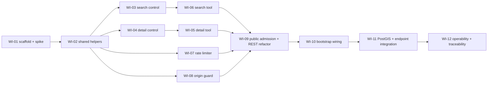

> **Purpose:** the implementation plan, one work item per slice · **Derived from:** 02, 07 · **Delta:** backend-only; no migration, no frontend, no OpenAPI change
> **Status:** approved 2026-11-08 (design commit `aad0e46`) · TDD per item, green before commit

# 09 — Work items: SC-209

Backend first, in dependency order. Each WI lands as a failing test, a red run,
the implementation, then a green run. No frontend work and no schema change.

| WI | Layer | Covers UC steps | Tests first | Depends on | PR |
|---|---|---|---|---|---|
| WI-01 | build · `:mcp` | Protocol precondition (AC-1); spike for Q-5/D-11 | `McpDiscoveryTest.initializeWithoutAuthSucceeds` | — | A |
| WI-02 | application | UC-01.3; UC-02.3, 5, A1 | `ListingSearchRequestParserTest.matchesRestSemantics`; `CertificateFactsTest.requiresVerifiedApprovedAndArchivedKey` | — | A |
| WI-03 | application | UC-01.3–6; A1–A3; E1–E3, E7 | `SearchListingsForAgentTest.geocodesPlaceThenSearches`, `coordinatesSkipGeocoding`, `placeNotResolvedIsActionable`, `geocoderOutageIsDistinctAndActionable`, `computesNextOffsetOnlyWhenPageFull` | WI-02 | B |
| WI-04 | application | UC-02.3–6; A1, A2; E1, E2, E6 | `GetListingForAgentTest.missingListingThrowsNotFound`, `verifiedListingReadsLatestApprovedReview` | WI-02 | B |
| WI-05 | `:mcp` tool | UC-02.2, 6, 7; A1, A2; E1, E2 | `GetRestaurantToolTest.unknownIdReturnsNotFoundToolError`, `malformedIdReturnsToolError`, `verifiedWithApprovedCertificateIncludesFacts`, `unverifiedOrUnapprovedOmitsCertificate`, `partialHalalReportsScopeAndItems`, `certificateUrlAndImageUrlUseConfiguredApiBase` | WI-04 | C |
| WI-06 | `:mcp` tool | UC-01.2, 6, 7; A2–A4; E1 | `SearchRestaurantsToolTest.rejectsWhenNeitherPlaceNorCenter`, `rejectsWhenBothPlaceAndCenter`, `rejectsNonPositiveRadius`, `rejectsLimitOutsideOneToOneHundred`, `rejectsNegativeOffset`, `rejectsMinPriceAboveMaxPrice`, `rejectsRatingOutsideZeroToFive`, `rejectsBlankOrOverlongCuisine`, `emptyResultIsSuccess`, `reportsNextOffsetWhenPageIsFull`, `preservesTriStateHandCutAndDelivery`, `preservesNullRating`, `buildsWebsiteUrlFromConfig` | WI-03 | C |
| WI-07 | `:mcp` guard | UC-01.E4; UC-02.E3 (BR-12, BR-18) | `McpRateLimitTest.rejectsBeyondBudgetBeforeToolExecution`, `budgetIsPerClient` | WI-01 | D |
| WI-08 | `:mcp` guard | UC-01.E6; UC-02.E5 (AC-7) | `McpOriginTest.allowsRequestsWithoutOrigin`, `rejectsDisallowedOriginWith403` | WI-01 | D |
| WI-09 | `:web-api` · `:mcp` | UC-01.2 (admission); AC-6, AC-8 | `McpPublicAccessTest.initializeAndToolsCallNeedNoJwt`; `McpRegressionTest.restSearchAndDetailUnchanged` | WI-05–08 | D |
| WI-10 | `:bootstrap` | Wiring and config for every step; AC-10 | `McpDisabledWiringTest.endpointIs404WhenDisabled`; `McpEnabledWiringTest.endpointIsPublicAndMounted` | WI-09 | E |
| WI-11 | integration · PostGIS | UC-01.5, 6; AC-2, AC-4, AC-9 | `McpSearchPostgisTest.filtersAndOrdersByDistance`, `handCutOnlyExcludesUnknownAndFalse`, `cuisineAndOrSemantics`, `priceAndRatingExcludeUnknowns`, `indexGateExcludesCrossContamination`; `McpEndpointTest.toolsCallOverStreamableHttp`, `statelessConcurrentCallsSucceed` | WI-10 | E |
| WI-12 | operability | AC-9, AC-10; Q-3 copy sign-off | Log assertions in `McpEndpointTest`; injection/body-size case in `McpEndpointTest` | WI-11 | E |

## Class coverage (07 → WI)

| Phase 7 element | WI |
|---|---|
| `ListingSearchRequestParser`, `CertificateFacts`, agent request/result/detail DTOs, `AgentExceptions`, `SearchLocation` | WI-02 |
| `SearchListingsForAgent` | WI-03 |
| `GetListingForAgent` | WI-04 |
| `GetRestaurantTool`, `AgentResultMapper` (detail) | WI-05 |
| `SearchRestaurantsTool`, `AgentResultMapper` (cards) | WI-06 |
| `McpRateLimiter`, `Bucket4jMcpRateLimiter` | WI-07 |
| `McpOriginGuard` | WI-08 |
| `WebApi.isPublicRequest`, `ListingRoutes`, `ListingReadDtos` | WI-09 |
| `McpConfig`, `McpSettings`, `McpUseCases`, `TahirsListMcpServer`, `installMcp`, `AppModules`, `ConfigValidation` | WI-01 + WI-10 |
| `PhotonGeocoder` wiring, `APP_GEOCODER_BASE_URL` | WI-10 |

## UC step coverage (02 → WI)

| UC step | WI |
|---|---|
| UC-01.1 (user asks) | out of system; no code |
| UC-01.2–3, UC-02.2–3 (call + validation) | WI-06, WI-05, WI-02 |
| UC-01.4 (geocode over HTTP) | WI-03 + WI-10 |
| UC-01.5–6, UC-02.4–6 | WI-03, WI-04, WI-11 |
| UC-01.7, UC-02.7 (agent presents) | out of system; no code |
| UC-01.E4/E6, UC-02.E3/E5 (refusals) | WI-07, WI-08, WI-09 |
| UC-01.E5, UC-02.E4 (protocol) | WI-01 + SDK |
| All ACs on the wire | WI-11, WI-12 |

## WI-01 spike result — 2026-11-08

Checked against `io.modelcontextprotocol:kotlin-sdk-server:0.16.0` sources (not from memory).

| Finding | Consequence |
|---|---|
| `Application.mcpStatelessStreamableHttp(path, enableDnsRebindingProtection, allowedHosts, allowedOrigins, block)` exists; POST-only, GET/DELETE return 405, no session id, one session per request | Use it directly. **D-11 fallback is not needed**; no dedicated localhost server. |
| The helper installs `ContentNegotiation` with the SDK's `McpJson` itself | No competing `Json` instance; the coexistence risk in 07 is retired. |
| The helper's `allowedOrigins` compares **hostname only** (scheme/port ignored) and `null` skips validation when custom `allowedHosts` are set | Keep our `McpOriginGuard` for exact-origin matching + 403; pass `allowedOrigins = null` so the weaker SDK check does not pre-empt ours. No design change. |
| No `maxRequestBodySize` parameter on the stateless helper | Oversized-body handling (AC-9) comes from Ktor's server request limit in `:bootstrap`, verified in WI-12. |

## Sequencing notes

- **WI-01 decides D-11.** If the SDK's install conflicts with `ContentNegotiation`, record the chosen fallback in 06/07 and ask for a one-line re-approval before WI-09.
- **Q-3 must close before WI-05/WI-06 merge.** The tool descriptions are copied from 07 verbatim; Fatima's wording change is a text edit, not a design change.
- **No PR is opened on a red build.** Each WI's tests must fail for the right reason before implementation.
- **Traceability starts at PR A** — `10-traceability.md` is created with the first PR number and updated as each PR lands.
